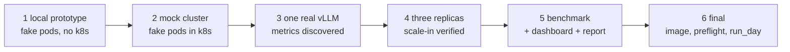

# Cache-aware scale-in for vLLM on Kubernetes

A small Kubernetes controller that scores each vLLM replica's KV cache and
writes the score to the pod's `controller.kubernetes.io/pod-deletion-cost`
annotation. When the Deployment scales down, Kubernetes removes the replica
with the lowest cost first, which is the one whose cache is worth the least,
instead of a replica picked by age. Fewer hot caches thrown away means fewer
full prefills after a scale-in, which shows up as lower time to first token
(TTFT).

```
pod A  hit rate 70%  -> cost 700   (kept)
pod B  hit rate 55%  -> cost 550   (kept)
pod C  hit rate  5%  -> cost  50   <- removed on scale-down
```

CS 297 project. Setup: Llama 3 8B, 3 vLLM replicas on A100s, llm-d for
routing, k3s, Python. Benchmarked with `kubernetes-sigs/inference-perf`
(and a built-in fallback load generator).

## Start here

| If you want to... | Read / run |
|---|---|
| understand the whole project from zero | [guide.md](guide.md), section 5 ("explained for an undergrad") |
| see why each design choice was made | [guide.md](guide.md), section 4 |
| see the plan and timeline for the GPU day | [PLAN.md](PLAN.md) and [stage6_final/checklist.md](stage6_final/checklist.md) |
| run something right now on a laptop | `make test` (stage 1, no cluster, no GPU) |
| run the GPU day end to end | `stage6_final/run_day.sh` (see the runbook, guide.md section 6) |
| watch a benchmark live | `stage5_benchmark/dashboard.sh` + an SSH tunnel (guide.md section 7) |

## The six stages

The project is built as a ladder. Every stage reuses the code of the stage
before it and adds one new capability plus an evaluation that proves it.

| stage | folder | needs | adds | eval proves |
|---|---|---|---|---|
| 1 | `stage1_local_prototype/` | laptop | metric parsing, scoring, fake vLLM pods, the control loop | costs come out 700 / 550 / 50 for the example pods; unit tests (30 across stages 1, 3, 5) |
| 2 | `stage2_mock_cluster/` | kind / k3d / k3s | Kubernetes backend, annotation patching, the scale-in trial harness | scaling 3 → 2 removes the lowest-cost (fake) pod every time; the default does not |
| 3 | `stage3_vllm_single/` | 1 GPU | real vLLM, metric-name discovery, prefix-heavy load generator | prefix caching works on this vLLM version (hit rate > 0.5) |
| 4 | `stage4_scale_in_real/` | 3 GPUs | real skewed warm-up (hot / warm / cold pods) | **GPU-day goal 1:** the real scale-in removes the coldest replica |
| 5 | `stage5_benchmark/` | 3 GPUs + gateway | inference-perf / loadgen benchmark, live dashboard, report | **GPU-day goals 2 + 3:** TTFT and hit rate, default vs cache-aware |
| 6 | `stage6_final/` | 3 GPUs | controller as an in-cluster image + RBAC, preflight, one-command day runner, N-body runbook | preflight says GO; everything above runs from one script |



## Repository map

```
cacheaware/                 the Python package (grows stage by stage)
  vllm_metrics.py           [1] read cache signals from a /metrics page, any vLLM version
  scoring.py                [1] recent hit rate (EWMA of deltas) -> cache value -> deletion cost
  fake_vllm.py              [1] fake vLLM pod: /metrics + a fake streaming /v1/completions
  kube.py                   [2] list pods, scrape, annotate (direct or API-server proxy)
  controller.py             [2] the loop: scrape -> score -> patch pod-deletion-cost
  loadgen.py                [3] prefix-heavy traffic (Zipf groups), client-side TTFT
  live.py                   [5] status + the ONE metrics sampler that feeds the dashboard
  dashboard.py/.html        [5] read-only live dashboard
  report.py                 [5] trial folders -> RESULTS.md + chart
scripts/
  lib.sh                    shell helpers every stage uses (pods, scrape, scale, wait...)
  scale_in_trials.sh        the scale-in verification harness (stage 2 and 4)
stage1_local_prototype/     run.sh, eval.sh, tests/
stage2_mock_cluster/        setup.sh, run_controller.sh, eval.sh, k8s/mock-vllm.yaml
stage3_vllm_single/         setup.sh, discover_metrics.sh, eval.sh, k8s/vllm.yaml
stage4_scale_in_real/       setup.sh, warm_skewed.sh, eval.sh
stage5_benchmark/           run_trial.sh, run_benchmark.sh, dashboard.sh, eval.sh, inference-perf.yaml.template
stage6_final/               Dockerfile, k8s/, build_image.sh, preflight.sh, run_day.sh, nbody_a100.sh, checklist.md
results/                    everything the scripts produce (RESULTS.md, csv, png, live/, bench/)
guide.md                    plan, architecture decisions, undergrad explainer, runbook, troubleshooting
PLAN.md                     the GPU-day plan with time budget and risks
```

## Quick start

```bash
git clone https://github.com/colmeabhi/cache-aware-scale-in
cd cache-aware-scale-in
pip install -r requirements.txt
make test                      # 30 unit tests + the three-fake-pod scenario, ~5 s
stage1_local_prototype/run.sh  # watch the controller think against fake pods
```

Every stage script reads the same environment variables, documented at the
top of `scripts/lib.sh`: `NAMESPACE`, `SELECTOR`, `DEPLOYMENT`,
`METRICS_PORT`, `RESULTS_DIR`, `CONTROLLER_MODE`. Stage 5 also needs
`GATEWAY_URL`.

## Where results land

| file | written by | what |
|---|---|---|
| `results/scale_in_trials.csv` | stage 2 / 4 | one row per scale-in trial: which pod was cold, which was removed |
| `results/metrics_discovery_*.txt` | stage 3 | the exact metric names your vLLM exposes |
| `results/bench/<mode>/trial_<n>/` | stage 5 | raw trial data (snapshots, load tool output, summary.json) |
| `results/RESULTS.md`, `results/ttft_after_scale_in.png` | stage 5 report | the comparison tables and chart |
| `results/live/` | sampler | what the dashboard reads |
