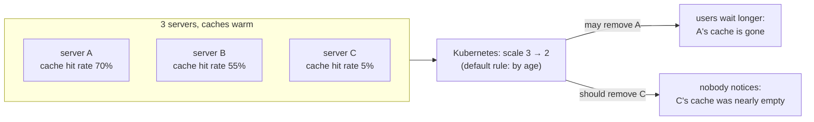

## The problem in one page

A company runs a chatbot on three identical servers, each with one powerful graphics card (GPU) and one copy of a language model. Every server keeps a private memory of recent prompts, called its cache, which lets it answer repeated questions faster. At night, traffic drops, and the cluster manager (Kubernetes) switches one server off to save money. It picks which one by age, not by what is inside it. One time in three it switches off the server with the most useful cache, and for the next minute or two every user whose request lands on the other two servers waits noticeably longer for the first word of the answer.



The default rule can remove any of the three. Only one choice is harmless.

The fix is a small program, called a **controller**, that runs beside the servers:

1. Every five seconds it reads each server's statistics page and computes how valuable that server's cache is right now.
2. It writes the value, as a number from 0 to 1000, onto the server's record in Kubernetes, in a field Kubernetes already understands: the **pod-deletion-cost**.
3. When Kubernetes has to remove a server, it removes the one with the lowest cost first. That is the coldest cache.

```
server A  hit rate 70%  -> cost 700   (kept)
server B  hit rate 55%  -> cost 550   (kept)
server C  hit rate  5%  -> cost  50   <- removed on scale-down
```

The rest of this book explains every word in those three steps, shows how the program was built and tested in six stages, and describes how its effect is measured honestly with two numbers: the time users wait for the first word (time to first token, TTFT) and the share of prompt text that the surviving servers still find in their caches (the prefix-cache hit rate).
