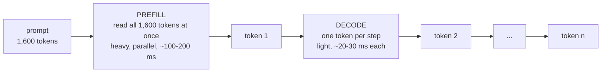
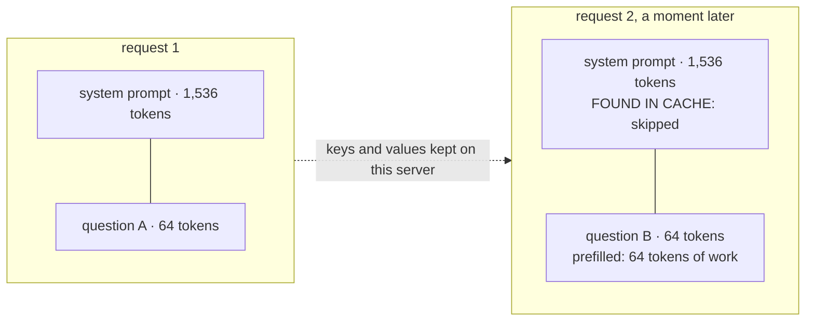

## Part I · Chapter 1: How a language model produces text

A language model turns text into numbers, does a large amount of arithmetic on a GPU, and turns the result back into text one piece at a time. Three ideas from that process matter for this project: tokens, the two phases of generation, and the cache that connects them.

### Tokens

A model does not read letters or words. It reads **tokens**: short chunks of text from a fixed vocabulary, typically a word, part of a word, or a punctuation mark. For English prose, one token is about three quarters of a word, so a 1,200-word system prompt is roughly 1,600 tokens. Every cost in this book (memory, time, cache hits) is counted in tokens.

### Two phases: prefill and decode

Generating an answer happens in two very different phases.



Prefill is one big batch of work; decode is many small steps. The first word of the answer appears only after prefill is done. (Times are illustrative for an 8-billion-parameter model on one A100 with no other traffic.)

**Prefill** reads the whole prompt. For each token it computes, in every layer of the model, two vectors called the **key** and the **value**. These are what the "attention" mechanism uses: when the model produces a new token, it compares that token against the keys of every earlier token and mixes in their values. Prefill is heavy because it touches every token of the prompt, but it is parallel, so the GPU does it in one burst.

**Decode** produces the answer one token at a time. Each step needs the keys and values of every token so far, the prompt included. Recomputing them for the entire prompt at every step would make generation hundreds of times slower, so they are stored.

### The KV cache

The stored keys and values are the **KV cache**. It lives in the GPU's memory, next to the model weights. Its size is easy to compute from the model's architecture. Llama 3 8B has 32 layers, 8 key-value heads of 128 numbers each, and stores both a key and a value per token in 16-bit floating point:

```latex
32 \text{ layers} \times 8 \text{ heads} \times 128 \text{ dims} \times 2 \text{ (K and V)} \times 2 \text{ bytes} = 131{,}072 \text{ bytes per token}
```

That is 128 KB per token, so a 1,600-token prompt occupies about 200 MB. An 80 GB A100 holding the 16 GB of weights has, at 90 % memory use, roughly 55 GB left for cache, enough for about 430,000 tokens across all requests in flight and all retained prefixes. The exact figure changes with the model; the shape of the arithmetic does not.

### Time to first token

Users feel two delays: how long until the first word appears, and how fast words arrive after that. The first is **time to first token (TTFT)**. It is, to a good approximation:

```latex
\text{TTFT} \approx \text{time waiting in the queue} + \text{prefill time}
```

Prefill time grows with prompt length. Long system prompts, long documents and long chat histories all make TTFT worse. This is the number the project improves.

### Prefix caching: not doing the same prefill twice

Most prompts in a real service start the same way. A customer-support bot sends the same 1,500-token instructions before every user question. A document-question tool sends the same document before each question about it. A chat sends the whole conversation so far, which is the previous turn plus a little more.

If two prompts begin with the same tokens, the keys and values computed for that shared beginning are identical, because attention only looks backwards. So the server can keep them after the first request and reuse them for the second. This is **prefix caching**. The server only prefills the part of the new prompt that differs: the tail.



Request 2 pays for 64 tokens of prefill instead of 1,600. Its TTFT drops by roughly the same factor.

Two details matter later:

- The cache works in **blocks** of 16 tokens. A prompt is looked up block by block from the start; the match stops at the first block that differs. The number of tokens found is counted as **hits**, the number looked up as **queries**. Their ratio is the **prefix-cache hit rate**. A 96 % hit rate means that, over the measured window, 96 % of prompt tokens were served from cache.
- The cache belongs to **one server**. Server A knowing a prefix does nothing for server B. There is no sharing between servers by default, which is the whole reason the project exists: when server A is switched off, everything it knew is gone, and the next request with those prefixes pays full price on B or C.

When the cache fills up, the server evicts the blocks that were used least recently. A busy server with a 55 GB cache can hold tens of thousands of distinct prefixes, so in practice eviction is rare and the cache keeps getting warmer the longer a server runs.

### Worked example

A support bot has three system prompts: a general one used by 70 % of requests, a billing one used by 25 %, and a legal one used by 5 %. Each is about 1,500 tokens; each user question adds about 100. With a cold cache, every request prefills 1,600 tokens. With a warm cache, the general and billing prompts are nearly always found, so a typical request prefills about 100 tokens. On an A100, illustratively:

| state of the cache | tokens prefilled | prefill time | TTFT seen by the user |
|---|--:|--:|--:|
| cold (just started) | 1,600 | ~160 ms | ~170 ms |
| warm | ~100 | ~10 ms | ~20 ms |

An eightfold difference in TTFT, produced entirely by what the server remembers. Lose the memory, and the eightfold cost comes back until the cache re-warms.

### What to remember

- Text is processed as tokens, about 0.75 words each.
- Prefill reads the whole prompt and dominates time to first token; decode produces one token per step.
- The KV cache stores the keys and values of every token so decode does not recompute them; 128 KB per token for Llama 3 8B.
- Prefix caching reuses the KV entries of a shared prompt beginning, so repeated prefixes are nearly free.
- Hit rate = hits / queries, counted in tokens, per server.
- The cache is private to one server and disappears when that server stops.
