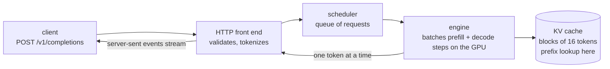

## Part I · Chapter 2: Serving a model with vLLM

A model on its own is a file of weights. To answer users it needs a **server**: a program that loads the weights onto a GPU, accepts requests over the network, batches them so the GPU stays busy, and streams tokens back. The server used in this project is **vLLM**, an open-source inference server that popularised an efficient way to manage the KV cache.

### What the server does with a request



Every request passes the scheduler, which decides what the GPU works on in each step. Prefill for a new request and decode steps for running requests are mixed in the same batch, so the GPU is never idle waiting for one request. This is called **continuous batching**, and it is why one GPU can serve dozens of conversations at once.

vLLM speaks the same HTTP API as OpenAI's service, so any client library works against it. Two endpoints matter here:

- `POST /v1/completions` with a JSON body `{"model": ..., "prompt": ..., "max_tokens": ..., "stream": true}`. With `stream: true` the server sends tokens as they are produced, one `data: {...}` line each, ending with `data: [DONE]`. Measuring the time until the first `data:` line arrives is how the load generator in this project measures TTFT.
- `GET /v1/models` lists the model being served; the scripts use it to discover the model name.

### PagedAttention in one paragraph

Earlier servers reserved one contiguous slab of GPU memory per request, sized for the longest possible answer, so most of it sat unused. vLLM instead stores the KV cache in fixed-size **blocks**, like pages of memory in an operating system, and keeps a small table per request saying which blocks it owns. Blocks can be allocated on demand, freed when a request finishes, and, crucially, **shared** between requests that have the same tokens. Prefix caching is built on that sharing: a block is identified by a hash of the tokens it holds and of all tokens before it, so a new prompt whose beginning hashes to blocks already present simply points at them.

### The flags this project sets

The vLLM pods are started with a handful of arguments (`stage3_vllm_single/k8s/vllm.yaml`):

| flag | meaning | why this value |
|---|---|---|
| `--model meta-llama/Meta-Llama-3-8B-Instruct` | which weights to load | an 8B model fits one A100 with room for a large cache |
| `--enable-prefix-caching` | reuse KV blocks across requests | the behaviour the whole project depends on (on by default in recent versions; stated anyway) |
| `--max-model-len 8192` | longest prompt + answer accepted | the benchmark prompts are ~1,700 tokens; 8,192 leaves headroom without reserving too much |
| `--gpu-memory-utilization 0.90` | share of GPU memory vLLM may use | weights plus the largest cache that still leaves a safety margin |
| `--disable-log-requests` | do not log every request | keeps log volume low during benchmarks |

### The statistics page: `/metrics`

vLLM exposes a page of counters and gauges in the **Prometheus text format**, a plain-text convention where each line is `name{labels} value`. The controller reads it directly. A trimmed example:

```
# HELP vllm:kv_cache_usage_perc KV-cache usage. 1 means 100 percent usage.
# TYPE vllm:kv_cache_usage_perc gauge
vllm:kv_cache_usage_perc{model_name="meta-llama/Meta-Llama-3-8B-Instruct"} 0.42
vllm:prefix_cache_queries{model_name="..."} 183296.0
vllm:prefix_cache_hits{model_name="..."} 128000.0
vllm:num_requests_running{model_name="..."} 3.0
vllm:num_requests_waiting{model_name="..."} 0.0
vllm:time_to_first_token_seconds_sum{model_name="..."} 41.2
vllm:time_to_first_token_seconds_count{model_name="..."} 512.0
```

| metric | kind | what it tells the controller |
|---|---|---|
| `vllm:kv_cache_usage_perc` | gauge, 0..1 | how full the cache is right now |
| `vllm:prefix_cache_queries` | counter | tokens looked up in the prefix cache since the server started |
| `vllm:prefix_cache_hits` | counter | of those, tokens that were found |
| `vllm:num_requests_running` / `_waiting` | gauges | how busy the server is |
| `vllm:time_to_first_token_seconds_sum` / `_count` | histogram parts | sum and count of TTFT; sum ÷ count over a window gives the mean TTFT the server itself observed |

Two things make these slightly awkward, and the code handles both:

**The names changed between vLLM versions.** The older engine exposed a single gauge, `vllm:gpu_prefix_cache_hit_rate`. The newer engine replaced it with two counters, first spelled `vllm:gpu_prefix_cache_queries` and `_hits`, later `vllm:prefix_cache_queries` and `_hits`; cache usage went from `gpu_cache_usage_perc` to `kv_cache_usage_perc`. `cacheaware/vllm_metrics.py` tries every spelling, newest first, and records which one it found. Stage 3 of the build prints that so you know what your installation speaks before anything else runs.

**The counters are cumulative since start.** `prefix_cache_hits` only ever grows. A server that served a million cache hits yesterday and nothing today still shows a million. To know what is happening *now*, you read the counters twice and subtract. That subtraction is the heart of the scoring in Part II.

### Health and discovery endpoints

`GET /health` returns 200 once the model is loaded; Kubernetes uses it to know when the server is ready for traffic. `GET /version` returns the vLLM version string, saved by the stage 3 discovery script for the record.

### What to remember

- vLLM loads the model once, batches many requests on one GPU, and streams tokens over an OpenAI-compatible HTTP API.
- The KV cache is stored in 16-token blocks that requests can share; prefix caching is that sharing applied to common prompt beginnings.
- `/metrics` is a plain-text page; the controller reads usage, prefix-cache queries and hits, and queue lengths from it.
- Metric names changed across versions; the parser knows all of them.
- Counters are cumulative; recent behaviour is the difference between two readings.
