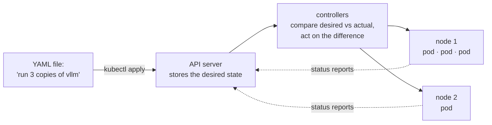
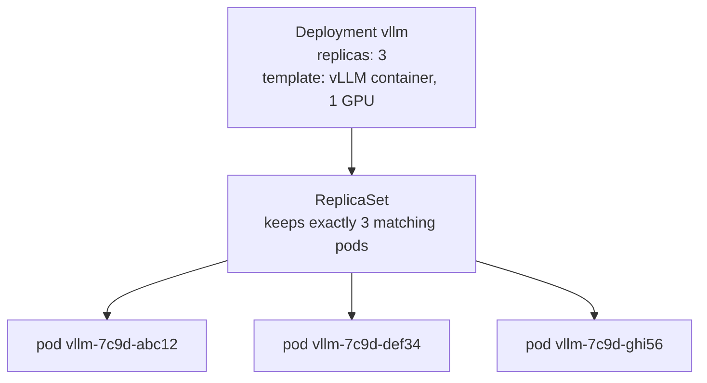
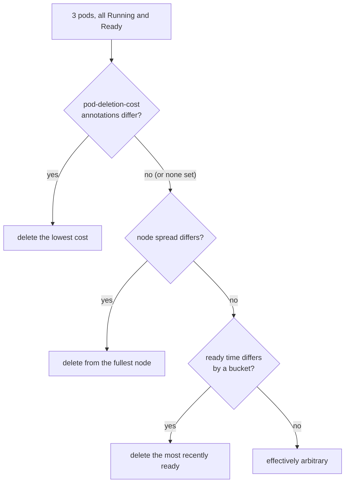

## Part I · Chapter 3: Containers and Kubernetes from zero

The servers in this project do not run as plain programs on a machine. They run as **containers** managed by **Kubernetes**. This chapter gives you exactly the Kubernetes you need to read the rest of the book, and nothing more.

### Containers

A container is a program packaged together with everything it needs to run: its libraries, its Python version, its configuration. The package is called an **image**; a running copy of an image is a container. The point is reproducibility: the vLLM image runs the same on your laptop, on a rented GPU box, and in a data centre. A container that needs a GPU is given access to it by a small piece of host software, the NVIDIA container toolkit; the bootstrap script in Part VI installs it.

### Kubernetes in one picture

Kubernetes is a program that runs containers across one or more machines (**nodes**) and keeps them running. You tell it what you want, in a text file; it works out what to do and keeps doing it.

Everything in Kubernetes follows this loop: a desired state is written to the API server, a controller notices a difference between desired and actual, and it acts to close the gap. The project's controller is exactly such a loop, written in Python, that happens to live outside Kubernetes' own code.

`kubectl` is the command-line tool that talks to the API server. `kubectl get pods` lists running containers; `kubectl apply -f file.yaml` submits a desired state; `kubectl scale deployment vllm --replicas=2` changes one number in it. **k3s** is a small, single-binary distribution of Kubernetes that installs in a minute on one machine; the project uses it on the GPU box.

### Pods, labels and annotations

The smallest thing Kubernetes runs is a **pod**: one or more containers that share a network address. In this project a pod is one vLLM container with one GPU, so "pod", "replica" and "server" mean the same thing.

Every pod carries two kinds of key-value notes:

- **Labels** are for selecting. `app=vllm` on each vLLM pod lets a command, a Service, or the controller say "all the pods with `app=vllm`". A **label selector** is such an expression; it is the `SELECTOR` variable the scripts use.
- **Annotations** are for information that is not used for selection: a build id, a note from a tool, or, in this project, `controller.kubernetes.io/pod-deletion-cost`. Annotations are plain strings, and anyone with permission can write one onto a pod.

### Deployments, ReplicaSets and scaling

You rarely create pods directly. You create a **Deployment** that says "I want N identical pods built from this template". The Deployment creates a **ReplicaSet**, whose single job is to keep exactly N pods alive: if one dies, it starts another; if N changes, it adds or removes pods.

Changing `replicas` from 3 to 2 is **scaling in** (or scaling down); the ReplicaSet must now delete one pod. Changing it to 4 is scaling out. A `rollout restart` replaces every pod with a fresh one; the benchmark uses it to give every trial pods of the same age with empty caches.

A **Service** gives a set of pods one stable name and address. Requests to the name are spread across the pods in turn. That spreading is the plain, cache-unaware routing that Chapter 4 improves on.

A **readiness probe** is a URL Kubernetes polls (`/health` for vLLM); a pod receives traffic only while it answers. **Namespaces** separate groups of objects; the vLLM pods live in `vllm`, the monitoring stack in `monitoring`.

### Which pod gets deleted on scale-in

This is the question the project answers, so it deserves precision. When a ReplicaSet must remove pods, it sorts them and deletes from the front. The order (from the Kubernetes source, `ActivePodsWithRanks`) is:

1. pods not yet assigned to a node
2. pods still starting (Pending) before running ones
3. pods that are not Ready before Ready ones
4. **lower `controller.kubernetes.io/pod-deletion-cost` before higher**
5. pods on nodes that hold more copies ("doubled up") before pods alone on a node
6. pods that have been Ready for a shorter time before longer (compared in coarse logarithmic buckets, ties broken arbitrarily)
7. pods whose containers restarted more often
8. newer pods before older ones

For healthy replicas, the deletion cost is the first rule that can distinguish them. When nobody sets it, the choice falls to age buckets and then to an arbitrary tie-break, which is what "Kubernetes picks blindly" means in practice.

Facts about the annotation that shape the design:

- It is an integer written as a string: `"700"`. Pods without it count as 0.
- It only orders pods within the same ReplicaSet. It never causes a deletion by itself.
- It has been on by default since Kubernetes 1.22. It is documented as "best effort": Kubernetes does not promise to honour it under every race, which is why the project verifies it empirically rather than assuming it.
- The Kubernetes documentation advises against updating it very frequently, because every update is a write to the API server. Part II explains the dead band that keeps writes rare.

### Permissions

Programs that talk to the API server do so as a **ServiceAccount** with a **Role** listing what they may do, attached by a **RoleBinding**. The controller's Role allows four verbs on pods in one namespace: get, list, watch, patch. It cannot delete anything, which is a useful property for a program whose purpose is to influence deletions.

### GPUs in Kubernetes

A GPU is a resource like memory. A pod asks for one with `resources.limits: nvidia.com/gpu: 1`, and Kubernetes places it on a node that advertises free GPUs. Nodes advertise GPUs through the NVIDIA **device plugin**, a small program that runs on every GPU node. On k3s, GPU pods also name a **RuntimeClass** (`nvidia`) so the container is started with GPU access. The bootstrap script in Part VI sets all three up.

### What to remember

- A pod is one running vLLM server; a Deployment keeps N of them via a ReplicaSet; scaling in lowers N.
- Labels select pods; annotations carry notes; `pod-deletion-cost` is an annotation Kubernetes reads when choosing what to delete.
- For healthy pods, lower deletion cost goes first; without it, the choice is by age bucket and then arbitrary.
- Kubernetes is built from control loops: desired state, actual state, act on the difference. The project's controller is one more such loop.
- The controller can read and patch pods, nothing else.
