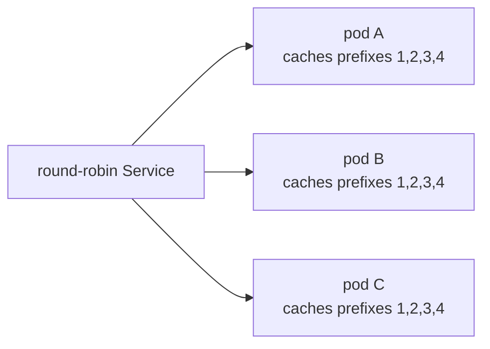
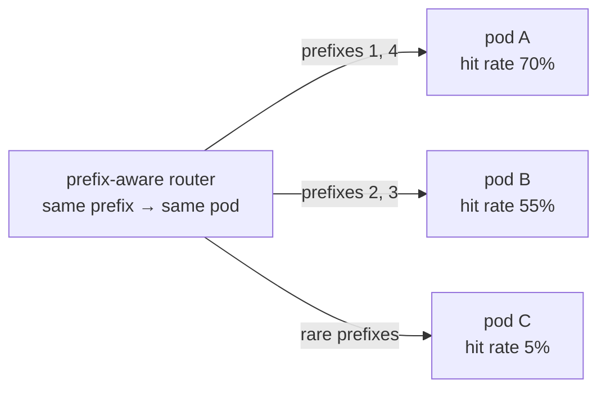
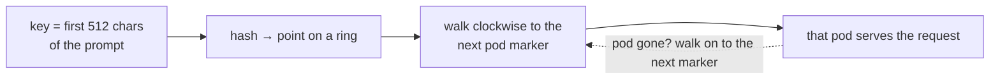

## Part I · Chapter 4: Routing requests to replicas

Three servers hold three separate caches. Something in front of them decides which server each request goes to. That decision determines what each cache ends up holding, and therefore whether the choice of which server to switch off matters at all.

### Plain routing makes every cache the same

A Kubernetes Service hands requests to the pods in turn: request 1 to A, request 2 to B, request 3 to C, request 4 to A again. Consider a popular system prompt that arrives thirty times a minute. Under round-robin, each pod sees it ten times a minute. All three caches learn it after the first visit; after that, all three serve it from cache. The same happens for every popular prefix. Within a few minutes the three caches hold the same set of popular prefixes.

Every cache ends up with every popular prefix. Switching off any pod loses nothing the others do not have.

Two consequences. First, each new prefix is prefilled three times instead of once, and each cache holds three times more than it needs to, so the fleet's total cache is wasted threefold. Second, for this project: if all caches are the same, no choice of pod to delete is better than another, and a cache-aware controller cannot help. In the plain-Service world the problem the project solves barely exists.

### Prefix-aware routing makes caches different, and better

The alternative is to send requests that share a prefix to the same pod every time. Each popular prefix then lives on one pod, that pod's hit rate for it is near 100 %, and the fleet's cache capacity adds up instead of being copied.

Now the caches differ. Switching off A loses the two most popular prefixes; switching off C loses almost nothing. This is the world in which the controller's choice matters, and it is also the world a real serving platform runs in.

### llm-d

**llm-d** is an open-source project for running vLLM at scale on Kubernetes. Its routing layer is an **inference gateway**: a proxy in front of the pods with a pluggable **endpoint picker** that scores each pod for each request. The scorers consider, among other things, which pod most likely already holds the request's prefix (prefix-cache affinity) and how loaded each pod is, so that hot prefixes stay put but no pod is overwhelmed. llm-d also supports more advanced layouts, such as running prefill and decode on different pods, that this project does not use.

The project's benchmark is designed to run behind llm-d's gateway: the load generator sends requests to the gateway's address (`GATEWAY_URL`), and the gateway spreads prefixes across the three pods the way a production system would. The controller never talks to the gateway; it only reads the pods' metrics and writes annotations, so it works with any router.

### The built-in router, for when llm-d is not there

Installing llm-d is a project of its own. For the hands-free cloud path in Part VI, where a fresh machine is set up from nothing, the repository includes a small stand-in: `cacheaware/router.py`, about 150 lines, which gives the one property the benchmark needs: same prefix, same pod.

It uses **consistent hashing**. Each pod is placed at 64 pseudo-random points on a circle ("virtual nodes"). A request's **key**, the first 512 characters of its prompt, which is the system prompt in practice, is hashed to a point on the same circle, and the request goes to the first pod found walking clockwise from that point.

Why a ring and not `hash mod 3`? Because of scale-in. With `hash mod 3`, going from three pods to two changes almost every key's assignment, so every prefix moves and every cache is cold. On the ring, removing a pod only moves the keys that pointed to that pod's markers; every other key keeps its pod and its warm cache. The property is exactly what a scale-in needs, and the test `test_removing_a_pod_only_moves_its_keys` checks it.

The router refreshes the list of pods from Kubernetes every two seconds, so a deleted pod disappears from the ring quickly, and if a request reaches a pod that has just gone, the router retries on the next pod around the ring. Responses are streamed line by line, so TTFT measured through the router is the pod's TTFT plus a fraction of a millisecond.

When `GATEWAY_URL` is set, the router is not started at all; the benchmark uses llm-d or whatever gateway you point it at.

### Why the experiments sometimes bypass the router

A prefix-aware router decides where prefixes go. For the scale-in verification in stages 2 and 4, the experiment needs to *choose* which pod is cold, so it cannot let the router decide. Those scripts open a direct tunnel to each pod (`kubectl port-forward`) and send 120 repeated-prefix requests to the pod that should be hot, 60 mixed to the warm one, and 40 one-off prompts to the cold one. The benchmark in stage 5 does the opposite: it goes through the router, because that is what production looks like and the whole point is to measure what users would see.

### What to remember

- Round-robin routing makes every cache hold the same prefixes; nothing is gained or lost by deleting any pod.
- Prefix-aware routing concentrates each prefix on one pod; caches differ, and the choice of pod to delete matters.
- llm-d's gateway does prefix-aware routing in production; the controller is independent of it.
- The built-in router is a consistent-hash stand-in keyed on the first 512 characters of the prompt; removing a pod moves only that pod's keys.
- Experiments that must choose the cold pod bypass the router with port-forwards; the benchmark goes through it.
