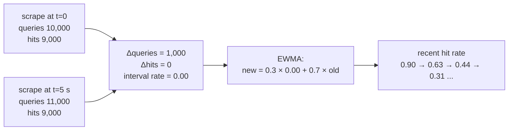
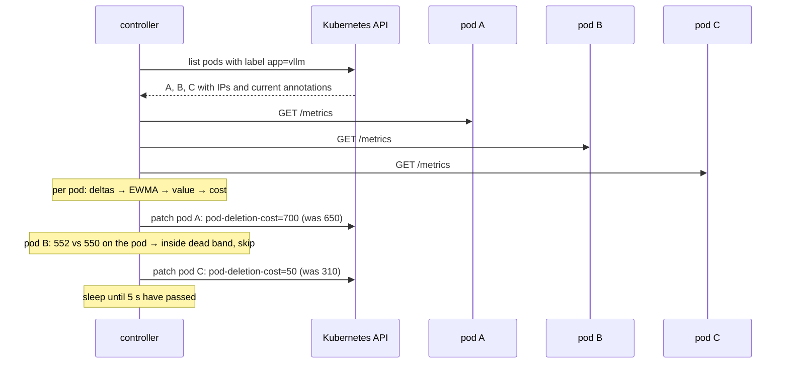

## Part II · The idea: a controller that knows what each cache is worth

Everything in Part I leads to one sentence: when Kubernetes removes a vLLM pod, it should remove the one whose cache is worth the least. This part explains how "worth" is measured, how the measurement becomes a number Kubernetes understands, and what happens in one cycle of the controller.

### What a cache is worth

A cache is worth what it saves. It saves prefill work when a request's prefix is found in it. So the first ingredient is the **prefix-cache hit rate**: of the prompt tokens looked up recently, what share was found. A pod with a 70 % hit rate is turning most of its prompts into near-free prefills; a pod with 5 % is doing full prefills regardless, and losing its cache changes almost nothing.

The second ingredient is **how much is cached**: the KV-cache usage from 0 to 1. Hit rate measures usefulness per token; usage measures quantity. A pod with a 70 % hit rate on a nearly empty cache has little to lose; the same hit rate on a full cache represents a lot of work that would need redoing.

Combined, with weights that favour usefulness:

```latex
\text{cache value} = 0.7 \times \text{recent hit rate} + 0.3 \times \text{KV usage} \qquad (0 \ldots 1)
```

A third ingredient, requests in flight, is available as a weight but off by default: Kubernetes already gives a pod 30 seconds to finish its in-flight requests when it is deleted, so busyness is handled elsewhere.

### "Recent" is the hard word

vLLM only reports lifetime totals. The controller has to turn them into a picture of the last few seconds. It does this per pod, every cycle:



Lifetime says 82 %; the deltas say this pod has served no cache hits for the last five seconds. The smoothed rate drifts down over a few cycles rather than jumping.

Three rules make this robust (all in `cacheaware/scoring.py`, class `PodHistory`):

- **Smoothing.** The interval rate is folded into an exponentially weighted moving average with weight 0.3 on the newest interval. One noisy five-second window moves the estimate by at most 30 % of the way; after four quiet intervals the estimate has moved 76 % of the way. This stops the ranking flapping on a single burst.
- **Idle intervals teach nothing.** If fewer than 256 tokens were looked up in an interval, the estimate is kept as it was. Dividing 3 hits by 4 lookups would otherwise produce a confident-looking 75 % from almost no evidence.
- **Counter resets start over.** If the lifetime counter goes down, the pod restarted. The history is discarded and begins again from the new lifetime values. The very first sample of any pod uses its lifetime rate, which for a fresh pod is "unknown" and scores as 0.

### From a value to a cost

Kubernetes compares integers, so:

```latex
\text{deletion cost} = \text{round}(\text{cache value} \times 1000)
```

A value of 0.613 becomes 613. The scale is arbitrary; 1000 keeps the number readable ("a 70 % hit rate alone would be 700").

The controller does not rewrite the annotation every cycle. It patches only when the new cost differs from the one on the pod by at least 25, the **dead band** (`worth_patching`). The ranking only needs to be in the right order, not exact to the unit, and Kubernetes' own documentation asks for this annotation not to be churned. With three pods and a five-second cycle, the dead band turns up to 36 API writes per minute into a handful.

### One cycle, end to end



Only pods whose cost moved by 25 or more are written. Pods that fail to answer keep their old cost.

Each patch also writes four explanatory annotations (`cacheaware.dev/recent-hit-rate`, `kv-usage`, `cache-value`, `updated-at`) so that `kubectl describe pod` shows why the number is what it is.

### What happens when things go wrong

| situation | what the controller does | why |
|---|---|---|
| a pod does not answer `/metrics` | keeps the pod's previous cost, logs an error | writing 0 on a network blip could get a hot pod deleted |
| a pod is still starting or already terminating | skips it | Kubernetes orders those before any cost anyway |
| the API server is unreachable | logs, sleeps, retries next cycle | nothing to do without it |
| the controller crashes | nothing changes on the pods | stale costs are never worse than no costs; the Deployment restarts it |
| `--dry-run` | computes and prints, never writes | for watching it think, and for stage 1 |

### Worked example, with the scale-in

Three pods behind a prefix-aware router, after a few minutes of traffic in which the general support prompt (70 % of requests) landed on A, the billing prompt (25 %) on B, and one-off prompts on C. The controller's log shows:

```
10:02:11  pod                  hit  usage  value  cost   was  action
          vllm-7c9d-abc12     0.91   0.38   0.75   751   740  kept
          vllm-7c9d-def34     0.49   0.21   0.41   406   410  kept
          vllm-7c9d-ghi56     0.02   0.14   0.06    56    61  kept
```

`kubectl get pods` with the annotation shown:

```
NAME                COST
vllm-7c9d-abc12     751
vllm-7c9d-def34     406
vllm-7c9d-ghi56     56
```

An operator (or an autoscaler) runs `kubectl scale deployment vllm --replicas=2`. The ReplicaSet sorts the three Ready pods by cost and deletes `vllm-7c9d-ghi56`. Requests that were going to it (the one-off prompts) move to A and B and pay a full prefill, which they would have paid anyway. Requests for the general and billing prompts never notice.

Had the controller not been running, the ReplicaSet would have compared the pods' ready times, found them in the same bucket, and deleted one effectively at random. One time in three that is `abc12`, and for the next minute or two 70 % of requests pay a 1,600-token prefill on B or C.

### Why these choices and not others

The design notes in `guide.md` section 4 go through each alternative. In short: lifetime hit rate was rejected because it cannot see a pod going cold; usage alone was rejected because a full cache of unwanted prefixes is worthless; deleting pods from the controller itself was rejected because it would race Kubernetes' own ReplicaSet controller; polling instead of a Prometheus query was chosen because three pods every five seconds is trivial and removes a dependency.

### What to remember

- Cache value = 0.7 × recent hit rate + 0.3 × KV usage, from 0 to 1.
- "Recent" comes from the difference between two scrapes, smoothed with an EWMA (weight 0.3), ignoring intervals with under 256 lookups, restarting on counter resets.
- Cost = value × 1000, written as `controller.kubernetes.io/pod-deletion-cost`, only when it moved by 25 or more.
- On any doubt (scrape failure, pod starting or stopping), the controller leaves the pod's cost alone.
- Kubernetes does the deleting; the controller only ranks.
