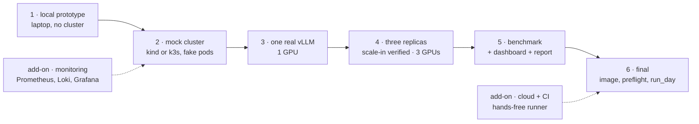

## Part III · Building it in six stages

Three A100s cost real money by the hour, and a bug found on them costs more than the same bug found on a laptop. So the project was built as a ladder: each stage adds one capability, proves it with an evaluation that exits 0 or 1, and hands finished code to the next stage. Only the top four stages need a GPU; only the top three need three of them.

Every stage reuses the stage before it. Shared Python lives in one package, `cacheaware/`; shared shell helpers live in `scripts/lib.sh`. A stage folder holds only what is specific to it: its scripts, its evaluation, its README.

### Stage 1 · The brain, on a laptop

**Goal.** Prove the scoring with no Kubernetes and no GPU.

**What is new.** `vllm_metrics.py` (reads a `/metrics` page, any version), `scoring.py` (deltas, EWMA, value, cost, dead band), `controller.py` (the loop, with a `StaticBackend` that takes a list of URLs instead of asking Kubernetes), and `fake_vllm.py`, a 180-line fake vLLM pod. The fake serves a `/metrics` page whose counters advance as if it were handling a configurable number of lookups per second at a configurable hit rate, a `/set` endpoint to change those knobs while it runs, and a fake streaming `/v1/completions` whose first token arrives after a delay that depends on the hit rate. That last part lets every later tool, from the load generator to the report, be rehearsed without a GPU.

**Run.** `stage1_local_prototype/run.sh` starts three fakes at hit rates 0.70, 0.55 and 0.05 and the controller in dry-run mode; every two seconds it prints the table from Part II. From another terminal, `curl 'http://127.0.0.1:9003/set?hit_rate=0.9'` makes the cold pod hot and the cost follows over the next few cycles.

**Eval.** `stage1_local_prototype/eval.sh`: 21 unit tests (metric spellings, scoring rules, the loop against an in-memory backend) and `eval_scenario.py`, which runs the real controller against the three fakes and requires costs of 700, 550 and 50 within tolerance with pod C lowest. Pass looks like `PASS: coldest cache gets the lowest pod-deletion-cost`.

### Stage 2 · The mechanism, in a real cluster

**Goal.** Prove that writing the annotation really changes which pod Kubernetes deletes.

**What is new.** `kube.py` (list pods, scrape through pod IP or through the API server's proxy, patch annotations), the `KubeBackend`, `scripts/lib.sh`, and `scripts/scale_in_trials.sh`, the experiment that stage 4 reuses unchanged. The fake pods run inside Kubernetes from a ConfigMap and a stock Python image, so any cluster will do; `setup.sh` creates a `kind` cluster if none is reachable.

**The experiment.** For each trial: restart all pods so they are the same age; pick one as the cold pod, rotating through the three so a pass cannot be an accident of ordering; set the fakes' knobs (hot 0.70, warm 0.55, cold 0.05); wait 30 seconds for the controller to re-score; print the cost table; scale to 2; see which pod vanished; compare. Then the same with the controller off and annotations stripped, to see what Kubernetes does alone.

**Eval.** `stage2_mock_cluster/eval.sh`. Pass looks like `cache-aware coldest pod removed in 3/3 trials` and `baseline ... 1/3`. The baseline line is whatever the age tie-break produced; anything other than 3/3 is normal.

### Stage 3 · One real vLLM

**Goal.** Get a real model serving, learn which metric names this version uses, confirm prefix caching works.

**What is new.** The vLLM Deployment manifest (one GPU, prefix caching on, Hugging Face weights cached on the host so they download once), `discover_metrics.sh` (prints the vLLM version, the raw cache metric lines, and which spelling the parser picked; saves it to `results/`), and `loadgen.py`, the traffic generator used by every later stage.

**The load generator** builds deterministic long prefixes (seeded, so every run and every pod sees the same text), attaches a unique question to each, draws the prefix for each request from a skewed popularity distribution, and measures TTFT as the time to the first streamed token. It has a `warm` mode (send N requests, closed loop) and a `bench` mode (requests per second, Poisson arrivals, warm then measure phases, writes a report).

**Eval.** `stage3_vllm_single/eval.sh` sends 40 requests over two shared prefixes straight to the pod and reads the hit counters before and after. Pass: hit rate over the run above 0.5 (in practice around 0.9). If this fails nothing later can work, and it fails within ten minutes of having the GPU.

### Stage 4 · Three replicas, scale-in verified (GPU-day goal 1)

**Goal.** The stage 2 experiment on real pods with real traffic.

**What is new.** `warm_skewed.sh`: three port-forwards, three load generators in parallel: 120 requests over 3 prefixes to the hot pod, 60 over 6 prefixes with 30 % one-offs to the warm pod, 40 one-off prompts to the cold pod. Everything else is the stage 2 harness with `SKEW=real`.

**Eval.** `stage4_scale_in_real/eval.sh`, about 25 minutes with pod restarts between trials. Pass: `cache-aware coldest pod removed in 3/3 trials`.

### Stage 5 · The benchmark (GPU-day goals 2 and 3)

**Goal.** Measure what cache-aware scale-in buys: TTFT and hit rate, default versus cache-aware, through the gateway. Part IV is entirely about this stage's design.

**What is new.** `run_trial.sh` (one trial), `run_benchmark.sh` (N trials per mode, interleaved), the live dashboard (`live.py`, `dashboard.py`), the report (`report.py`), and the inference-perf config template.

**Eval.** `stage5_benchmark/eval.sh` runs the benchmark and then checks that every trial has TTFT numbers, that fewer than 5 % of requests failed, and that every cache-aware trial removed the rank-1 pod. It ends by printing the "numbers for the resume bullet" from `results/RESULTS.md`.

### Stage 6 · Final shape

**Goal.** The controller as a real cluster component, and the whole day as one command.

**What is new.** A `Dockerfile` (Python slim image, non-root), RBAC (get, list, watch, patch on pods), a Deployment with `Recreate` strategy so two controllers never patch at once, `build_image.sh` (builds and imports into k3s without a registry), `preflight.sh` (a read-only GO/NO-GO list), `run_day.sh` (every phase in order, pausing between them unless `PAUSE=0`), `nbody_a100.sh` (Part VII) and `checklist.md`.

With `CONTROLLER_MODE=cluster`, the stage 4 and 5 scripts switch the in-cluster controller on and off by scaling its Deployment to 1 or 0, instead of starting a local process.

### The two add-ons

**Monitoring** (`monitoring/`): Prometheus, Loki, Alloy and Grafana as plain pinned manifests, a provisioned dashboard, and a `/metrics` endpoint on the controller so its costs show up in Grafana. Usable from stage 2 onward. Part V.

**Cloud and CI** (`cloud/`, `.github/workflows/`): a provider contract, a bootstrap script that turns a fresh Ubuntu GPU box into a k3s cluster with GPU support, a remote runner, a GitHub Actions workflow for the whole day, and a CI workflow that runs the tests and the stage 2 experiment on every push. Part VI.

### Repository map

| path | stage | role |
|---|---|---|
| `cacheaware/vllm_metrics.py` | 1 | read cache signals from a `/metrics` page, any vLLM version |
| `cacheaware/scoring.py` | 1 | recent hit rate → cache value → deletion cost, dead band |
| `cacheaware/fake_vllm.py` | 1 | fake vLLM pod: metrics, knobs, fake streaming completions |
| `cacheaware/controller.py` | 2 | the loop; static and Kubernetes backends; settings from flags or env |
| `cacheaware/kube.py` | 2 | list pods, scrape, annotate |
| `cacheaware/loadgen.py` | 3 | prefix-heavy traffic, Zipf popularity, client-side TTFT |
| `cacheaware/live.py` | 5 | status files and the one metrics sampler for the dashboard |
| `cacheaware/dashboard.py`, `.html` | 5 | read-only live dashboard |
| `cacheaware/report.py` | 5 | trial folders → `RESULTS.md` and a chart |
| `cacheaware/metrics_exporter.py` | add-on | the controller's own Prometheus metrics |
| `cacheaware/router.py` | add-on | consistent-hash prefix-affinity router |
| `scripts/lib.sh` | 2 | every shell helper: pods, scrape, scale, wait, controller on/off |
| `scripts/scale_in_trials.sh` | 2 | the scale-in experiment (stages 2 and 4) |
| `stage1..6_*/` | 1–6 | per-stage scripts, evals, READMEs |
| `monitoring/`, `cloud/`, `.github/` | add-ons | observability, hands-free runner, CI |
| `results/` | all | everything produced; `RESULTS.md` is the deliverable |
| `guide.md`, `PLAN.md`, `book/` | docs | design decisions and runbook; the plan; this book |

### How to read the code

Read in this order: `cacheaware/scoring.py` (120 lines, the idea), `cacheaware/controller.py` (the loop), `scripts/lib.sh` (what every script can do), `scripts/scale_in_trials.sh` (the experiment), `stage5_benchmark/run_trial.sh` (the benchmark). Every file starts with a comment that says what it is for and how to run it; every Python module answers `--help`.

### What to remember

- Six stages, each adding one capability and one evaluation; only stages 3 to 6 need a GPU.
- Stage 1 proves the scoring, stage 2 the Kubernetes mechanism, stage 3 the real metrics, stage 4 the real scale-in, stage 5 the benefit, stage 6 the packaging.
- Fake vLLM pods make everything up to stage 2 runnable on a laptop in minutes, including a rehearsal of the benchmark pipeline.
- Code is shared through one Python package and one shell library; stage folders hold only what is specific to them.
