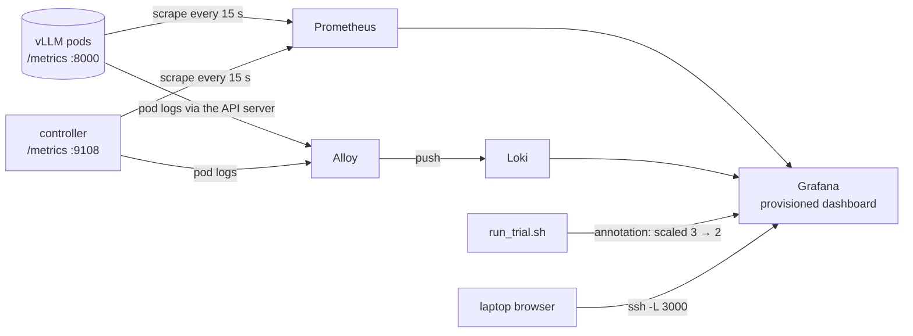

## Part V · Observability

A benchmark you cannot watch is a benchmark you cannot debug. The project ships two ways to see what is happening: a small file-based dashboard that needs nothing installed in the cluster, and a full monitoring stack of the kind production systems use. Both were designed under one rule: they must not change what they measure.

### Metrics, logs, dashboards

Three kinds of observation, three tools:

- **Metrics** are numbers over time: cache usage, hit counters, queue lengths, TTFT histograms. They are small, cheap to store, and easy to graph. Tool: **Prometheus**.
- **Logs** are lines of text a program prints: the controller's cost table every five seconds, vLLM's startup messages and warnings. Tool: **Loki**, fed by **Alloy**.
- **Dashboards** put both on a screen. Tool: **Grafana**.

Nothing in the stack sends inference requests or touches the GPU. Prometheus and Alloy read; Grafana reads from them.

### Prometheus in four sentences

Prometheus **pulls**: every 15 seconds it fetches the `/metrics` page of every target and stores each line as a time series identified by the metric name and its labels. Targets are found by asking the Kubernetes API for pods matching the same label selector the controller uses (so llm-d's pods are found too) plus any pod annotated `prometheus.io/scrape: "true"`, which is how the controller's own metrics are picked up. Queries are written in **PromQL**; the three the dashboard relies on are:

| PromQL | meaning |
|---|---|
| `sum by (pod) (rate(vllm:prefix_cache_hits[1m])) / sum by (pod) (rate(vllm:prefix_cache_queries[1m]))` | recent hit rate per pod: hits per second over the last minute divided by lookups per second, the same delta idea as the controller's EWMA |
| `histogram_quantile(0.9, sum by (le) (rate(vllm:time_to_first_token_seconds_bucket[1m])))` | TTFT p90 over the last minute as the server saw it |
| `max by (pod) (cacheaware_pod_deletion_cost)` | the cost the controller wrote, per pod |

Storage is a two-day ring on local disk; enough for a GPU day, and a single line to change if you want more.

### The controller's own metrics

The deletion cost lives in an annotation, which Prometheus cannot see. So the controller publishes what it decided as metrics on port 9108 (`cacheaware/metrics_exporter.py`, standard library only):

| metric | meaning |
|---|---|
| `cacheaware_pod_deletion_cost{pod}` | the cost written to that pod |
| `cacheaware_recent_hit_rate{pod}`, `cacheaware_kv_usage{pod}`, `cacheaware_cache_value{pod}` | the ingredients |
| `cacheaware_patches_total` | annotation writes so far (watch the dead band working: this should rise slowly) |
| `cacheaware_scrape_errors_total` | pods that failed to answer |
| `cacheaware_cycle_duration_seconds`, `cacheaware_pods_seen` | health of the loop |

### Logs: Loki and Alloy

Loki stores log lines with labels (namespace, pod, container, app) and is queried with a small language, LogQL: `{app="cache-aware-controller"}` shows the controller's cost tables; `{namespace="vllm"} |~ "(?i)error|warn"` shows vLLM's complaints. Alloy is the collector: it asks the Kubernetes API for the list of pods, reads their logs through the API server (the same channel `kubectl logs` uses), attaches the labels and pushes to Loki. Because it reads through the API it needs no access to the machine's disk and runs as one ordinary pod. Promtail, the older collector, is end of life and was not used.

### The Grafana dashboard

Grafana is provisioned from files: both data sources and one dashboard, `vLLM cache-aware scale-in`, with thirteen panels:

| row | panels |
|---|---|
| summary | replicas up · controller patches per minute · scrape errors · TTFT p90 · requests in flight |
| the controller's view | pod-deletion-cost per pod · recent hit rate per pod |
| the servers' state | KV-cache usage per pod · TTFT p50 and p90 |
| load | running and waiting requests per pod · cache value per pod |
| logs | controller logs · vLLM logs |

Every benchmark event (`load starting`, `scaling 3 → 2`, `removed pod X`) is also posted to Grafana as an annotation with the tag `bench`, so the moments of scale-in appear as red vertical lines across the graphs. Watching the hit-rate panel at such a line is the quickest way to see the project working: in a baseline trial the survivors' lines sometimes dip and climb back; in a cache-aware trial they stay flat.

### The file-based live dashboard

Before any of the above is installed, stage 5 has its own dashboard. One process, the **sampler** (`cacheaware/live.py sample`), scrapes each pod's `/metrics` every two seconds and appends one JSON line per pod to a file. The benchmark scripts write their phase, trial and the removed pod to a status file and their events to another. The dashboard (`cacheaware/dashboard.py`) is a tiny web server that reads those files and serves one HTML page which refreshes every two seconds: the current phase and trial, each pod's hit rate, usage, cost and running requests, which pod was removed and its rank, two charts (hit rate per pod, server-side TTFT per pod, last ten minutes), the table of finished trials, and the event log.

It binds to localhost on the GPU box; from a laptop, `ssh -L 8080:127.0.0.1:8080 user@box` and open `http://localhost:8080`. It needs no installation beyond Python.

### Does monitoring disturb the benchmark?

This question was asked, and the answer is no, for three reasons that are worth stating precisely.

| what touches a vLLM pod | how often | what it costs the pod |
|---|---|---|
| Prometheus | one `GET /metrics` per 15 s | a few milliseconds of CPU in the HTTP front end; no GPU; no cache change |
| the stage 5 sampler | one `GET /metrics` per 2 s | the same |
| the controller | one `GET /metrics` per 5 s, plus a patch when the cost moves by 25 | the same, plus one API-server write; this one is the system under test |
| Alloy, Loki, Grafana, the dashboard | never | nothing |

First, rendering `/metrics` is text formatting in the server's front end, not work in the engine that does prefill and decode. Second, everything runs identically in both arms of every trial, so any constant cost is in both columns and cancels in the comparison. Third, the only way the stack could matter is by competing for host CPU on a small machine; `kubectl top pods` during a warm-up answers that in one line, and the stack asks for about a third of one core. For the strict reader, one extra pair of trials with the monitoring Deployments scaled to zero turns the argument into a measurement.

### What to remember

- Prometheus pulls metrics every 15 s and stores time series; PromQL `rate()` over a minute is the dashboard's version of the controller's deltas.
- The controller exports its costs as metrics so Grafana can show them; annotations alone are invisible to Prometheus.
- Alloy reads pod logs through the Kubernetes API and pushes them to Loki; Grafana shows metrics and logs together, with benchmark events as red lines.
- The file-based dashboard needs nothing installed and is reached through an SSH tunnel.
- Nothing in observability touches the GPU or the caches; it runs in both arms, so it cancels.
