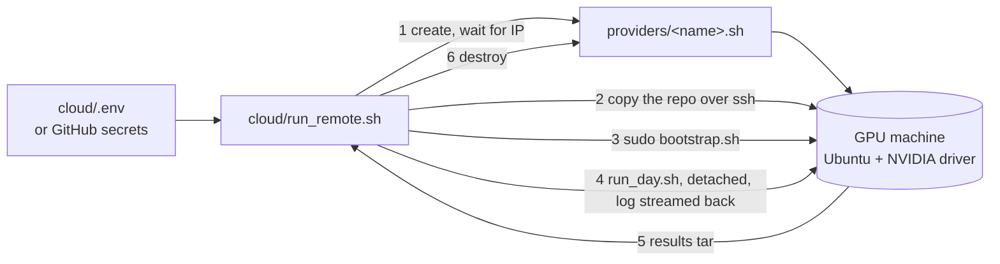

## Part VI · Running it anywhere

The GPU day should need no typing on the GPU machine. This part covers the layer that makes that true: a credentials file, a provider contract, a bootstrap script, a remote runner, two GitHub Actions workflows, and the runbook for a human doing it by hand.

### The one-command path

Every GPU cloud sells the thing in the middle: a Linux machine with NVIDIA drivers that you can reach over SSH. The runner needs nothing else, which is why it works across providers.

**The credentials file.** `cloud/.env` (copied from `cloud/.env.example`, never committed) holds the Hugging Face token for the Llama 3 weights, the machine's address and SSH key for a machine you already have, or a provider name and API key for one to be created, and the run's knobs: trials, load tool, whether to run N-body, whether to keep the machine afterwards.

**The provider contract.** A provider is a shell file with three functions: `provider_create` makes a machine with three or more GPUs and your SSH public key and prints its id; `provider_wait_ip` blocks until it has an address; `provider_destroy` terminates it. `manual.sh` is for a machine that already exists; `template.sh` shows the shape of a REST-API adapter. The destroy step runs on exit even when something failed, so a crashed run does not leave a machine billing overnight; `KEEP_INSTANCE=1` turns that off for debugging.

A note on Coral Bricks, since that is where the credits are: its public site describes an inference service and shows no API or VM documentation. If the credits buy inference calls rather than machines, they cannot host this benchmark, which needs raw GPUs with Kubernetes on them. If they buy machines, a twenty-line adapter from their console or docs plugs in.

**Bootstrap.** `cloud/bootstrap.sh` runs on the machine as root and is safe to rerun:

1. base packages, and a check that `nvidia-smi` works;
2. the NVIDIA container toolkit, installed *before* k3s so that k3s registers the NVIDIA container runtime by itself;
3. k3s, a single-node Kubernetes;
4. the `nvidia` RuntimeClass and the NVIDIA device plugin, then a wait until the node advertises `nvidia.com/gpu`;
5. the Python dependencies (and inference-perf if chosen);
6. a directory on the host for the model weights so they download once.

Three to six minutes on a fresh Ubuntu image.

**The run.** The runner starts `stage6_final/run_day.sh` with `PAUSE=0` under `nohup` so it survives a dropped SSH session, follows its log, waits for the exit marker the script writes, pulls the whole `results/` folder back into `results/remote-<timestamp>/`, prints the "numbers for the resume bullet" block, and destroys the machine.

Because llm-d is not installed by the bootstrap, `run_day.sh` sets the benchmark to use the built-in prefix-affinity router from Part I, Chapter 4 whenever no `GATEWAY_URL` is given.

### Continuous integration

Two workflows in `.github/workflows/`:

**`ci.yml`, on every push.** Job one runs the 38 unit tests, the stage 1 scenario and shellcheck over every script. Job two creates a `kind` cluster on the GitHub runner, deploys the fake pods, runs the stage 2 experiment (two trials each way) and the monitoring stack with its eval. So every change to the controller is re-proven against a real Kubernetes, without a GPU, in about ten minutes.

**`gpu-benchmark.yml`, on demand.** *Actions → GPU benchmark → Run workflow*, choose trials, load tool and whether to run N-body, and the runner executes the one-command path from secrets. Results are uploaded as a workflow artifact and committed to a branch named `results/run-<n>`. The job has a 350-minute limit, under GitHub's six-hour cap, and the day takes about four hours.

| secret | purpose |
|---|---|
| `HF_TOKEN` | Llama 3 weights are gated on Hugging Face |
| `GPU_SSH_PRIVATE_KEY` | logging into the machine; the public half goes to the provider or the machine |
| `GPU_SSH_HOST` | for a machine you already have |
| `GPU_PROVIDER_API_KEY` | for a provider adapter |

### The runbook, by hand

For a person at a keyboard on the GPU box (every row is also what `run_day.sh` does in order):

| step | command | time | pass looks like |
|---|---|---|---|
| 0 | `export KUBECONFIG=... HF_TOKEN=... GATEWAY_URL=...`; `pip install -r requirements.txt` | 2 min | |
| 1 | `stage6_final/preflight.sh` | 1 min | `GO` |
| 2 | `monitoring/setup.sh && monitoring/eval.sh` (optional) | 3 min | `monitoring stack: PASS` |
| 3a | `stage3_vllm_single/setup.sh` (skip if llm-d already serves) | 5–25 min | `1 pod(s) ready` |
| 3b | `stage3_vllm_single/discover_metrics.sh` | 1 min | real metric names printed and saved |
| 3c | `stage3_vllm_single/eval.sh` | 2 min | `PASS: prefix caching works` |
| 4 | `stage4_scale_in_real/setup.sh && stage4_scale_in_real/eval.sh` | 30 min | `cache-aware coldest pod removed in 3/3` |
| 5 | `stage5_benchmark/dashboard.sh` in a second pane, then `stage5_benchmark/eval.sh` | 60 min | `PASS: benchmark data is usable` |
| 6 | read `results/RESULTS.md`; commit `results/` | 5 min | |
| 7 | `kubectl scale deploy vllm --replicas=0`; `stage6_final/nbody_a100.sh` | 70 min | README results filled; branch ready to push |

Knobs worth knowing: `TRIALS` (3), `TOOL` (`loadgen` or `inference-perf`), `RATE` (4 requests per second), `WARM` and `MEASURE` (120 s each), `FRESH_PODS` (1), `SETTLE` (30 s), `CONTROLLER_MODE` (`local` or `cluster`).

### When something goes wrong

| symptom | likely cause | what to do |
|---|---|---|
| `No prefix-cache metric found` | prefix caching off, or a fourth metric spelling | run `discover_metrics.sh`; add the name to `NAME_CANDIDATES` in `vllm_metrics.py` |
| costs stay `-` in the pod table | controller not running or wrong `SELECTOR` | `cat results/controller.log`; `kubectl get pods -l "$SELECTOR"` |
| cache-aware trial removed a pod with rank other than 1 | annotation written after the scale, Kubernetes older than 1.22, or a pod not Ready | raise `SETTLE`; `kubectl version`; check the table before scaling |
| baseline removed the cold pod | expected one time in three | more trials |
| load tool reports errors | gateway URL or model name wrong | `curl $GATEWAY_URL/v1/models`; pass `MODEL=` |
| inference-perf rejects its config | schema differs from the template | compare with its examples, or `TOOL=loadgen` |
| TTFT identical in both arms | caches not warm, traffic not skewed, router not sticky | raise `WARM`, lower `GROUPS`, watch hit rates during warm-up |
| `nbody_a100.sh` refuses to start | vLLM still holds the GPU | scale the Deployment to 0 |
| Prometheus has no vLLM targets | selector label differs from the pods' labels | `kubectl get pods --show-labels`; rerun `monitoring/setup.sh` |

### Honest status of this layer

The cloud runner, the bootstrap and the workflows could not be executed where the project was written: there was no GPU and no cloud account. Every script passes a syntax check, every manifest parses, the pinned image tags were verified to exist, and the unit tests cover the router. The first real run will most likely surface one or two environment details. Run it with `KEEP_INSTANCE=1` the first time so the machine stays up to be fixed in place.

### What to remember

- One file of credentials and one command: provision, bootstrap, run the day, fetch results, destroy.
- The provider contract is three shell functions; any SSH-reachable GPU machine works.
- CI re-proves the controller on a real Kubernetes without a GPU on every push; the GPU workflow runs the day from secrets.
- The by-hand runbook is the same sequence `run_day.sh` executes, with the pass condition for each step.
