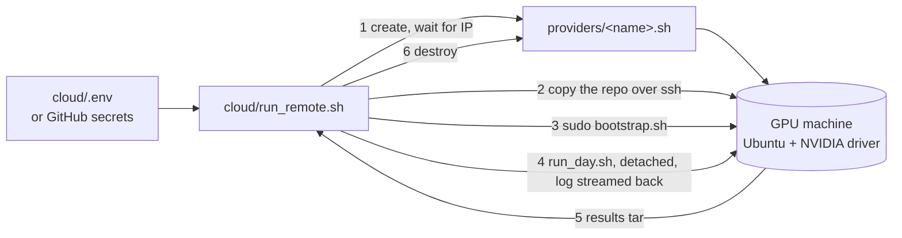
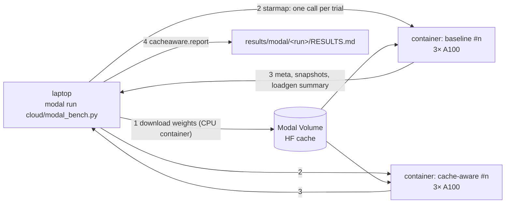

## Part VI · Running it anywhere

The GPU day should need no typing on the GPU machine. This part covers the layer that makes that true: a credentials file, a provider contract, a bootstrap script, a remote runner, two GitHub Actions workflows, and the runbook for a human doing it by hand.

### The one-command path



Every GPU cloud sells the thing in the middle: a Linux machine with NVIDIA drivers that you can reach over SSH. The runner needs nothing else, which is why it works across providers.

**The credentials file.** `cloud/.env` (copied from `cloud/.env.example`, never committed) holds the Hugging Face token for the Llama 3 weights, the machine's address and SSH key for a machine you already have, or a provider name and API key for one to be created, and the run's knobs: trials, load tool, whether to run N-body, whether to keep the machine afterwards.

**The provider contract.** A provider is a shell file with three functions: `provider_create` makes a machine with three or more GPUs and your SSH public key and prints its id; `provider_wait_ip` blocks until it has an address; `provider_destroy` terminates it. `manual.sh` is for a machine that already exists; `template.sh` shows the shape of a REST-API adapter. The destroy step runs on exit even when something failed, so a crashed run does not leave a machine billing overnight; `KEEP_INSTANCE=1` turns that off for debugging.

A note on Coral Bricks, since that is where the credits are: its public site describes an inference service and shows no API or VM documentation. If the credits buy inference calls rather than machines, they cannot host this benchmark, which needs raw GPUs with Kubernetes on them. If they buy machines, a twenty-line adapter from their console or docs plugs in.

**Bootstrap.** `cloud/bootstrap.sh` runs on the machine as root and is safe to rerun:

1. base packages, and a check that `nvidia-smi` works;
2. the NVIDIA container toolkit, installed *before* k3s so that k3s registers the NVIDIA container runtime by itself;
3. k3s, a single-node Kubernetes;
4. the `nvidia` RuntimeClass and the NVIDIA device plugin, then a wait until the node advertises `nvidia.com/gpu`;
5. the Python dependencies (and inference-perf if chosen);
6. a directory on the host for the model weights so they download once.

Three to six minutes on a fresh Ubuntu image.

**The run.** The runner starts `stage6_final/run_day.sh` with `PAUSE=0` under `nohup` so it survives a dropped SSH session, follows its log, waits for the exit marker the script writes, pulls the whole `results/` folder back into `results/remote-<timestamp>/`, prints the "numbers for the resume bullet" block, and destroys the machine.

Because llm-d is not installed by the bootstrap, `run_day.sh` sets the benchmark to use the built-in prefix-affinity router from Part I, Chapter 4 whenever no `GATEWAY_URL` is given.

### Continuous integration

Two workflows in `.github/workflows/`:

**`ci.yml`, on every push.** Job one runs the 39 unit tests, the stage 1 scenario and shellcheck over every script. Job two creates a `kind` cluster on the GitHub runner, deploys the fake pods, runs the stage 2 experiment (two trials each way) and the monitoring stack with its eval. So every change to the controller is re-proven against a real Kubernetes, without a GPU, in about ten minutes.

**`gpu-benchmark.yml`, on demand.** *Actions → GPU benchmark → Run workflow*, choose trials, load tool and whether to run N-body, and the runner executes the one-command path from secrets. Results are uploaded as a workflow artifact and committed to a branch named `results/run-<n>`. The job has a 350-minute limit, under GitHub's six-hour cap, and the day takes about four hours.

| secret | purpose |
|---|---|
| `HF_TOKEN` | Llama 3 weights are gated on Hugging Face |
| `GPU_SSH_PRIVATE_KEY` | logging into the machine; the public half goes to the provider or the machine |
| `GPU_SSH_HOST` | for a machine you already have |
| `GPU_PROVIDER_API_KEY` | for a provider adapter |

### The runbook, by hand

For a person at a keyboard on the GPU box (every row is also what `run_day.sh` does in order):

| step | command | time | pass looks like |
|---|---|---|---|
| 0 | `export KUBECONFIG=... HF_TOKEN=... GATEWAY_URL=...`; `pip install -r requirements.txt` | 2 min | |
| 1 | `stage6_final/preflight.sh` | 1 min | `GO` |
| 2 | `monitoring/setup.sh && monitoring/eval.sh` (optional) | 3 min | `monitoring stack: PASS` |
| 3a | `stage3_vllm_single/setup.sh` (skip if llm-d already serves) | 5–25 min | `1 pod(s) ready` |
| 3b | `stage3_vllm_single/discover_metrics.sh` | 1 min | real metric names printed and saved |
| 3c | `stage3_vllm_single/eval.sh` | 2 min | `PASS: prefix caching works` |
| 4 | `stage4_scale_in_real/setup.sh && stage4_scale_in_real/eval.sh` | 30 min | `cache-aware coldest pod removed in 3/3` |
| 5 | `stage5_benchmark/dashboard.sh` in a second pane, then `stage5_benchmark/eval.sh` | 60 min | `PASS: benchmark data is usable` |
| 6 | read `results/RESULTS.md`; commit `results/` | 5 min | |
| 7 | `kubectl scale deploy vllm --replicas=0`; `stage6_final/nbody_a100.sh` | 70 min | README results filled; branch ready to push |

Knobs worth knowing: `TRIALS` (3), `TOOL` (`loadgen` or `inference-perf`), `RATE` (4 requests per second), `WARM` and `MEASURE` (120 s each), `FRESH_PODS` (1), `SETTLE` (30 s), `CONTROLLER_MODE` (`local` or `cluster`).

### When something goes wrong

| symptom | likely cause | what to do |
|---|---|---|
| `No prefix-cache metric found` | prefix caching off, or a fourth metric spelling | run `discover_metrics.sh`; add the name to `NAME_CANDIDATES` in `vllm_metrics.py` |
| costs stay `-` in the pod table | controller not running or wrong `SELECTOR` | `cat results/controller.log`; `kubectl get pods -l "$SELECTOR"` |
| cache-aware trial removed a pod with rank other than 1 | annotation written after the scale, Kubernetes older than 1.22, or a pod not Ready | raise `SETTLE`; `kubectl version`; check the table before scaling |
| baseline removed the cold pod | expected one time in three | more trials |
| load tool reports errors | gateway URL or model name wrong | `curl $GATEWAY_URL/v1/models`; pass `MODEL=` |
| inference-perf rejects its config | schema differs from the template | compare with its examples, or `TOOL=loadgen` |
| TTFT identical in both arms | caches not warm, traffic not skewed, router not sticky | raise `WARM`, lower `GROUPS`, watch hit rates during warm-up |
| `nbody_a100.sh` refuses to start | vLLM still holds the GPU | scale the Deployment to 0 |
| Prometheus has no vLLM targets | selector label differs from the pods' labels | `kubectl get pods --show-labels`; rerun `monitoring/setup.sh` |

### Running it on Modal (no Kubernetes)

Everything above assumes a machine you can SSH into and install k3s on. Modal sells something different: GPU *containers* that start on demand, bill per second and disappear when the function returns. There is no node to install Kubernetes on. `cloud/modal_bench.py` runs the stage 5 benchmark there anyway by replacing only the Kubernetes plumbing; every piece that decides the result is the repo's own code.

| Kubernetes concept | on Modal |
|---|---|
| vLLM pod *i* | a `vllm serve` process pinned to GPU *i* (`CUDA_VISIBLE_DEVICES=i`), port 8001+*i*, inside one 3-GPU container |
| llm-d gateway / `router.py` | `cacheaware.router`'s consistent-hash `Ring` and handler, started in-process on port 8080 |
| `controller.py` | `cacheaware.scoring` on a 5 s scrape loop, with the controller's defaults (weights 0.7/0.3, EWMA alpha 0.3, 256-token minimum) |
| `pod-deletion-cost` | the cost the scorer computed at the moment of scale-in |
| `kubectl scale 3 → 2` | remove the victim from the ring (the endpoint disappears), then SIGTERM its vLLM |
| `FRESH_PODS=1` | every trial is a separate function call, so a brand-new container with empty caches |
| default ReplicaSet choice | `rng.choice(replicas)`, seeded per trial: fresh pods tie on every rule Kubernetes checks, so the pick is effectively arbitrary, the same one-in-three the stage 5 README assumes |



```bash
uv tool install modal && modal setup            # once
modal run cloud/modal_bench.py                  # smoke: 1 trial per mode, 60 s warm + 60 s measure
modal run cloud/modal_bench.py --trials 3 --warm 120 --measure 120   # the repo's default benchmark
```

Results land in `results/modal/<timestamp>/bench/<mode>/trial_<n>/` in exactly the layout stage 5 writes, plus two files stage 5 does not have: `cost_timeline.json` (every pod's hit rate, KV usage and cost every 5 s, the data behind the Grafana cost panel) and `router_stats.json`. `cacheaware.report` then builds `RESULTS.md` unchanged.

**Why one call per trial.** A fresh container is the cleanest possible "fresh pods": same age, empty caches, nothing left over. `starmap` also runs both arms at the same time, so the wall-clock time is one trial's, while the GPU-seconds (the bill) are the same as running them in sequence.

**Why weights download on a CPU container first.** The 15 GB of weights go into a Modal Volume once, from a container with no GPU. Otherwise three A100s would sit idle (and bill) during the download, and three vLLM processes would race to write the same cache.

**What it does not cover.** No Kubernetes means no annotation is actually written and no ReplicaSet actually chooses: the Modal run measures the *effect* of removing the cold replica versus an arbitrary one, which is the claim the benchmark makes. Stage 2 (and CI) remain the proof that Kubernetes honours the annotation; stage 4 on a real cluster remains the proof that it does so with real vLLM. Grafana and Loki need a cluster too, so on Modal the equivalent views are the Modal app page (per-container logs and GPU usage) and `cost_timeline.json`.

#### What the first Modal runs taught us

The first real executions surfaced exactly the kind of "one or two environment details" the honest-status note below predicts. Three are worth remembering:

1. **vLLM needs `nvcc` at runtime.** On a `debian_slim` image vLLM 0.32 loaded the weights, captured CUDA graphs, then died with `Could not find nvcc and default cuda_home='/usr/local/cuda' doesn't exist`: it JIT-compiles kernels during engine warm-up. The fix is a CUDA *devel* base image (`nvidia/cuda:13.0.3-devel-ubuntu24.04`, matching the cu130 torch wheel) plus `ninja`. The driver was never the problem (Modal's was CUDA 13.3); checking it first on one GPU, not three, kept the diagnosis cheap.
2. **A fourth metric spelling.** vLLM 0.32 exposes the prefix-cache counters with the standard Prometheus suffix: `vllm:prefix_cache_queries_total` and `vllm:prefix_cache_hits_total` (with `*_created` gauges beside them). This is the `No prefix-cache metric found` row of the table above, and the fix is the one it prescribes: the names were added to `NAME_CANDIDATES` in `vllm_metrics.py`, newest first, with a unit test built from the real page. The `vLLM metric names` line the Modal run prints at startup is stage 3's metric discovery, done automatically.
3. **Read the root cause, not the last traceback.** vLLM prints the real error well before the final `Engine core initialization failed`; the last 40 lines of its log were all traceback. Startup failures now report the `ERROR` lines first.

A smaller surprise: asking Modal for `A100-40GB` landed on an 80 GB card. Modal may upgrade a request; the benchmark is unaffected (an 8B model needs about 16 GB), but write down the GPU you actually got.

**Cost.** Modal bills per second and a trial's container exits when the trial ends, so idle time costs nothing. Roughly (A100 at about $2/GPU-hour, check the current price): the smoke test is a few dollars, the 3-trials-per-mode benchmark about $5–8, against $15–25 for the full four-hour GPU day on a rented 3×A100 VM.

#### The first result: the pipeline works, the default workload shows nothing

The first successful smoke test (1 trial per mode, 60 s warm-up, 60 s measurement, 4 requests/s, 16 prefix groups, Qwen2.5-7B-Instruct, vLLM 0.32.0) ran end to end with zero request errors, and the cache-aware arm removed the rank-1 pod as designed. It also showed no effect, and the reason is more useful than a number would have been:

| | default | cache-aware |
|---|--:|--:|
| costs at scale-in | 666 / 663 / 677 | 666 / 663 / 677 |
| removed | rank 2 | rank 1 |
| TTFT p50, first 30 s after scale-in | 41 ms | 43 ms |
| survivor prefix-cache hit rate | 94.6 % | 94.6 % |

- **Hit rate saturates on every replica.** The rate is measured in tokens. Each request is about 1,800 tokens of shared prefix plus a few unique ones, so once a replica has seen a prefix, nearly every later token for it is a hit. All three replicas converged to about 95 % within 45 s. The router *did* create skew, but in volume (235 vs 185 vs 69 requests per replica in the baseline trial), and volume is not in the score.
- **KV usage reads about 0.** Requests finish in about 50 ms and vLLM counts cached-but-idle blocks as free, so the 0.3 weight on usage contributed nothing on an 80 GB card under this load.
- **Losing a cache is cheap here.** Re-prefilling an 1,800-token prefix on an A100 costs a few tens of milliseconds, once per moved prefix group. TTFT after scale-in stayed at about 41 ms in both arms.

This is why stage 4 makes hot, warm and cold pods on purpose (`warm_skewed.sh`, with a cold pod that sees only unique prompts): stage 5's default traffic, sent through a prefix-affinity router, does not create hit-rate differences on its own. Two directions follow. Make the cold replica genuinely cold and the cache genuinely expensive (stage 4's skewed warm-up, longer prefixes, a smaller KV budget), or score what the router actually differentiates: cache *hits per second* rather than hit *rate* (see Limitations).

### Honest status of this layer

The cloud runner, the bootstrap and the workflows could not be executed where the project was written: there was no GPU and no cloud account. Every script passes a syntax check, every manifest parses, the pinned image tags were verified to exist, and the unit tests cover the router. The first real run will most likely surface one or two environment details. Run it with `KEEP_INSTANCE=1` the first time so the machine stays up to be fixed in place.

### What to remember

- One file of credentials and one command: provision, bootstrap, run the day, fetch results, destroy.
- The provider contract is three shell functions; any SSH-reachable GPU machine works.
- CI re-proves the controller on a real Kubernetes without a GPU on every push; the GPU workflow runs the day from secrets.
- The by-hand runbook is the same sequence `run_day.sh` executes, with the pass condition for each step.
- Without a Kubernetes node, `cloud/modal_bench.py` runs stage 5 on Modal: one 3-GPU container per trial, the repo's router and scoring in-process, scale-in as ring removal plus SIGTERM. Use a CUDA devel image, and expect metric names to drift.
