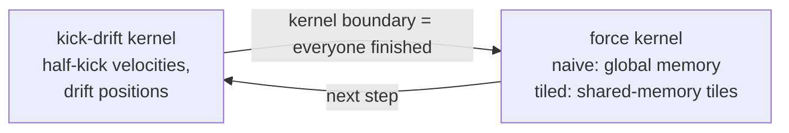

## Part VII · The N-body side project

The GPU day has a second job. A separate repository, `colmeabhi/parallelized-nbody-simulation-cuda-cpp`, is a complete gravitational N-body simulation with CPU and CUDA solvers, and its README has a results table whose GPU rows say "not measured yet". The same rented A100 fills them in, so the runbook includes it.

### What an N-body simulation is

N bodies (stars, say) attract each other by gravity. At every time step, the force on each body is the sum of the pulls from every other body, so computing all forces directly costs N × N interactions: 4,096 bodies is 16 million interactions per step, 65,536 bodies is 4.3 billion. The positions and velocities are then advanced by a small time step and the process repeats. The project simulates a Milky Way-like galaxy: a central black hole, a rotating disk and a bulge.

Two CUDA kernels compute the forces. The **naive** kernel has each thread read every other body's position from the GPU's main memory. The **tiled** kernel first copies a tile of bodies into the fast shared memory of each thread block, lets all threads in the block use it, then moves to the next tile; the same arithmetic with far fewer slow memory reads. Comparing the two is the classic demonstration of why GPU memory hierarchy matters. The CPU side has a single-thread solver, an OpenMP multi-thread solver, and a Barnes–Hut tree solver that approximates distant groups of bodies as one and brings the cost down to N log N.

The integrator is a **kick-drift-kick leapfrog**, which conserves energy far better than the simple scheme it replaced; the energy drift over a run is one of the measured quantities, so a fast kernel that produces nonsense would be caught.

### What the pipeline produces

The N-body repository already has the whole measurement pipeline; the runbook only drives it:

| script | produces |
|---|---|
| `scripts/run_benchmarks.sh` | `cpu_scaling.csv`, `gpu_scaling.csv` (naive vs tiled at 1K to 64K bodies), `gpu_block_sweep.csv` (thread-block sizes 64 to 512), energy-drift logs for both integrators |
| `scripts/profile_ncu.sh` | `ncu_metrics.csv`: Nsight Compute counters for the naive and tiled kernels (compute and memory throughput, cache hit rates, occupancy, stall reasons) |
| `scripts/make_report.py` | charts and the results section of the README, regenerated from the CSV files |

`stage6_final/nbody_a100.sh` in this repository refuses to start while anything else is using the GPU (so vLLM must be scaled to zero first), sets the CUDA architecture from `nvidia-smi` (an A100 is `sm_80`), runs all three scripts, and leaves a commit on a `results/a100-<date>` branch ready to push. It reruns the CPU benchmarks as well as the GPU ones, because the speed-up column compares the GPU against a single CPU thread *on the same machine*; the existing CPU rows came from a different, 4-thread machine.

About an hour, most of it the CPU runs at the largest sizes.

### What to remember

- Direct N-body is N² work per step; the tiled CUDA kernel is the textbook shared-memory optimisation over the naive one.
- The repository's own scripts measure scaling, block sizes, Nsight counters and energy conservation; the runbook only drives them and commits the results.
- The GPU must be free: scale vLLM to zero before starting.
