# Cache-Aware Scale-In: The Book

_A from-zero explanation of the cache-aware scale-in controller for vLLM on Kubernetes. Written 2026-11-05. Source: https://github.com/colmeabhi/cache-aware-scale-in_

## How to read this book

This book explains one project from nothing: a small program that makes a cluster of language-model servers smarter about which server to switch off when traffic drops. It assumes you have never used Kubernetes, never run a language model, and have not seen the code. If you can read Python and have used a terminal, you have everything you need.

The book has seven parts. Read them in order the first time; each part uses words defined in the part before it.

| part | what it gives you | pages |
|---|---|---|
| The problem in one page | the whole idea, before any background | 1 |
| I. Background | how language models generate text, how they are served, what Kubernetes is, how requests are routed | 14 |
| II. The idea | the controller: what it reads, how it scores, what it writes | 6 |
| III. Building it in six stages | the code, from a laptop prototype to a packaged cluster component | 10 |
| IV. Measuring honestly | how the benchmark is designed so its numbers mean something | 8 |
| V. Observability | metrics, logs and dashboards, and why they do not disturb the benchmark | 5 |
| VI. Running it anywhere | the hands-free cloud runner, CI, the GPU-day runbook | 5 |
| VII. The N-body side project, limitations, glossary, references, appendix | | 8 |

Conventions used throughout:

- A **term in bold** is defined where it first appears and again in the glossary.
- Code and commands look `like this`. Every command in the book exists in the repository and can be run as written.
- Diagrams are drawn with boxes and arrows; read them left to right or top to bottom. The sentence under each diagram says what to notice.
- Numbers given as examples are marked "illustrative" when they are typical values rather than measurements. The real measurements are produced by the benchmark in Part IV and land in `results/RESULTS.md`.
- Each chapter ends with a short "What to remember" list. If you only read those lists, you will still be able to follow the code.

The repository this book describes is `colmeabhi/cache-aware-scale-in`. File names in the text are paths inside it.


## The problem in one page

A company runs a chatbot on three identical servers, each with one powerful graphics card (GPU) and one copy of a language model. Every server keeps a private memory of recent prompts, called its cache, which lets it answer repeated questions faster. At night, traffic drops, and the cluster manager (Kubernetes) switches one server off to save money. It picks which one by age, not by what is inside it. One time in three it switches off the server with the most useful cache, and for the next minute or two every user whose request lands on the other two servers waits noticeably longer for the first word of the answer.

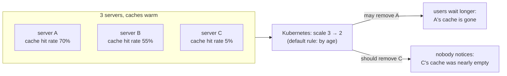

The default rule can remove any of the three. Only one choice is harmless.

The fix is a small program, called a **controller**, that runs beside the servers:

1. Every five seconds it reads each server's statistics page and computes how valuable that server's cache is right now.
2. It writes the value, as a number from 0 to 1000, onto the server's record in Kubernetes, in a field Kubernetes already understands: the **pod-deletion-cost**.
3. When Kubernetes has to remove a server, it removes the one with the lowest cost first. That is the coldest cache.

```
server A  hit rate 70%  -> cost 700   (kept)
server B  hit rate 55%  -> cost 550   (kept)
server C  hit rate  5%  -> cost  50   <- removed on scale-down
```

The rest of this book explains every word in those three steps, shows how the program was built and tested in six stages, and describes how its effect is measured honestly with two numbers: the time users wait for the first word (time to first token, TTFT) and the share of prompt text that the surviving servers still find in their caches (the prefix-cache hit rate).


## Part I · Chapter 1: How a language model produces text

A language model turns text into numbers, does a large amount of arithmetic on a GPU, and turns the result back into text one piece at a time. Three ideas from that process matter for this project: tokens, the two phases of generation, and the cache that connects them.

### Tokens

A model does not read letters or words. It reads **tokens**: short chunks of text from a fixed vocabulary, typically a word, part of a word, or a punctuation mark. For English prose, one token is about three quarters of a word, so a 1,200-word system prompt is roughly 1,600 tokens. Every cost in this book (memory, time, cache hits) is counted in tokens.

### Two phases: prefill and decode

Generating an answer happens in two very different phases.

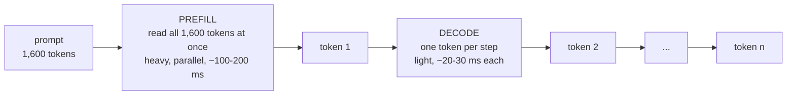

Prefill is one big batch of work; decode is many small steps. The first word of the answer appears only after prefill is done. (Times are illustrative for an 8-billion-parameter model on one A100 with no other traffic.)

**Prefill** reads the whole prompt. For each token it computes, in every layer of the model, two vectors called the **key** and the **value**. These are what the "attention" mechanism uses: when the model produces a new token, it compares that token against the keys of every earlier token and mixes in their values. Prefill is heavy because it touches every token of the prompt, but it is parallel, so the GPU does it in one burst.

**Decode** produces the answer one token at a time. Each step needs the keys and values of every token so far, the prompt included. Recomputing them for the entire prompt at every step would make generation hundreds of times slower, so they are stored.

### The KV cache

The stored keys and values are the **KV cache**. It lives in the GPU's memory, next to the model weights. Its size is easy to compute from the model's architecture. Llama 3 8B has 32 layers, 8 key-value heads of 128 numbers each, and stores both a key and a value per token in 16-bit floating point:

```latex
32 \text{ layers} \times 8 \text{ heads} \times 128 \text{ dims} \times 2 \text{ (K and V)} \times 2 \text{ bytes} = 131{,}072 \text{ bytes per token}
```

That is 128 KB per token, so a 1,600-token prompt occupies about 200 MB. An 80 GB A100 holding the 16 GB of weights has, at 90 % memory use, roughly 55 GB left for cache, enough for about 430,000 tokens across all requests in flight and all retained prefixes. The exact figure changes with the model; the shape of the arithmetic does not.

### Time to first token

Users feel two delays: how long until the first word appears, and how fast words arrive after that. The first is **time to first token (TTFT)**. It is, to a good approximation:

```latex
\text{TTFT} \approx \text{time waiting in the queue} + \text{prefill time}
```

Prefill time grows with prompt length. Long system prompts, long documents and long chat histories all make TTFT worse. This is the number the project improves.

### Prefix caching: not doing the same prefill twice

Most prompts in a real service start the same way. A customer-support bot sends the same 1,500-token instructions before every user question. A document-question tool sends the same document before each question about it. A chat sends the whole conversation so far, which is the previous turn plus a little more.

If two prompts begin with the same tokens, the keys and values computed for that shared beginning are identical, because attention only looks backwards. So the server can keep them after the first request and reuse them for the second. This is **prefix caching**. The server only prefills the part of the new prompt that differs: the tail.

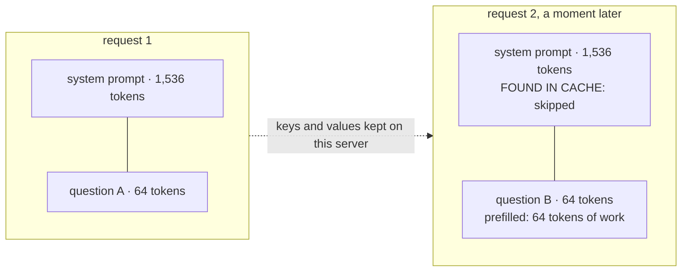

Request 2 pays for 64 tokens of prefill instead of 1,600. Its TTFT drops by roughly the same factor.

Two details matter later:

- The cache works in **blocks** of 16 tokens. A prompt is looked up block by block from the start; the match stops at the first block that differs. The number of tokens found is counted as **hits**, the number looked up as **queries**. Their ratio is the **prefix-cache hit rate**. A 96 % hit rate means that, over the measured window, 96 % of prompt tokens were served from cache.
- The cache belongs to **one server**. Server A knowing a prefix does nothing for server B. There is no sharing between servers by default, which is the whole reason the project exists: when server A is switched off, everything it knew is gone, and the next request with those prefixes pays full price on B or C.

When the cache fills up, the server evicts the blocks that were used least recently. A busy server with a 55 GB cache can hold tens of thousands of distinct prefixes, so in practice eviction is rare and the cache keeps getting warmer the longer a server runs.

### Worked example

A support bot has three system prompts: a general one used by 70 % of requests, a billing one used by 25 %, and a legal one used by 5 %. Each is about 1,500 tokens; each user question adds about 100. With a cold cache, every request prefills 1,600 tokens. With a warm cache, the general and billing prompts are nearly always found, so a typical request prefills about 100 tokens. On an A100, illustratively:

| state of the cache | tokens prefilled | prefill time | TTFT seen by the user |
|---|--:|--:|--:|
| cold (just started) | 1,600 | ~160 ms | ~170 ms |
| warm | ~100 | ~10 ms | ~20 ms |

An eightfold difference in TTFT, produced entirely by what the server remembers. Lose the memory, and the eightfold cost comes back until the cache re-warms.

### What to remember

- Text is processed as tokens, about 0.75 words each.
- Prefill reads the whole prompt and dominates time to first token; decode produces one token per step.
- The KV cache stores the keys and values of every token so decode does not recompute them; 128 KB per token for Llama 3 8B.
- Prefix caching reuses the KV entries of a shared prompt beginning, so repeated prefixes are nearly free.
- Hit rate = hits / queries, counted in tokens, per server.
- The cache is private to one server and disappears when that server stops.


## Part I · Chapter 2: Serving a model with vLLM

A model on its own is a file of weights. To answer users it needs a **server**: a program that loads the weights onto a GPU, accepts requests over the network, batches them so the GPU stays busy, and streams tokens back. The server used in this project is **vLLM**, an open-source inference server that popularised an efficient way to manage the KV cache.

### What the server does with a request

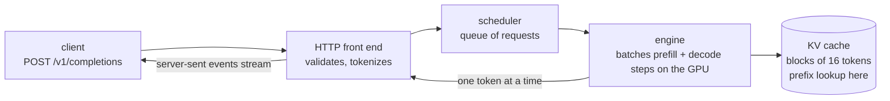

Every request passes the scheduler, which decides what the GPU works on in each step. Prefill for a new request and decode steps for running requests are mixed in the same batch, so the GPU is never idle waiting for one request. This is called **continuous batching**, and it is why one GPU can serve dozens of conversations at once.

vLLM speaks the same HTTP API as OpenAI's service, so any client library works against it. Two endpoints matter here:

- `POST /v1/completions` with a JSON body `{"model": ..., "prompt": ..., "max_tokens": ..., "stream": true}`. With `stream: true` the server sends tokens as they are produced, one `data: {...}` line each, ending with `data: [DONE]`. Measuring the time until the first `data:` line arrives is how the load generator in this project measures TTFT.
- `GET /v1/models` lists the model being served; the scripts use it to discover the model name.

### PagedAttention in one paragraph

Earlier servers reserved one contiguous slab of GPU memory per request, sized for the longest possible answer, so most of it sat unused. vLLM instead stores the KV cache in fixed-size **blocks**, like pages of memory in an operating system, and keeps a small table per request saying which blocks it owns. Blocks can be allocated on demand, freed when a request finishes, and, crucially, **shared** between requests that have the same tokens. Prefix caching is built on that sharing: a block is identified by a hash of the tokens it holds and of all tokens before it, so a new prompt whose beginning hashes to blocks already present simply points at them.

### The flags this project sets

The vLLM pods are started with a handful of arguments (`stage3_vllm_single/k8s/vllm.yaml`):

| flag | meaning | why this value |
|---|---|---|
| `--model meta-llama/Meta-Llama-3-8B-Instruct` | which weights to load | an 8B model fits one A100 with room for a large cache |
| `--enable-prefix-caching` | reuse KV blocks across requests | the behaviour the whole project depends on (on by default in recent versions; stated anyway) |
| `--max-model-len 8192` | longest prompt + answer accepted | the benchmark prompts are ~1,700 tokens; 8,192 leaves headroom without reserving too much |
| `--gpu-memory-utilization 0.90` | share of GPU memory vLLM may use | weights plus the largest cache that still leaves a safety margin |
| `--disable-log-requests` | do not log every request | keeps log volume low during benchmarks |

### The statistics page: `/metrics`

vLLM exposes a page of counters and gauges in the **Prometheus text format**, a plain-text convention where each line is `name{labels} value`. The controller reads it directly. A trimmed example:

```
# HELP vllm:kv_cache_usage_perc KV-cache usage. 1 means 100 percent usage.
# TYPE vllm:kv_cache_usage_perc gauge
vllm:kv_cache_usage_perc{model_name="meta-llama/Meta-Llama-3-8B-Instruct"} 0.42
vllm:prefix_cache_queries{model_name="..."} 183296.0
vllm:prefix_cache_hits{model_name="..."} 128000.0
vllm:num_requests_running{model_name="..."} 3.0
vllm:num_requests_waiting{model_name="..."} 0.0
vllm:time_to_first_token_seconds_sum{model_name="..."} 41.2
vllm:time_to_first_token_seconds_count{model_name="..."} 512.0
```

| metric | kind | what it tells the controller |
|---|---|---|
| `vllm:kv_cache_usage_perc` | gauge, 0..1 | how full the cache is right now |
| `vllm:prefix_cache_queries` | counter | tokens looked up in the prefix cache since the server started |
| `vllm:prefix_cache_hits` | counter | of those, tokens that were found |
| `vllm:num_requests_running` / `_waiting` | gauges | how busy the server is |
| `vllm:time_to_first_token_seconds_sum` / `_count` | histogram parts | sum and count of TTFT; sum ÷ count over a window gives the mean TTFT the server itself observed |

Two things make these slightly awkward, and the code handles both:

**The names changed between vLLM versions.** The older engine exposed a single gauge, `vllm:gpu_prefix_cache_hit_rate`. The newer engine replaced it with two counters, first spelled `vllm:gpu_prefix_cache_queries` and `_hits`, later `vllm:prefix_cache_queries` and `_hits`; cache usage went from `gpu_cache_usage_perc` to `kv_cache_usage_perc`. `cacheaware/vllm_metrics.py` tries every spelling, newest first, and records which one it found. Stage 3 of the build prints that so you know what your installation speaks before anything else runs.

**The counters are cumulative since start.** `prefix_cache_hits` only ever grows. A server that served a million cache hits yesterday and nothing today still shows a million. To know what is happening *now*, you read the counters twice and subtract. That subtraction is the heart of the scoring in Part II.

### Health and discovery endpoints

`GET /health` returns 200 once the model is loaded; Kubernetes uses it to know when the server is ready for traffic. `GET /version` returns the vLLM version string, saved by the stage 3 discovery script for the record.

### What to remember

- vLLM loads the model once, batches many requests on one GPU, and streams tokens over an OpenAI-compatible HTTP API.
- The KV cache is stored in 16-token blocks that requests can share; prefix caching is that sharing applied to common prompt beginnings.
- `/metrics` is a plain-text page; the controller reads usage, prefix-cache queries and hits, and queue lengths from it.
- Metric names changed across versions; the parser knows all of them.
- Counters are cumulative; recent behaviour is the difference between two readings.


## Part I · Chapter 3: Containers and Kubernetes from zero

The servers in this project do not run as plain programs on a machine. They run as **containers** managed by **Kubernetes**. This chapter gives you exactly the Kubernetes you need to read the rest of the book, and nothing more.

### Containers

A container is a program packaged together with everything it needs to run: its libraries, its Python version, its configuration. The package is called an **image**; a running copy of an image is a container. The point is reproducibility: the vLLM image runs the same on your laptop, on a rented GPU box, and in a data centre. A container that needs a GPU is given access to it by a small piece of host software, the NVIDIA container toolkit; the bootstrap script in Part VI installs it.

### Kubernetes in one picture

Kubernetes is a program that runs containers across one or more machines (**nodes**) and keeps them running. You tell it what you want, in a text file; it works out what to do and keeps doing it.

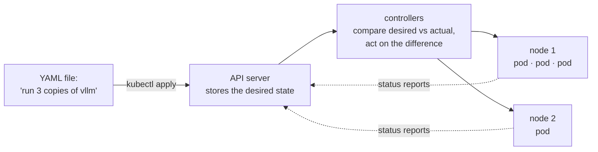

Everything in Kubernetes follows this loop: a desired state is written to the API server, a controller notices a difference between desired and actual, and it acts to close the gap. The project's controller is exactly such a loop, written in Python, that happens to live outside Kubernetes' own code.

`kubectl` is the command-line tool that talks to the API server. `kubectl get pods` lists running containers; `kubectl apply -f file.yaml` submits a desired state; `kubectl scale deployment vllm --replicas=2` changes one number in it. **k3s** is a small, single-binary distribution of Kubernetes that installs in a minute on one machine; the project uses it on the GPU box.

### Pods, labels and annotations

The smallest thing Kubernetes runs is a **pod**: one or more containers that share a network address. In this project a pod is one vLLM container with one GPU, so "pod", "replica" and "server" mean the same thing.

Every pod carries two kinds of key-value notes:

- **Labels** are for selecting. `app=vllm` on each vLLM pod lets a command, a Service, or the controller say "all the pods with `app=vllm`". A **label selector** is such an expression; it is the `SELECTOR` variable the scripts use.
- **Annotations** are for information that is not used for selection: a build id, a note from a tool, or, in this project, `controller.kubernetes.io/pod-deletion-cost`. Annotations are plain strings, and anyone with permission can write one onto a pod.

### Deployments, ReplicaSets and scaling

You rarely create pods directly. You create a **Deployment** that says "I want N identical pods built from this template". The Deployment creates a **ReplicaSet**, whose single job is to keep exactly N pods alive: if one dies, it starts another; if N changes, it adds or removes pods.

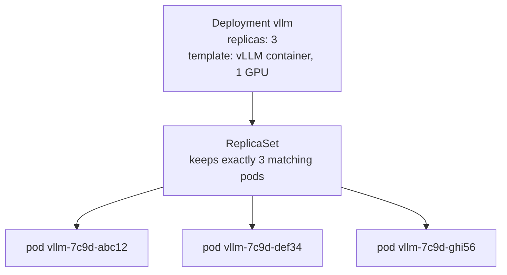

Changing `replicas` from 3 to 2 is **scaling in** (or scaling down); the ReplicaSet must now delete one pod. Changing it to 4 is scaling out. A `rollout restart` replaces every pod with a fresh one; the benchmark uses it to give every trial pods of the same age with empty caches.

A **Service** gives a set of pods one stable name and address. Requests to the name are spread across the pods in turn. That spreading is the plain, cache-unaware routing that Chapter 4 improves on.

A **readiness probe** is a URL Kubernetes polls (`/health` for vLLM); a pod receives traffic only while it answers. **Namespaces** separate groups of objects; the vLLM pods live in `vllm`, the monitoring stack in `monitoring`.

### Which pod gets deleted on scale-in

This is the question the project answers, so it deserves precision. When a ReplicaSet must remove pods, it sorts them and deletes from the front. The order (from the Kubernetes source, `ActivePodsWithRanks`) is:

1. pods not yet assigned to a node
2. pods still starting (Pending) before running ones
3. pods that are not Ready before Ready ones
4. **lower `controller.kubernetes.io/pod-deletion-cost` before higher**
5. pods on nodes that hold more copies ("doubled up") before pods alone on a node
6. pods that have been Ready for a shorter time before longer (compared in coarse logarithmic buckets, ties broken arbitrarily)
7. pods whose containers restarted more often
8. newer pods before older ones

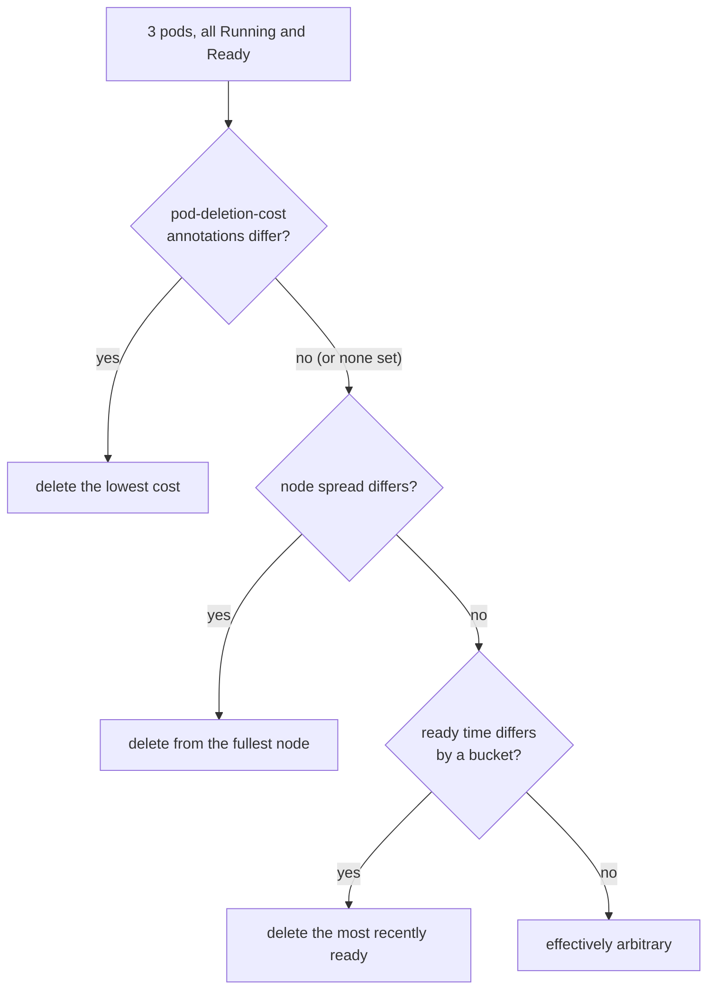

For healthy replicas, the deletion cost is the first rule that can distinguish them. When nobody sets it, the choice falls to age buckets and then to an arbitrary tie-break, which is what "Kubernetes picks blindly" means in practice.

Facts about the annotation that shape the design:

- It is an integer written as a string: `"700"`. Pods without it count as 0.
- It only orders pods within the same ReplicaSet. It never causes a deletion by itself.
- It has been on by default since Kubernetes 1.22. It is documented as "best effort": Kubernetes does not promise to honour it under every race, which is why the project verifies it empirically rather than assuming it.
- The Kubernetes documentation advises against updating it very frequently, because every update is a write to the API server. Part II explains the dead band that keeps writes rare.

### Permissions

Programs that talk to the API server do so as a **ServiceAccount** with a **Role** listing what they may do, attached by a **RoleBinding**. The controller's Role allows four verbs on pods in one namespace: get, list, watch, patch. It cannot delete anything, which is a useful property for a program whose purpose is to influence deletions.

### GPUs in Kubernetes

A GPU is a resource like memory. A pod asks for one with `resources.limits: nvidia.com/gpu: 1`, and Kubernetes places it on a node that advertises free GPUs. Nodes advertise GPUs through the NVIDIA **device plugin**, a small program that runs on every GPU node. On k3s, GPU pods also name a **RuntimeClass** (`nvidia`) so the container is started with GPU access. The bootstrap script in Part VI sets all three up.

### What to remember

- A pod is one running vLLM server; a Deployment keeps N of them via a ReplicaSet; scaling in lowers N.
- Labels select pods; annotations carry notes; `pod-deletion-cost` is an annotation Kubernetes reads when choosing what to delete.
- For healthy pods, lower deletion cost goes first; without it, the choice is by age bucket and then arbitrary.
- Kubernetes is built from control loops: desired state, actual state, act on the difference. The project's controller is one more such loop.
- The controller can read and patch pods, nothing else.


## Part I · Chapter 4: Routing requests to replicas

Three servers hold three separate caches. Something in front of them decides which server each request goes to. That decision determines what each cache ends up holding, and therefore whether the choice of which server to switch off matters at all.

### Plain routing makes every cache the same

A Kubernetes Service hands requests to the pods in turn: request 1 to A, request 2 to B, request 3 to C, request 4 to A again. Consider a popular system prompt that arrives thirty times a minute. Under round-robin, each pod sees it ten times a minute. All three caches learn it after the first visit; after that, all three serve it from cache. The same happens for every popular prefix. Within a few minutes the three caches hold the same set of popular prefixes.

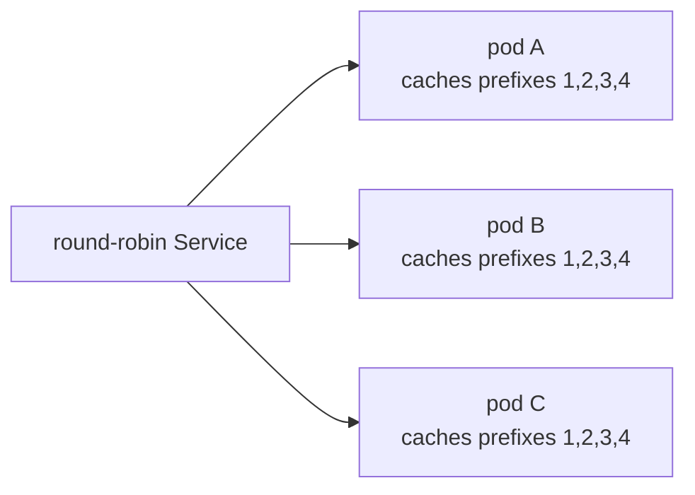

Every cache ends up with every popular prefix. Switching off any pod loses nothing the others do not have.

Two consequences. First, each new prefix is prefilled three times instead of once, and each cache holds three times more than it needs to, so the fleet's total cache is wasted threefold. Second, for this project: if all caches are the same, no choice of pod to delete is better than another, and a cache-aware controller cannot help. In the plain-Service world the problem the project solves barely exists.

### Prefix-aware routing makes caches different, and better

The alternative is to send requests that share a prefix to the same pod every time. Each popular prefix then lives on one pod, that pod's hit rate for it is near 100 %, and the fleet's cache capacity adds up instead of being copied.

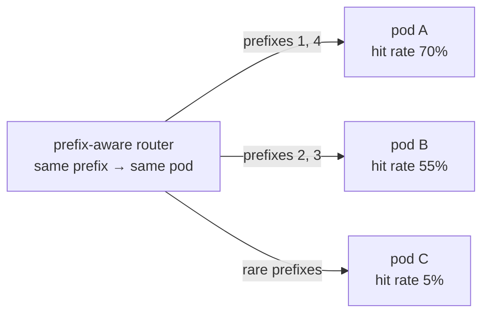

Now the caches differ. Switching off A loses the two most popular prefixes; switching off C loses almost nothing. This is the world in which the controller's choice matters, and it is also the world a real serving platform runs in.

### llm-d

**llm-d** is an open-source project for running vLLM at scale on Kubernetes. Its routing layer is an **inference gateway**: a proxy in front of the pods with a pluggable **endpoint picker** that scores each pod for each request. The scorers consider, among other things, which pod most likely already holds the request's prefix (prefix-cache affinity) and how loaded each pod is, so that hot prefixes stay put but no pod is overwhelmed. llm-d also supports more advanced layouts, such as running prefill and decode on different pods, that this project does not use.

The project's benchmark is designed to run behind llm-d's gateway: the load generator sends requests to the gateway's address (`GATEWAY_URL`), and the gateway spreads prefixes across the three pods the way a production system would. The controller never talks to the gateway; it only reads the pods' metrics and writes annotations, so it works with any router.

### The built-in router, for when llm-d is not there

Installing llm-d is a project of its own. For the hands-free cloud path in Part VI, where a fresh machine is set up from nothing, the repository includes a small stand-in: `cacheaware/router.py`, about 150 lines, which gives the one property the benchmark needs: same prefix, same pod.

It uses **consistent hashing**. Each pod is placed at 64 pseudo-random points on a circle ("virtual nodes"). A request's **key**, the first 512 characters of its prompt, which is the system prompt in practice, is hashed to a point on the same circle, and the request goes to the first pod found walking clockwise from that point.

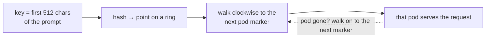

Why a ring and not `hash mod 3`? Because of scale-in. With `hash mod 3`, going from three pods to two changes almost every key's assignment, so every prefix moves and every cache is cold. On the ring, removing a pod only moves the keys that pointed to that pod's markers; every other key keeps its pod and its warm cache. The property is exactly what a scale-in needs, and the test `test_removing_a_pod_only_moves_its_keys` checks it.

The router refreshes the list of pods from Kubernetes every two seconds, so a deleted pod disappears from the ring quickly, and if a request reaches a pod that has just gone, the router retries on the next pod around the ring. Responses are streamed line by line, so TTFT measured through the router is the pod's TTFT plus a fraction of a millisecond.

When `GATEWAY_URL` is set, the router is not started at all; the benchmark uses llm-d or whatever gateway you point it at.

### Why the experiments sometimes bypass the router

A prefix-aware router decides where prefixes go. For the scale-in verification in stages 2 and 4, the experiment needs to *choose* which pod is cold, so it cannot let the router decide. Those scripts open a direct tunnel to each pod (`kubectl port-forward`) and send 120 repeated-prefix requests to the pod that should be hot, 60 mixed to the warm one, and 40 one-off prompts to the cold one. The benchmark in stage 5 does the opposite: it goes through the router, because that is what production looks like and the whole point is to measure what users would see.

### What to remember

- Round-robin routing makes every cache hold the same prefixes; nothing is gained or lost by deleting any pod.
- Prefix-aware routing concentrates each prefix on one pod; caches differ, and the choice of pod to delete matters.
- llm-d's gateway does prefix-aware routing in production; the controller is independent of it.
- The built-in router is a consistent-hash stand-in keyed on the first 512 characters of the prompt; removing a pod moves only that pod's keys.
- Experiments that must choose the cold pod bypass the router with port-forwards; the benchmark goes through it.


## Part II · The idea: a controller that knows what each cache is worth

Everything in Part I leads to one sentence: when Kubernetes removes a vLLM pod, it should remove the one whose cache is worth the least. This part explains how "worth" is measured, how the measurement becomes a number Kubernetes understands, and what happens in one cycle of the controller.

### What a cache is worth

A cache is worth what it saves. It saves prefill work when a request's prefix is found in it. So the first ingredient is the **prefix-cache hit rate**: of the prompt tokens looked up recently, what share was found. A pod with a 70 % hit rate is turning most of its prompts into near-free prefills; a pod with 5 % is doing full prefills regardless, and losing its cache changes almost nothing.

The second ingredient is **how much is cached**: the KV-cache usage from 0 to 1. Hit rate measures usefulness per token; usage measures quantity. A pod with a 70 % hit rate on a nearly empty cache has little to lose; the same hit rate on a full cache represents a lot of work that would need redoing.

Combined, with weights that favour usefulness:

```latex
\text{cache value} = 0.7 \times \text{recent hit rate} + 0.3 \times \text{KV usage} \qquad (0 \ldots 1)
```

A third ingredient, requests in flight, is available as a weight but off by default: Kubernetes already gives a pod 30 seconds to finish its in-flight requests when it is deleted, so busyness is handled elsewhere.

### "Recent" is the hard word

vLLM only reports lifetime totals. The controller has to turn them into a picture of the last few seconds. It does this per pod, every cycle:

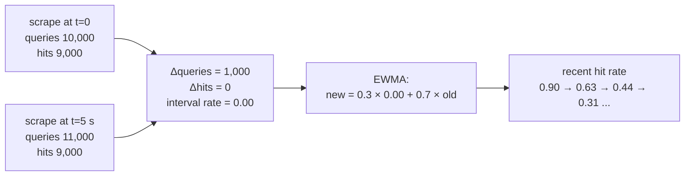

Lifetime says 82 %; the deltas say this pod has served no cache hits for the last five seconds. The smoothed rate drifts down over a few cycles rather than jumping.

Three rules make this robust (all in `cacheaware/scoring.py`, class `PodHistory`):

- **Smoothing.** The interval rate is folded into an exponentially weighted moving average with weight 0.3 on the newest interval. One noisy five-second window moves the estimate by at most 30 % of the way; after four quiet intervals the estimate has moved 76 % of the way. This stops the ranking flapping on a single burst.
- **Idle intervals teach nothing.** If fewer than 256 tokens were looked up in an interval, the estimate is kept as it was. Dividing 3 hits by 4 lookups would otherwise produce a confident-looking 75 % from almost no evidence.
- **Counter resets start over.** If the lifetime counter goes down, the pod restarted. The history is discarded and begins again from the new lifetime values. The very first sample of any pod uses its lifetime rate, which for a fresh pod is "unknown" and scores as 0.

### From a value to a cost

Kubernetes compares integers, so:

```latex
\text{deletion cost} = \text{round}(\text{cache value} \times 1000)
```

A value of 0.613 becomes 613. The scale is arbitrary; 1000 keeps the number readable ("a 70 % hit rate alone would be 700").

The controller does not rewrite the annotation every cycle. It patches only when the new cost differs from the one on the pod by at least 25, the **dead band** (`worth_patching`). The ranking only needs to be in the right order, not exact to the unit, and Kubernetes' own documentation asks for this annotation not to be churned. With three pods and a five-second cycle, the dead band turns up to 36 API writes per minute into a handful.

### One cycle, end to end

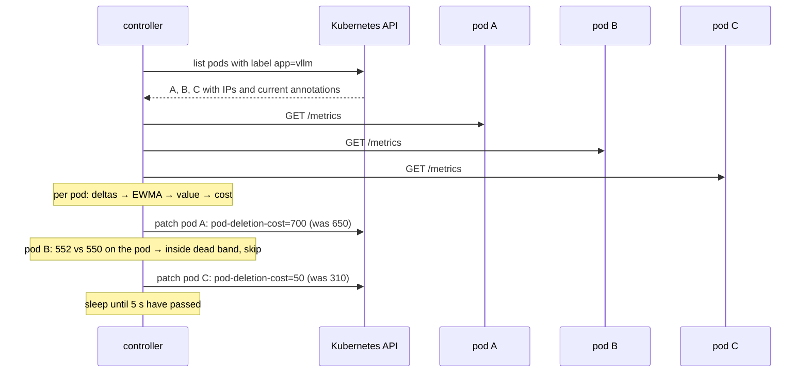

Only pods whose cost moved by 25 or more are written. Pods that fail to answer keep their old cost.

Each patch also writes four explanatory annotations (`cacheaware.dev/recent-hit-rate`, `kv-usage`, `cache-value`, `updated-at`) so that `kubectl describe pod` shows why the number is what it is.

### What happens when things go wrong

| situation | what the controller does | why |
|---|---|---|
| a pod does not answer `/metrics` | keeps the pod's previous cost, logs an error | writing 0 on a network blip could get a hot pod deleted |
| a pod is still starting or already terminating | skips it | Kubernetes orders those before any cost anyway |
| the API server is unreachable | logs, sleeps, retries next cycle | nothing to do without it |
| the controller crashes | nothing changes on the pods | stale costs are never worse than no costs; the Deployment restarts it |
| `--dry-run` | computes and prints, never writes | for watching it think, and for stage 1 |

### Worked example, with the scale-in

Three pods behind a prefix-aware router, after a few minutes of traffic in which the general support prompt (70 % of requests) landed on A, the billing prompt (25 %) on B, and one-off prompts on C. The controller's log shows:

```
10:02:11  pod                  hit  usage  value  cost   was  action
          vllm-7c9d-abc12     0.91   0.38   0.75   751   740  kept
          vllm-7c9d-def34     0.49   0.21   0.41   406   410  kept
          vllm-7c9d-ghi56     0.02   0.14   0.06    56    61  kept
```

`kubectl get pods` with the annotation shown:

```
NAME                COST
vllm-7c9d-abc12     751
vllm-7c9d-def34     406
vllm-7c9d-ghi56     56
```

An operator (or an autoscaler) runs `kubectl scale deployment vllm --replicas=2`. The ReplicaSet sorts the three Ready pods by cost and deletes `vllm-7c9d-ghi56`. Requests that were going to it (the one-off prompts) move to A and B and pay a full prefill, which they would have paid anyway. Requests for the general and billing prompts never notice.

Had the controller not been running, the ReplicaSet would have compared the pods' ready times, found them in the same bucket, and deleted one effectively at random. One time in three that is `abc12`, and for the next minute or two 70 % of requests pay a 1,600-token prefill on B or C.

### Why these choices and not others

The design notes in `guide.md` section 4 go through each alternative. In short: lifetime hit rate was rejected because it cannot see a pod going cold; usage alone was rejected because a full cache of unwanted prefixes is worthless; deleting pods from the controller itself was rejected because it would race Kubernetes' own ReplicaSet controller; polling instead of a Prometheus query was chosen because three pods every five seconds is trivial and removes a dependency.

### What to remember

- Cache value = 0.7 × recent hit rate + 0.3 × KV usage, from 0 to 1.
- "Recent" comes from the difference between two scrapes, smoothed with an EWMA (weight 0.3), ignoring intervals with under 256 lookups, restarting on counter resets.
- Cost = value × 1000, written as `controller.kubernetes.io/pod-deletion-cost`, only when it moved by 25 or more.
- On any doubt (scrape failure, pod starting or stopping), the controller leaves the pod's cost alone.
- Kubernetes does the deleting; the controller only ranks.


## Part III · Building it in six stages

Three A100s cost real money by the hour, and a bug found on them costs more than the same bug found on a laptop. So the project was built as a ladder: each stage adds one capability, proves it with an evaluation that exits 0 or 1, and hands finished code to the next stage. Only the top four stages need a GPU; only the top three need three of them.

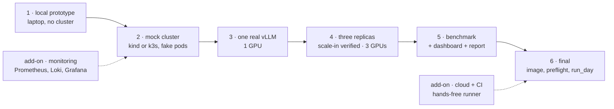

Every stage reuses the stage before it. Shared Python lives in one package, `cacheaware/`; shared shell helpers live in `scripts/lib.sh`. A stage folder holds only what is specific to it: its scripts, its evaluation, its README.

### Stage 1 · The brain, on a laptop

**Goal.** Prove the scoring with no Kubernetes and no GPU.

**What is new.** `vllm_metrics.py` (reads a `/metrics` page, any version), `scoring.py` (deltas, EWMA, value, cost, dead band), `controller.py` (the loop, with a `StaticBackend` that takes a list of URLs instead of asking Kubernetes), and `fake_vllm.py`, a 180-line fake vLLM pod. The fake serves a `/metrics` page whose counters advance as if it were handling a configurable number of lookups per second at a configurable hit rate, a `/set` endpoint to change those knobs while it runs, and a fake streaming `/v1/completions` whose first token arrives after a delay that depends on the hit rate. That last part lets every later tool, from the load generator to the report, be rehearsed without a GPU.

**Run.** `stage1_local_prototype/run.sh` starts three fakes at hit rates 0.70, 0.55 and 0.05 and the controller in dry-run mode; every two seconds it prints the table from Part II. From another terminal, `curl 'http://127.0.0.1:9003/set?hit_rate=0.9'` makes the cold pod hot and the cost follows over the next few cycles.

**Eval.** `stage1_local_prototype/eval.sh`: 21 unit tests (metric spellings, scoring rules, the loop against an in-memory backend) and `eval_scenario.py`, which runs the real controller against the three fakes and requires costs of 700, 550 and 50 within tolerance with pod C lowest. Pass looks like `PASS: coldest cache gets the lowest pod-deletion-cost`.

### Stage 2 · The mechanism, in a real cluster

**Goal.** Prove that writing the annotation really changes which pod Kubernetes deletes.

**What is new.** `kube.py` (list pods, scrape through pod IP or through the API server's proxy, patch annotations), the `KubeBackend`, `scripts/lib.sh`, and `scripts/scale_in_trials.sh`, the experiment that stage 4 reuses unchanged. The fake pods run inside Kubernetes from a ConfigMap and a stock Python image, so any cluster will do; `setup.sh` creates a `kind` cluster if none is reachable.

**The experiment.** For each trial: restart all pods so they are the same age; pick one as the cold pod, rotating through the three so a pass cannot be an accident of ordering; set the fakes' knobs (hot 0.70, warm 0.55, cold 0.05); wait 30 seconds for the controller to re-score; print the cost table; scale to 2; see which pod vanished; compare. Then the same with the controller off and annotations stripped, to see what Kubernetes does alone.

**Eval.** `stage2_mock_cluster/eval.sh`. Pass looks like `cache-aware coldest pod removed in 3/3 trials` and `baseline ... 1/3`. The baseline line is whatever the age tie-break produced; anything other than 3/3 is normal.

### Stage 3 · One real vLLM

**Goal.** Get a real model serving, learn which metric names this version uses, confirm prefix caching works.

**What is new.** The vLLM Deployment manifest (one GPU, prefix caching on, Hugging Face weights cached on the host so they download once), `discover_metrics.sh` (prints the vLLM version, the raw cache metric lines, and which spelling the parser picked; saves it to `results/`), and `loadgen.py`, the traffic generator used by every later stage.

**The load generator** builds deterministic long prefixes (seeded, so every run and every pod sees the same text), attaches a unique question to each, draws the prefix for each request from a skewed popularity distribution, and measures TTFT as the time to the first streamed token. It has a `warm` mode (send N requests, closed loop) and a `bench` mode (requests per second, Poisson arrivals, warm then measure phases, writes a report).

**Eval.** `stage3_vllm_single/eval.sh` sends 40 requests over two shared prefixes straight to the pod and reads the hit counters before and after. Pass: hit rate over the run above 0.5 (in practice around 0.9). If this fails nothing later can work, and it fails within ten minutes of having the GPU.

### Stage 4 · Three replicas, scale-in verified (GPU-day goal 1)

**Goal.** The stage 2 experiment on real pods with real traffic.

**What is new.** `warm_skewed.sh`: three port-forwards, three load generators in parallel: 120 requests over 3 prefixes to the hot pod, 60 over 6 prefixes with 30 % one-offs to the warm pod, 40 one-off prompts to the cold pod. Everything else is the stage 2 harness with `SKEW=real`.

**Eval.** `stage4_scale_in_real/eval.sh`, about 25 minutes with pod restarts between trials. Pass: `cache-aware coldest pod removed in 3/3 trials`.

### Stage 5 · The benchmark (GPU-day goals 2 and 3)

**Goal.** Measure what cache-aware scale-in buys: TTFT and hit rate, default versus cache-aware, through the gateway. Part IV is entirely about this stage's design.

**What is new.** `run_trial.sh` (one trial), `run_benchmark.sh` (N trials per mode, interleaved), the live dashboard (`live.py`, `dashboard.py`), the report (`report.py`), and the inference-perf config template.

**Eval.** `stage5_benchmark/eval.sh` runs the benchmark and then checks that every trial has TTFT numbers, that fewer than 5 % of requests failed, and that every cache-aware trial removed the rank-1 pod. It ends by printing the "numbers for the resume bullet" from `results/RESULTS.md`.

### Stage 6 · Final shape

**Goal.** The controller as a real cluster component, and the whole day as one command.

**What is new.** A `Dockerfile` (Python slim image, non-root), RBAC (get, list, watch, patch on pods), a Deployment with `Recreate` strategy so two controllers never patch at once, `build_image.sh` (builds and imports into k3s without a registry), `preflight.sh` (a read-only GO/NO-GO list), `run_day.sh` (every phase in order, pausing between them unless `PAUSE=0`), `nbody_a100.sh` (Part VII) and `checklist.md`.

With `CONTROLLER_MODE=cluster`, the stage 4 and 5 scripts switch the in-cluster controller on and off by scaling its Deployment to 1 or 0, instead of starting a local process.

### The two add-ons

**Monitoring** (`monitoring/`): Prometheus, Loki, Alloy and Grafana as plain pinned manifests, a provisioned dashboard, and a `/metrics` endpoint on the controller so its costs show up in Grafana. Usable from stage 2 onward. Part V.

**Cloud and CI** (`cloud/`, `.github/workflows/`): a provider contract, a bootstrap script that turns a fresh Ubuntu GPU box into a k3s cluster with GPU support, a remote runner, a GitHub Actions workflow for the whole day, and a CI workflow that runs the tests and the stage 2 experiment on every push. Part VI.

### Repository map

| path | stage | role |
|---|---|---|
| `cacheaware/vllm_metrics.py` | 1 | read cache signals from a `/metrics` page, any vLLM version |
| `cacheaware/scoring.py` | 1 | recent hit rate → cache value → deletion cost, dead band |
| `cacheaware/fake_vllm.py` | 1 | fake vLLM pod: metrics, knobs, fake streaming completions |
| `cacheaware/controller.py` | 2 | the loop; static and Kubernetes backends; settings from flags or env |
| `cacheaware/kube.py` | 2 | list pods, scrape, annotate |
| `cacheaware/loadgen.py` | 3 | prefix-heavy traffic, Zipf popularity, client-side TTFT |
| `cacheaware/live.py` | 5 | status files and the one metrics sampler for the dashboard |
| `cacheaware/dashboard.py`, `.html` | 5 | read-only live dashboard |
| `cacheaware/report.py` | 5 | trial folders → `RESULTS.md` and a chart |
| `cacheaware/metrics_exporter.py` | add-on | the controller's own Prometheus metrics |
| `cacheaware/router.py` | add-on | consistent-hash prefix-affinity router |
| `scripts/lib.sh` | 2 | every shell helper: pods, scrape, scale, wait, controller on/off |
| `scripts/scale_in_trials.sh` | 2 | the scale-in experiment (stages 2 and 4) |
| `stage1..6_*/` | 1–6 | per-stage scripts, evals, READMEs |
| `monitoring/`, `cloud/`, `.github/` | add-ons | observability, hands-free runner, CI |
| `results/` | all | everything produced; `RESULTS.md` is the deliverable |
| `guide.md`, `PLAN.md`, `book/` | docs | design decisions and runbook; the plan; this book |

### How to read the code

Read in this order: `cacheaware/scoring.py` (120 lines, the idea), `cacheaware/controller.py` (the loop), `scripts/lib.sh` (what every script can do), `scripts/scale_in_trials.sh` (the experiment), `stage5_benchmark/run_trial.sh` (the benchmark). Every file starts with a comment that says what it is for and how to run it; every Python module answers `--help`.

### What to remember

- Six stages, each adding one capability and one evaluation; only stages 3 to 6 need a GPU.
- Stage 1 proves the scoring, stage 2 the Kubernetes mechanism, stage 3 the real metrics, stage 4 the real scale-in, stage 5 the benefit, stage 6 the packaging.
- Fake vLLM pods make everything up to stage 2 runnable on a laptop in minutes, including a rehearsal of the benchmark pipeline.
- Code is shared through one Python package and one shell library; stage folders hold only what is specific to them.


## Part III · Chapter 2: A guided reading of the code

This chapter walks through the pieces of code that carry the idea, excerpt by excerpt. Each excerpt is real code from the repository, trimmed of comments; read the files for the full version. The order follows the data: a scrape becomes a hit rate, a hit rate becomes a cost, a cost is written, a scale-in reads it, an experiment checks it.

### 1. From two scrapes to a recent hit rate (`cacheaware/scoring.py`)

```python
@dataclass
class PodHistory:
    last_queries: float | None = None
    last_hits: float | None = None
    recent_hit_rate: float | None = None   # the EWMA

    def update(self, sample, alpha=0.3, min_tokens=256):
        queries, hits = sample.prefix_queries, sample.prefix_hits
        if queries is None or hits is None:          # old vLLM: only a gauge
            self.recent_hit_rate = sample.hit_rate_gauge
            return self.recent_hit_rate

        first_sample = self.last_queries is None
        counters_reset = not first_sample and queries < self.last_queries
        if first_sample or counters_reset:
            self.last_queries, self.last_hits = queries, hits
            self.recent_hit_rate = hits / queries if queries > 0 else None
            return self.recent_hit_rate

        delta_queries = queries - self.last_queries
        delta_hits = hits - self.last_hits
        self.last_queries, self.last_hits = queries, hits
        if delta_queries < min_tokens:
            return self.recent_hit_rate                # idle: keep what we knew

        interval_rate = min(1.0, max(0.0, delta_hits / delta_queries))
        if self.recent_hit_rate is None:
            self.recent_hit_rate = interval_rate
        else:
            self.recent_hit_rate = alpha * interval_rate + (1 - alpha) * self.recent_hit_rate
        return self.recent_hit_rate
```

Read it top to bottom as a list of cases. No counters: use the gauge. First time, or counters went backwards: start from the lifetime ratio. Too little traffic: say nothing new. Otherwise: the interval's ratio, folded into the running estimate with weight `alpha`. The function returns `None` whenever it honestly does not know, and the caller treats `None` as zero value, which is right for a fresh pod with an empty cache.

### 2. From a hit rate to a cost

```python
def cache_value(hit_rate, kv_usage, inflight_fraction=0.0, weights=None):
    w = (weights or Weights()).normalised()
    value = (w.hit_rate * clamp01(hit_rate)
             + w.kv_usage * clamp01(kv_usage)
             + w.inflight * clamp01(inflight_fraction))
    return clamp01(value)

def deletion_cost(value, scale=1000):
    return int(round(clamp01(value) * scale))

def worth_patching(current_cost, new_cost, min_delta=25):
    if current_cost is None:
        return True
    return abs(new_cost - current_cost) >= min_delta
```

Three one-screen functions, each testable alone. `clamp01` turns `None` into 0 and keeps everything in range, so a bad reading can never produce a cost above 1000 or below 0. `worth_patching` is the dead band: a missing annotation is always written; an existing one only when it moved enough.

### 3. One pod, one cycle (`cacheaware/controller.py`)

```python
def handle_pod(self, pod):
    report = PodReport(name=pod.name, previous_cost=read_cost(pod))

    if pod.phase != "Running" or pod.deleting:
        report.action = "skipped"
        return report

    try:
        text = self.backend.scrape(pod)
    except Exception as exc:
        report.action, report.note = "error", f"scrape failed: {exc}"[:80]
        return report                      # keep whatever cost it had

    sample = sample_from_text(text)
    history = self.histories.setdefault(pod.name, PodHistory())
    report.hit_rate = history.update(sample, self.s.ewma_alpha, self.s.min_tokens)
    report.kv_usage = sample.kv_usage
    inflight = (sample.running + sample.waiting) / max(1, self.s.max_inflight)
    report.value = cache_value(report.hit_rate, report.kv_usage, inflight, self.s.weights)
    report.cost = deletion_cost(report.value, self.s.cost_scale)

    if not worth_patching(report.previous_cost, report.cost, self.s.min_delta):
        report.action = "kept"
        return report

    annotations = {COST_ANNOTATION: str(report.cost), ...}
    if self.s.dry_run:
        report.action = "dry-run"
    else:
        self.backend.annotate(pod, annotations)
        report.action = "patched"
    return report
```

Every early `return` is a deliberate "do nothing" case: a pod that is starting or stopping, a pod that did not answer. The only write happens at the very end, after every check. `self.backend` is either the Kubernetes client or the static list of URLs from stage 1; the function cannot tell the difference, which is why the stage 1 tests exercise the same code the cluster runs.

### 4. Which pod *should* go (`scripts/lib.sh`)

```bash
lowest_cost_pod() {   # the pod Kubernetes should delete first (missing cost counts as 0)
    local p c best="" best_c=""
    for p in $(ready_pods); do
        c=$(pod_cost "$p"); [ "$c" = "-" ] && c=0
        if [ -z "$best" ] || [ "$c" -lt "$best_c" ]; then best="$p"; best_c="$c"; fi
    done
    printf '%s' "$best"
}
```

The experiments need an independent opinion of what Kubernetes ought to do, computed from the annotations alone, not from the controller's memory. This is it: read every Ready pod's annotation, treat a missing one as 0 (exactly as Kubernetes does), return the minimum. If the pod that disappears is not this one, something is wrong with the mechanism, not with the scoring.

### 5. One trial of the scale-in experiment (`scripts/scale_in_trials.sh`)

```bash
run_trial() {
    local trial="$1"
    if [ "$FRESH_PODS" = 1 ]; then fresh_pods 3; else scale 3; wait_ready 3; fi

    local all; mapfile -t all < <(ready_pods)
    local cold="${all[$(( (trial - 1) % 3 ))]}"      # rotates: 1st, 2nd, 3rd pod
    local hot="${all[$(( trial % 3 ))]}"
    local warm="${all[$(( (trial + 1) % 3 ))]}"

    [ "$MODE" = baseline ] && strip_costs
    "skew_$SKEW" "$hot" "$warm" "$cold"             # skew_mock or skew_real
    [ "$MODE" = cache-aware ] && sleep "$SETTLE" || strip_costs

    local costs expected before removed rank
    costs=$(costs_string); expected=$(lowest_cost_pod); before=$(pods)
    scale 2
    wait_ready 2 300
    removed=$(removed_pod "$before")
    rank=$(cost_rank_of "$removed" "$costs")

    if [ "$removed" = "$cold" ]; then ok "removed the COLD pod"; verdict=1
    else fail "removed $removed, the cold pod was $cold"; verdict=0; fi
    echo "$MODE,$trial,$cold,$hot,$warm,\"$costs\",$removed,$rank,$verdict" >> "$CSV"
}
```

The whole experiment is twenty lines once the helpers exist. Two details carry the honesty: the cold pod rotates with the trial number, and `before` is captured right before the scale so `removed_pod` can find the one that vanished by set difference. The CSV row records everything needed to re-check the verdict by hand. The only line that differs between stage 2 and stage 4 is `"skew_$SKEW"`: a function that sets fake knobs, or one that sends real traffic.

### 6. The scale-in moment in the benchmark (`stage5_benchmark/run_trial.sh`)

```bash
log "load started; warming for ${WARM}s"
sleep "$WARM"

snap "$trial_dir/pre_snapshot.json"
costs=$(costs_string); expected=$(lowest_cost_pod); before=$(pods)
live_event "scaling 3 -> 2 (costs: $costs)"
scale 2
scale_at=$(date +%s)
# the removed pod gets a deletionTimestamp immediately; find it without waiting for it to vanish
removed=""
for _ in $(seq 1 120); do
    removed=$(kubectl get pods -n "$NAMESPACE" -l "$SELECTOR" -o json | "$PYTHON" -c '
import json, sys
for p in json.load(sys.stdin)["items"]:
    if p["metadata"].get("deletionTimestamp"):
        print(p["metadata"]["name"]); break' || true)
    [ -n "$removed" ] && break
    sleep 0.5
done
rank=$(cost_rank_of "$removed" "$costs")
live_set phase=measuring removed_pod="$removed" removed_rank="$rank" expected_pod="$expected"
```

The snapshot before the scale is what the survivor hit rate is later computed against. The removed pod is identified by its deletion timestamp within half a second, rather than waiting the thirty seconds it takes to actually disappear, so the dashboard shows the verdict immediately and the measurement window is not confused with the drain.

### 7. Same prefix, same pod (`cacheaware/router.py`)

```python
def candidates(self, key):
    """Pods for this key, best first, each pod once (for failover)."""
    with self._lock:
        if not self._points:
            return []
        start = bisect.bisect_left(self._points, _h(key)) % len(self._points)
        seen = []
        for i in range(len(self._points)):
            name = self._owner[self._points[(start + i) % len(self._points)]]
            if name not in seen:
                seen.append(name)
            if len(seen) == len(self.urls):
                break
        return seen
```

`_points` is the sorted list of every pod's 64 markers on the ring; `_owner` maps a marker back to its pod. `bisect_left` finds where the key's hash lands, and the loop walks clockwise collecting pods in the order they are met. The first is the pod that serves the request; the rest are the failover order if it is gone. Removing a pod removes its markers and nothing else, which is the consistent-hashing property the test checks.

### What to remember

- The scoring is three short pure functions; everything uncertain returns `None` and scores as zero.
- `handle_pod` does nothing in every doubtful case and writes only at the end.
- The experiments compute "what should happen" from the annotations alone, independently of the controller.
- The stage 2 and stage 4 experiments are the same twenty lines with one function swapped.
- The router's ring is a sorted list and a binary search.


## Part IV · Measuring honestly

A controller that "feels faster" is worth nothing on a resume or in a paper. The benchmark in stage 5 exists to produce two numbers that would survive a sceptical reader: time to first token after a scale-in, and the prefix-cache hit rate of the surviving pods, each for default scale-in and for cache-aware scale-in. This part explains how the experiment is built so those numbers mean what they claim.

### What "fair" means

An experiment is fair when the only thing that differs between the two arms is the thing being tested. Here the thing being tested is *which pod Kubernetes deletes*. So everything else must be the same in both arms: the pods, their age, the traffic, the moment of the scale-in, the measurement window, the machine, the time of day as far as possible. Each design choice below removes one way the two arms could differ by accident.

### One trial

```mermaid
sequenceDiagram
  participant R as run_trial.sh
  participant K as Kubernetes
  participant L as load tool
  participant P as 3 vLLM pods
  R->>K: rollout restart; wait for 3 Ready
  Note over R: controller ON (cache-aware) or OFF + annotations stripped (baseline)
  R->>L: start: WARM s of traffic, then MEASURE s, same prefixes throughout
  L->>P: requests through the gateway or built-in router
  Note over P: caches fill; controller scores every 5 s
  R->>R: after WARM s: snapshot counters, record each pod's cost
  R->>K: scale 3 → 2
  K-->>P: deletes one pod
  R->>R: record which pod went and its cost rank (1 = lowest)
  L->>P: measurement continues on the 2 survivors
  R->>R: snapshot counters again; write meta.json; summarise
```

Default timings: 120 seconds of warm-up, 120 seconds of measurement, 4 requests per second, 16 prefix groups. One trial is about eight minutes including the pod restart.

### The design choices, and the accident each one prevents

**Fresh pods for every trial.** Before each trial, all three pods are restarted so they have the same age and empty caches. Without this, the baseline's age rule (Part I, Chapter 3) would always delete the pod that was most recently started, which after a scale-out is also the coldest. The baseline would look clever by accident. With equal ages, Kubernetes' default choice is effectively arbitrary, which is the honest thing to compare against.

**Baseline means controller stopped and annotations removed.** Stopping the controller alone would leave the last costs on the pods, and Kubernetes would still honour them.

**Interleaved trials.** The order is baseline, cache-aware, baseline, cache-aware, and so on. If the machine slowly warms up, another tenant appears, or the model's first minutes are slower, both arms are affected equally.

**The same prefixes in warm-up and measurement.** The load tool runs once per trial and switches from the warm phase to the measure phase without changing its prompts. If the measurement used different prompts, no cache could help either arm, and the experiment would measure nothing.

**Skewed prefix popularity.** The load generator draws each request's prefix from 16 groups with Zipf-distributed popularity (exponent 1.0):

| group | share of requests | | group | share of requests |
|--:|--:|---|--:|--:|
| 1 | 29.6 % | | 5 | 5.9 % |
| 2 | 14.8 % | | 8 | 3.7 % |
| 3 | 9.9 % | | 12 | 2.5 % |
| 4 | 7.4 % | | 16 | 1.8 % |

Real traffic looks like this: a few system prompts dominate. With uniform popularity and an even router, every pod's cache would be worth the same and there would be nothing for the controller to choose. Skew is not a trick in the controller's favour; it is what makes the question answerable, and the exponent is a knob (`ZIPF`) so you can show the effect shrinking as traffic becomes uniform.

**Measurement in 30-second windows.** The cost of losing a hot cache is paid by the requests that arrive right after the scale-in; the survivors re-learn the lost prefixes within a minute or two. A 10-minute average would bury the effect under recovery. The report shows the first 30 seconds after scale-in as the headline and every later window as the recovery curve, plus the whole-window average so nobody can accuse it of cherry-picking.

**Three numbers from two independent sources.**

| number | where it comes from | what it answers |
|---|---|---|
| TTFT p50 / p90 / p99 per window | the load tool, client side | what users would feel |
| mean TTFT on the survivors | vLLM's own histogram, server side, from the two snapshots | a cross-check: if client and server disagree wildly, the measurement is broken |
| survivor prefix-cache hit rate | `Δhits ÷ Δqueries` on the surviving pods between the two snapshots | how much cache the fleet kept |

**The rank of the removed pod** is recorded in every trial, so the benchmark also re-verifies goal 1 every time it runs.

### The two load tools

**inference-perf** is the Kubernetes community's benchmarking tool for inference servers (`kubernetes-sigs/inference-perf`). It takes a YAML config with a sequence of load stages (rate and duration), a dataset type (`shared_prefix`: groups of prompts sharing a long system prompt, which is exactly the shape needed), and writes per-stage reports with TTFT percentiles. The project's config template has one warm stage and four 30-second measurement stages, and the orchestrator scales the Deployment at the boundary between them.

**loadgen** is the project's own generator, used as a fallback (`TOOL=loadgen`). It exists because inference-perf's config schema has changed between releases and could not be verified against the version you will install; a schema mismatch should cost five minutes, not the GPU day. It implements the same protocol: deterministic prefixes, Zipf popularity, Poisson arrivals at a fixed rate, warm then measure, TTFT per request, per-window summaries. The report module reads either tool's output.

### Reading the report

`python -m cacheaware.report` turns the trial folders into `results/RESULTS.md`. Its headline table, with illustrative numbers of the kind a successful run produces:

| metric | default scale-in | cache-aware | change |
|---|--:|--:|--:|
| TTFT p90, first 30 s after scale-in | ~300 ms | ~120 ms | −60 % |
| TTFT p90, whole measure window | ~180 ms | ~110 ms | −39 % |
| prefix-cache hit rate on survivors | ~45 % | ~65 % | +44 % |
| coldest pod removed | 1 of 3 trials | 3 of 3 trials | |

Below it, a per-trial table (which pod was removed, its cost rank, the costs at the moment of scale-in, errors) and the recovery curve (TTFT p50 per window). A chart of the recovery curve is saved next to it.

**What a confusing result looks like, and why.** In a baseline trial, Kubernetes sometimes happens to delete the cold pod. That trial is then identical to a cache-aware trial and shows no difference. With three trials per arm this happens in roughly one baseline trial; the averages still separate, and the per-trial table shows exactly which trial it was. If *every* trial looks identical, the caches were not warm enough (`WARM` too short), the traffic was not skewed enough (`GROUPS` too many or `ZIPF` too low), or the router was not keeping prefixes on their pods (check hit rates on the dashboard during the warm-up).

### What the numbers do not say

- Three trials per arm is a small sample. The report prints mean and standard deviation; a reader should look at the per-trial table, not only the mean. More trials (`TRIALS=5`) tighten the averages at eight minutes per pair.
- The effect size depends on the workload. A sensitivity sweep over `ZIPF` and over the scoring weights is the natural next experiment, and the harness runs it with environment variables alone.
- The benchmark measures one scale-in from three to two pods. Larger fleets lose a smaller share of their cache per deletion, so the per-event effect shrinks, though scale-ins also happen more often.

### What to remember

- Fair means one difference: which pod is deleted. Fresh pods, interleaving, identical traffic and identical timing remove the others.
- Skewed prefix popularity is what makes caches unequal; it is a knob, not a thumb on the scale.
- The headline is the first 30 seconds after scale-in; the whole window and the recovery curve are reported too.
- Three numbers from two sources: client TTFT, server TTFT, survivor hit rate.
- A baseline trial that happens to delete the cold pod looks like a cache-aware trial; the per-trial table shows it.


## Part V · Observability

A benchmark you cannot watch is a benchmark you cannot debug. The project ships two ways to see what is happening: a small file-based dashboard that needs nothing installed in the cluster, and a full monitoring stack of the kind production systems use. Both were designed under one rule: they must not change what they measure.

### Metrics, logs, dashboards

Three kinds of observation, three tools:

- **Metrics** are numbers over time: cache usage, hit counters, queue lengths, TTFT histograms. They are small, cheap to store, and easy to graph. Tool: **Prometheus**.
- **Logs** are lines of text a program prints: the controller's cost table every five seconds, vLLM's startup messages and warnings. Tool: **Loki**, fed by **Alloy**.
- **Dashboards** put both on a screen. Tool: **Grafana**.

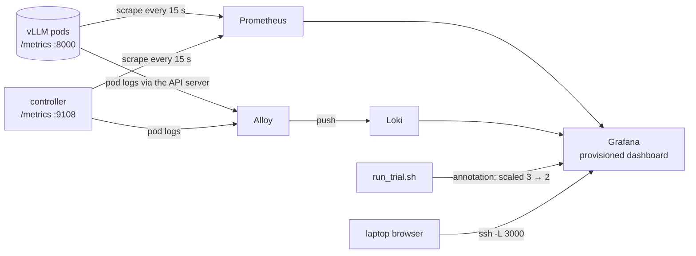

Nothing in the stack sends inference requests or touches the GPU. Prometheus and Alloy read; Grafana reads from them.

### Prometheus in four sentences

Prometheus **pulls**: every 15 seconds it fetches the `/metrics` page of every target and stores each line as a time series identified by the metric name and its labels. Targets are found by asking the Kubernetes API for pods matching the same label selector the controller uses (so llm-d's pods are found too) plus any pod annotated `prometheus.io/scrape: "true"`, which is how the controller's own metrics are picked up. Queries are written in **PromQL**; the three the dashboard relies on are:

| PromQL | meaning |
|---|---|
| `sum by (pod) (rate(vllm:prefix_cache_hits[1m])) / sum by (pod) (rate(vllm:prefix_cache_queries[1m]))` | recent hit rate per pod: hits per second over the last minute divided by lookups per second, the same delta idea as the controller's EWMA |
| `histogram_quantile(0.9, sum by (le) (rate(vllm:time_to_first_token_seconds_bucket[1m])))` | TTFT p90 over the last minute as the server saw it |
| `max by (pod) (cacheaware_pod_deletion_cost)` | the cost the controller wrote, per pod |

Storage is a two-day ring on local disk; enough for a GPU day, and a single line to change if you want more.

### The controller's own metrics

The deletion cost lives in an annotation, which Prometheus cannot see. So the controller publishes what it decided as metrics on port 9108 (`cacheaware/metrics_exporter.py`, standard library only):

| metric | meaning |
|---|---|
| `cacheaware_pod_deletion_cost{pod}` | the cost written to that pod |
| `cacheaware_recent_hit_rate{pod}`, `cacheaware_kv_usage{pod}`, `cacheaware_cache_value{pod}` | the ingredients |
| `cacheaware_patches_total` | annotation writes so far (watch the dead band working: this should rise slowly) |
| `cacheaware_scrape_errors_total` | pods that failed to answer |
| `cacheaware_cycle_duration_seconds`, `cacheaware_pods_seen` | health of the loop |

### Logs: Loki and Alloy

Loki stores log lines with labels (namespace, pod, container, app) and is queried with a small language, LogQL: `{app="cache-aware-controller"}` shows the controller's cost tables; `{namespace="vllm"} |~ "(?i)error|warn"` shows vLLM's complaints. Alloy is the collector: it asks the Kubernetes API for the list of pods, reads their logs through the API server (the same channel `kubectl logs` uses), attaches the labels and pushes to Loki. Because it reads through the API it needs no access to the machine's disk and runs as one ordinary pod. Promtail, the older collector, is end of life and was not used.

### The Grafana dashboard

Grafana is provisioned from files: both data sources and one dashboard, `vLLM cache-aware scale-in`, with thirteen panels:

| row | panels |
|---|---|
| summary | replicas up · controller patches per minute · scrape errors · TTFT p90 · requests in flight |
| the controller's view | pod-deletion-cost per pod · recent hit rate per pod |
| the servers' state | KV-cache usage per pod · TTFT p50 and p90 |
| load | running and waiting requests per pod · cache value per pod |
| logs | controller logs · vLLM logs |

Every benchmark event (`load starting`, `scaling 3 → 2`, `removed pod X`) is also posted to Grafana as an annotation with the tag `bench`, so the moments of scale-in appear as red vertical lines across the graphs. Watching the hit-rate panel at such a line is the quickest way to see the project working: in a baseline trial the survivors' lines sometimes dip and climb back; in a cache-aware trial they stay flat.

### The file-based live dashboard

Before any of the above is installed, stage 5 has its own dashboard. One process, the **sampler** (`cacheaware/live.py sample`), scrapes each pod's `/metrics` every two seconds and appends one JSON line per pod to a file. The benchmark scripts write their phase, trial and the removed pod to a status file and their events to another. The dashboard (`cacheaware/dashboard.py`) is a tiny web server that reads those files and serves one HTML page which refreshes every two seconds: the current phase and trial, each pod's hit rate, usage, cost and running requests, which pod was removed and its rank, two charts (hit rate per pod, server-side TTFT per pod, last ten minutes), the table of finished trials, and the event log.

It binds to localhost on the GPU box; from a laptop, `ssh -L 8080:127.0.0.1:8080 user@box` and open `http://localhost:8080`. It needs no installation beyond Python.

### Does monitoring disturb the benchmark?

This question was asked, and the answer is no, for three reasons that are worth stating precisely.

| what touches a vLLM pod | how often | what it costs the pod |
|---|---|---|
| Prometheus | one `GET /metrics` per 15 s | a few milliseconds of CPU in the HTTP front end; no GPU; no cache change |
| the stage 5 sampler | one `GET /metrics` per 2 s | the same |
| the controller | one `GET /metrics` per 5 s, plus a patch when the cost moves by 25 | the same, plus one API-server write; this one is the system under test |
| Alloy, Loki, Grafana, the dashboard | never | nothing |

First, rendering `/metrics` is text formatting in the server's front end, not work in the engine that does prefill and decode. Second, everything runs identically in both arms of every trial, so any constant cost is in both columns and cancels in the comparison. Third, the only way the stack could matter is by competing for host CPU on a small machine; `kubectl top pods` during a warm-up answers that in one line, and the stack asks for about a third of one core. For the strict reader, one extra pair of trials with the monitoring Deployments scaled to zero turns the argument into a measurement.

### What to remember

- Prometheus pulls metrics every 15 s and stores time series; PromQL `rate()` over a minute is the dashboard's version of the controller's deltas.
- The controller exports its costs as metrics so Grafana can show them; annotations alone are invisible to Prometheus.
- Alloy reads pod logs through the Kubernetes API and pushes them to Loki; Grafana shows metrics and logs together, with benchmark events as red lines.
- The file-based dashboard needs nothing installed and is reached through an SSH tunnel.
- Nothing in observability touches the GPU or the caches; it runs in both arms, so it cancels.


## Part VI · Running it anywhere

The GPU day should need no typing on the GPU machine. This part covers the layer that makes that true: a credentials file, a provider contract, a bootstrap script, a remote runner, two GitHub Actions workflows, and the runbook for a human doing it by hand.

### The one-command path

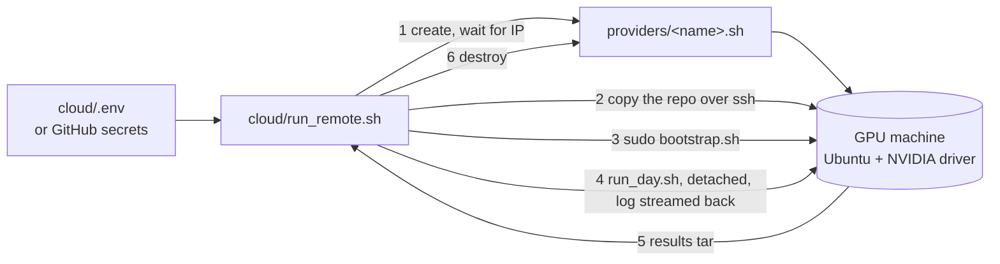

Every GPU cloud sells the thing in the middle: a Linux machine with NVIDIA drivers that you can reach over SSH. The runner needs nothing else, which is why it works across providers.

**The credentials file.** `cloud/.env` (copied from `cloud/.env.example`, never committed) holds the Hugging Face token for the Llama 3 weights, the machine's address and SSH key for a machine you already have, or a provider name and API key for one to be created, and the run's knobs: trials, load tool, whether to run N-body, whether to keep the machine afterwards.

**The provider contract.** A provider is a shell file with three functions: `provider_create` makes a machine with three or more GPUs and your SSH public key and prints its id; `provider_wait_ip` blocks until it has an address; `provider_destroy` terminates it. `manual.sh` is for a machine that already exists; `template.sh` shows the shape of a REST-API adapter. The destroy step runs on exit even when something failed, so a crashed run does not leave a machine billing overnight; `KEEP_INSTANCE=1` turns that off for debugging.

A note on Coral Bricks, since that is where the credits are: its public site describes an inference service and shows no API or VM documentation. If the credits buy inference calls rather than machines, they cannot host this benchmark, which needs raw GPUs with Kubernetes on them. If they buy machines, a twenty-line adapter from their console or docs plugs in.

**Bootstrap.** `cloud/bootstrap.sh` runs on the machine as root and is safe to rerun:

1. base packages, and a check that `nvidia-smi` works;
2. the NVIDIA container toolkit, installed *before* k3s so that k3s registers the NVIDIA container runtime by itself;
3. k3s, a single-node Kubernetes;
4. the `nvidia` RuntimeClass and the NVIDIA device plugin, then a wait until the node advertises `nvidia.com/gpu`;
5. the Python dependencies (and inference-perf if chosen);
6. a directory on the host for the model weights so they download once.

Three to six minutes on a fresh Ubuntu image.

**The run.** The runner starts `stage6_final/run_day.sh` with `PAUSE=0` under `nohup` so it survives a dropped SSH session, follows its log, waits for the exit marker the script writes, pulls the whole `results/` folder back into `results/remote-<timestamp>/`, prints the "numbers for the resume bullet" block, and destroys the machine.

Because llm-d is not installed by the bootstrap, `run_day.sh` sets the benchmark to use the built-in prefix-affinity router from Part I, Chapter 4 whenever no `GATEWAY_URL` is given.

### Continuous integration

Two workflows in `.github/workflows/`:

**`ci.yml`, on every push.** Job one runs the 39 unit tests, the stage 1 scenario and shellcheck over every script. Job two creates a `kind` cluster on the GitHub runner, deploys the fake pods, runs the stage 2 experiment (two trials each way) and the monitoring stack with its eval. So every change to the controller is re-proven against a real Kubernetes, without a GPU, in about ten minutes.

**`gpu-benchmark.yml`, on demand.** *Actions → GPU benchmark → Run workflow*, choose trials, load tool and whether to run N-body, and the runner executes the one-command path from secrets. Results are uploaded as a workflow artifact and committed to a branch named `results/run-<n>`. The job has a 350-minute limit, under GitHub's six-hour cap, and the day takes about four hours.

| secret | purpose |
|---|---|
| `HF_TOKEN` | Llama 3 weights are gated on Hugging Face |
| `GPU_SSH_PRIVATE_KEY` | logging into the machine; the public half goes to the provider or the machine |
| `GPU_SSH_HOST` | for a machine you already have |
| `GPU_PROVIDER_API_KEY` | for a provider adapter |

### The runbook, by hand

For a person at a keyboard on the GPU box (every row is also what `run_day.sh` does in order):

| step | command | time | pass looks like |
|---|---|---|---|
| 0 | `export KUBECONFIG=... HF_TOKEN=... GATEWAY_URL=...`; `pip install -r requirements.txt` | 2 min | |
| 1 | `stage6_final/preflight.sh` | 1 min | `GO` |
| 2 | `monitoring/setup.sh && monitoring/eval.sh` (optional) | 3 min | `monitoring stack: PASS` |
| 3a | `stage3_vllm_single/setup.sh` (skip if llm-d already serves) | 5–25 min | `1 pod(s) ready` |
| 3b | `stage3_vllm_single/discover_metrics.sh` | 1 min | real metric names printed and saved |
| 3c | `stage3_vllm_single/eval.sh` | 2 min | `PASS: prefix caching works` |
| 4 | `stage4_scale_in_real/setup.sh && stage4_scale_in_real/eval.sh` | 30 min | `cache-aware coldest pod removed in 3/3` |
| 5 | `stage5_benchmark/dashboard.sh` in a second pane, then `stage5_benchmark/eval.sh` | 60 min | `PASS: benchmark data is usable` |
| 6 | read `results/RESULTS.md`; commit `results/` | 5 min | |
| 7 | `kubectl scale deploy vllm --replicas=0`; `stage6_final/nbody_a100.sh` | 70 min | README results filled; branch ready to push |

Knobs worth knowing: `TRIALS` (3), `TOOL` (`loadgen` or `inference-perf`), `RATE` (4 requests per second), `WARM` and `MEASURE` (120 s each), `FRESH_PODS` (1), `SETTLE` (30 s), `CONTROLLER_MODE` (`local` or `cluster`).

### When something goes wrong

| symptom | likely cause | what to do |
|---|---|---|
| `No prefix-cache metric found` | prefix caching off, or a fourth metric spelling | run `discover_metrics.sh`; add the name to `NAME_CANDIDATES` in `vllm_metrics.py` |
| costs stay `-` in the pod table | controller not running or wrong `SELECTOR` | `cat results/controller.log`; `kubectl get pods -l "$SELECTOR"` |
| cache-aware trial removed a pod with rank other than 1 | annotation written after the scale, Kubernetes older than 1.22, or a pod not Ready | raise `SETTLE`; `kubectl version`; check the table before scaling |
| baseline removed the cold pod | expected one time in three | more trials |
| load tool reports errors | gateway URL or model name wrong | `curl $GATEWAY_URL/v1/models`; pass `MODEL=` |
| inference-perf rejects its config | schema differs from the template | compare with its examples, or `TOOL=loadgen` |
| TTFT identical in both arms | caches not warm, traffic not skewed, router not sticky | raise `WARM`, lower `GROUPS`, watch hit rates during warm-up |
| `nbody_a100.sh` refuses to start | vLLM still holds the GPU | scale the Deployment to 0 |
| Prometheus has no vLLM targets | selector label differs from the pods' labels | `kubectl get pods --show-labels`; rerun `monitoring/setup.sh` |

### Running it on Modal (no Kubernetes)

Everything above assumes a machine you can SSH into and install k3s on. Modal sells something different: GPU *containers* that start on demand, bill per second and disappear when the function returns. There is no node to install Kubernetes on. `cloud/modal_bench.py` runs the stage 5 benchmark there anyway by replacing only the Kubernetes plumbing; every piece that decides the result is the repo's own code.

| Kubernetes concept | on Modal |
|---|---|
| vLLM pod *i* | a `vllm serve` process pinned to GPU *i* (`CUDA_VISIBLE_DEVICES=i`), port 8001+*i*, inside one 3-GPU container |
| llm-d gateway / `router.py` | `cacheaware.router`'s consistent-hash `Ring` and handler, started in-process on port 8080 |
| `controller.py` | `cacheaware.scoring` on a 5 s scrape loop, with the controller's defaults (weights 0.7/0.3, EWMA alpha 0.3, 256-token minimum) |
| `pod-deletion-cost` | the cost the scorer computed at the moment of scale-in |
| `kubectl scale 3 → 2` | remove the victim from the ring (the endpoint disappears), then SIGTERM its vLLM |
| `FRESH_PODS=1` | every trial is a separate function call, so a brand-new container with empty caches |
| default ReplicaSet choice | `rng.choice(replicas)`, seeded per trial: fresh pods tie on every rule Kubernetes checks, so the pick is effectively arbitrary, the same one-in-three the stage 5 README assumes |

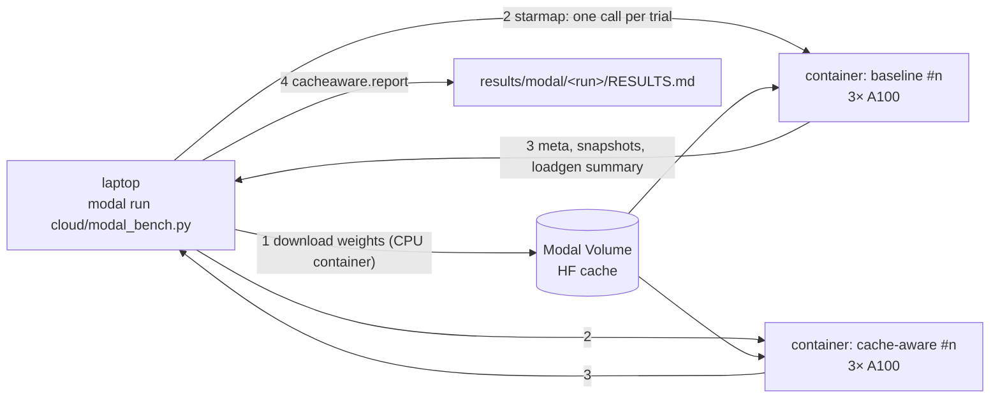

```bash
uv tool install modal && modal setup            # once
modal run cloud/modal_bench.py                  # smoke: 1 trial per mode, 60 s warm + 60 s measure
modal run cloud/modal_bench.py --trials 3 --warm 120 --measure 120   # the repo's default benchmark
```

Results land in `results/modal/<timestamp>/bench/<mode>/trial_<n>/` in exactly the layout stage 5 writes, plus two files stage 5 does not have: `cost_timeline.json` (every pod's hit rate, KV usage and cost every 5 s, the data behind the Grafana cost panel) and `router_stats.json`. `cacheaware.report` then builds `RESULTS.md` unchanged.

**Why one call per trial.** A fresh container is the cleanest possible "fresh pods": same age, empty caches, nothing left over. `starmap` also runs both arms at the same time, so the wall-clock time is one trial's, while the GPU-seconds (the bill) are the same as running them in sequence.

**Why weights download on a CPU container first.** The 15 GB of weights go into a Modal Volume once, from a container with no GPU. Otherwise three A100s would sit idle (and bill) during the download, and three vLLM processes would race to write the same cache.

**What it does not cover.** No Kubernetes means no annotation is actually written and no ReplicaSet actually chooses: the Modal run measures the *effect* of removing the cold replica versus an arbitrary one, which is the claim the benchmark makes. Stage 2 (and CI) remain the proof that Kubernetes honours the annotation; stage 4 on a real cluster remains the proof that it does so with real vLLM. Grafana and Loki need a cluster too, so on Modal the equivalent views are the Modal app page (per-container logs and GPU usage) and `cost_timeline.json`.

#### What the first Modal runs taught us

The first real executions surfaced exactly the kind of "one or two environment details" the honest-status note below predicts. Three are worth remembering:

1. **vLLM needs `nvcc` at runtime.** On a `debian_slim` image vLLM 0.32 loaded the weights, captured CUDA graphs, then died with `Could not find nvcc and default cuda_home='/usr/local/cuda' doesn't exist`: it JIT-compiles kernels during engine warm-up. The fix is a CUDA *devel* base image (`nvidia/cuda:13.0.3-devel-ubuntu24.04`, matching the cu130 torch wheel) plus `ninja`. The driver was never the problem (Modal's was CUDA 13.3); checking it first on one GPU, not three, kept the diagnosis cheap.
2. **A fourth metric spelling.** vLLM 0.32 exposes the prefix-cache counters with the standard Prometheus suffix: `vllm:prefix_cache_queries_total` and `vllm:prefix_cache_hits_total` (with `*_created` gauges beside them). This is the `No prefix-cache metric found` row of the table above, and the fix is the one it prescribes: the names were added to `NAME_CANDIDATES` in `vllm_metrics.py`, newest first, with a unit test built from the real page. The `vLLM metric names` line the Modal run prints at startup is stage 3's metric discovery, done automatically.
3. **Read the root cause, not the last traceback.** vLLM prints the real error well before the final `Engine core initialization failed`; the last 40 lines of its log were all traceback. Startup failures now report the `ERROR` lines first.

A smaller surprise: asking Modal for `A100-40GB` landed on an 80 GB card. Modal may upgrade a request; the benchmark is unaffected (an 8B model needs about 16 GB), but write down the GPU you actually got.

**Cost.** Modal bills per second and a trial's container exits when the trial ends, so idle time costs nothing. Roughly (A100 at about $2/GPU-hour, check the current price): the smoke test is a few dollars, the 3-trials-per-mode benchmark about $5–8, against $15–25 for the full four-hour GPU day on a rented 3×A100 VM.

#### The first result: the pipeline works, the default workload shows nothing

The first successful smoke test (1 trial per mode, 60 s warm-up, 60 s measurement, 4 requests/s, 16 prefix groups, Qwen2.5-7B-Instruct, vLLM 0.32.0) ran end to end with zero request errors, and the cache-aware arm removed the rank-1 pod as designed. It also showed no effect, and the reason is more useful than a number would have been:

| | default | cache-aware |
|---|--:|--:|
| costs at scale-in | 666 / 663 / 677 | 666 / 663 / 677 |
| removed | rank 2 | rank 1 |
| TTFT p50, first 30 s after scale-in | 41 ms | 43 ms |
| survivor prefix-cache hit rate | 94.6 % | 94.6 % |

- **Hit rate saturates on every replica.** The rate is measured in tokens. Each request is about 1,800 tokens of shared prefix plus a few unique ones, so once a replica has seen a prefix, nearly every later token for it is a hit. All three replicas converged to about 95 % within 45 s. The router *did* create skew, but in volume (235 vs 185 vs 69 requests per replica in the baseline trial), and volume is not in the score.
- **KV usage reads about 0.** Requests finish in about 50 ms and vLLM counts cached-but-idle blocks as free, so the 0.3 weight on usage contributed nothing on an 80 GB card under this load.
- **Losing a cache is cheap here.** Re-prefilling an 1,800-token prefix on an A100 costs a few tens of milliseconds, once per moved prefix group. TTFT after scale-in stayed at about 41 ms in both arms.

This is why stage 4 makes hot, warm and cold pods on purpose (`warm_skewed.sh`, with a cold pod that sees only unique prompts): stage 5's default traffic, sent through a prefix-affinity router, does not create hit-rate differences on its own. Two directions follow. Make the cold replica genuinely cold and the cache genuinely expensive (stage 4's skewed warm-up, longer prefixes, a smaller KV budget), or score what the router actually differentiates: cache *hits per second* rather than hit *rate* (see Limitations).

### Honest status of this layer

The cloud runner, the bootstrap and the workflows could not be executed where the project was written: there was no GPU and no cloud account. Every script passes a syntax check, every manifest parses, the pinned image tags were verified to exist, and the unit tests cover the router. The first real run will most likely surface one or two environment details. Run it with `KEEP_INSTANCE=1` the first time so the machine stays up to be fixed in place.

### What to remember

- One file of credentials and one command: provision, bootstrap, run the day, fetch results, destroy.
- The provider contract is three shell functions; any SSH-reachable GPU machine works.
- CI re-proves the controller on a real Kubernetes without a GPU on every push; the GPU workflow runs the day from secrets.
- The by-hand runbook is the same sequence `run_day.sh` executes, with the pass condition for each step.
- Without a Kubernetes node, `cloud/modal_bench.py` runs stage 5 on Modal: one 3-GPU container per trial, the repo's router and scoring in-process, scale-in as ring removal plus SIGTERM. Use a CUDA devel image, and expect metric names to drift.


## Part VI · Chapter 2: The GPU day, as a story

This chapter tells the day once through, with what you see at each step and what you decide. Terminal excerpts are illustrative: the shape is exact, the numbers are what a typical successful run looks like.

### 09:00 · The machine

You have an Ubuntu box with three A100s and SSH. Either `cloud/run_remote.sh` did everything below for you and you are reading its log, or you are doing it by hand. By hand, you open `tmux` with four panes: one to run things, one for `kubectl get pods -n vllm -w`, one for the dashboard, one for the Grafana port-forwards. On your laptop:

```bash
ssh -L 8080:127.0.0.1:8080 -L 3000:127.0.0.1:3000 user@gpu-box
```

Then, on the box:

```bash
sudo cloud/bootstrap.sh          # only on a fresh machine; 3-6 minutes
export KUBECONFIG=/etc/rancher/k3s/k3s.yaml HF_TOKEN=hf_...
stage6_final/preflight.sh
```

```
[PASS] kubectl installed
[PASS] cluster reachable
[PASS] python3 >= 3.10
[PASS] python kubernetes client
[PASS] a node advertises nvidia.com/gpu
[FAIL] deployment vllm exists
[FAIL] pods matching 'app=vllm' are ready
[PASS] stage 5 will use the built-in prefix-affinity router (no llm-d gateway given)
[FAIL] NO-GO: 2 problem(s) above
```

The two failures are expected before stage 3 has run; they are the next step, not a problem. Decision: proceed.

### 09:10 · One real vLLM (stage 3)

```bash
stage3_vllm_single/setup.sh
```

The first start downloads about 16 GB of weights into `/var/lib/hf-cache`; the `kubectl get pods -w` pane shows the pod in `ContainerCreating`, then `Running` but not Ready, for five to twenty minutes depending on the network. The script waits for it. Then:

```bash
stage3_vllm_single/discover_metrics.sh
```

```
== vllm-6f7d9c8b4-x2k9p
-- vLLM version:
{"version": "0.11.0"}
-- what the controller reads:
  kv_usage        vllm:kv_cache_usage_perc                   0.0012
  prefix_queries  vllm:prefix_cache_queries                  0
  prefix_hits     vllm:prefix_cache_hits                     0
  ...
```

This is the moment the metric-name question is settled. If a line said `-- not found --` for both `prefix_hits` and `hit_rate_gauge`, you would stop here and add the new name to `NAME_CANDIDATES`; it has not happened in any version so far. Then:

```bash
stage3_vllm_single/eval.sh
```

```
model=meta-llama/Meta-Llama-3-8B-Instruct groups=2 zipf=1.0 prefix_words=1200
  prefix-cache lookups during the run: 65,920 tokens, hits: 59,904 tokens, hit rate 0.909
  PASS: prefix caching works
```

Forty requests over two prefixes; nine tokens in ten came from cache. The load generator also prints its TTFT summary: the first request of each prefix around 170 ms, the rest around 20 ms. Decision: the foundation holds; proceed.

### 09:40 · Three replicas and the scale-in test (stage 4)

```bash
stage4_scale_in_real/setup.sh
stage4_scale_in_real/eval.sh
```

Each trial begins with a restart of all three pods (a minute or two, weights already on disk), then the three warm-ups run in parallel through port-forwards. The pod table appears:

```
  POD                                 READY  COST   HIT    USAGE
  vllm-6f7d9c8b4-abc12                True   694    0.91   0.38
  vllm-6f7d9c8b4-def34                True   412    0.49   0.21
  vllm-6f7d9c8b4-ghi56                True    61    0.02   0.14
[10:02:40] lowest cost -> Kubernetes should remove: vllm-6f7d9c8b4-ghi56
[10:02:40] scaled vllm to 2 replica(s)
[10:03:12] Kubernetes removed: vllm-6f7d9c8b4-ghi56 (cost rank 1 of 3, 1 = lowest)
[PASS] removed the COLD pod
```

Three trials, the cold pod rotating, three passes. Then three baseline trials with the controller off; two of the three remove a warm or hot pod, one happens to remove the cold one. The summary:

```
  cache-aware  coldest pod removed in 3/3 trials
  baseline     coldest pod removed in 1/3 trials
  PASS: cache-aware scale-in removed the coldest replica every time
```

Goal 1 is done, and `results/scale_in_trials.csv` has the six rows. Decision: proceed to the benchmark. If a cache-aware trial had failed with the right pod table (the lowest-cost pod clearly marked, but another removed), you would check `kubectl version`, raise `SETTLE`, and rerun that trial before anything else.

### 10:15 · The benchmark (stage 5)

In the dashboard pane:

```bash
stage5_benchmark/dashboard.sh
```

and in the main pane:

```bash
stage5_benchmark/eval.sh
```

The script starts the metrics sampler and, because no `GATEWAY_URL` is set, the built-in router on port 8081. Trial 1, baseline: pods restart, the load generator starts at four requests per second, and on the dashboard at `http://localhost:8080` the three hit-rate lines climb from zero over the two-minute warm-up: one towards 0.9, one towards 0.5, one staying low, because the router keeps each prefix on one pod and the popular prefixes are few. The phase chip reads *warming*, then *measuring*; the "last scale-in" card shows which pod went and its rank. In Grafana at `http://localhost:3000/d/cache-aware-scale-in`, a red line marks the scale-in on every panel.

What you watch for: in a baseline trial where the hot pod was removed, the survivors' hit-rate lines dip right after the red line and recover over the next minute, and the TTFT panel spikes. In a cache-aware trial, nothing visible happens at the red line. That picture *is* the result, before any table.

Six trials take about fifty minutes. The trials table at the bottom of the dashboard fills in one row at a time. At the end:

```
| metric                                  | default scale-in | cache-aware    | change  |
| TTFT p90, first 30 s after scale-in     | 312 ms ± 95 ms   | 118 ms ± 11 ms | -62.2%  |
| TTFT p90, whole measure window          | 184 ms ± 40 ms   | 109 ms ± 8 ms  | -40.8%  |
| prefix-cache hit rate on survivors      | 46.3%            | 66.1%          | +42.8%  |
| coldest pod removed                     | 1/3 trials       | 3/3 trials     |         |

  6 trials checked
  PASS: benchmark data is usable
```

The large standard deviation on the baseline is the one trial that happened to remove the cold pod; the per-trial table shows it. Decision: the numbers are quotable. Commit `results/`.

### 11:20 · If something had gone wrong instead

- The load generator printing `status=0` errors: the router or gateway is not reachable from where the script runs; `curl $GATEWAY_URL/v1/models` tells you in one line.
- Both arms identical in every trial: look at the warm-up hit rates on the dashboard. If all three lines are similar, the traffic is not skewed enough or the router is not sticky; lower `GROUPS` to 8 and rerun one pair of trials.
- A cache-aware trial with rank 2 or 3: the annotation was not on the pod when the scale happened. `SETTLE=60`.

### 11:30 · The N-body benchmarks (Part VII)

```bash
kubectl scale deploy -n vllm vllm --replicas=0
stage6_final/nbody_a100.sh
```

The script refuses to start while vLLM still holds the GPU, which is why the first line exists. Then about an hour of output: CPU scaling, Barnes–Hut crossover, GPU scaling for naive and tiled kernels, the block-size sweep, energy conservation, Nsight Compute counters, and finally the regenerated README with the GPU rows filled in. It ends with the commit on a results branch and the push command.

### 12:45 · Handing the GPU back

Commit this repository's `results/`, push the N-body branch, copy the "Numbers for the resume bullet" block from `results/RESULTS.md`, and stop the machine. Everything else can be done from a laptop.

### What to remember

- Three decision points: metric names found (stage 3), coldest pod removed 3/3 (stage 4), benchmark data usable (stage 5). Each has a one-line pass condition.
- The dashboard hit-rate lines at the red scale-in marker show the result before any table does.
- A baseline trial that removes the cold pod is expected and shows up as a wide standard deviation.
- Scale vLLM to zero before the N-body run.


## Part VII · The N-body side project

The GPU day has a second job. A separate repository, `colmeabhi/parallelized-nbody-simulation-cuda-cpp`, is a complete gravitational N-body simulation with CPU and CUDA solvers, and its README has a results table whose GPU rows say "not measured yet". The same rented A100 fills them in, so the runbook includes it.

### What an N-body simulation is

N bodies (stars, say) attract each other by gravity. At every time step, the force on each body is the sum of the pulls from every other body, so computing all forces directly costs N × N interactions: 4,096 bodies is 16 million interactions per step, 65,536 bodies is 4.3 billion. The positions and velocities are then advanced by a small time step and the process repeats. The project simulates a Milky Way-like galaxy: a central black hole, a rotating disk and a bulge.

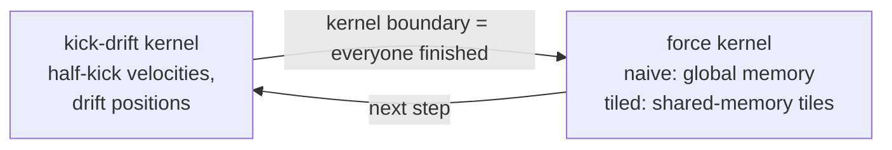

Two CUDA kernels compute the forces. The **naive** kernel has each thread read every other body's position from the GPU's main memory. The **tiled** kernel first copies a tile of bodies into the fast shared memory of each thread block, lets all threads in the block use it, then moves to the next tile; the same arithmetic with far fewer slow memory reads. Comparing the two is the classic demonstration of why GPU memory hierarchy matters. The CPU side has a single-thread solver, an OpenMP multi-thread solver, and a Barnes–Hut tree solver that approximates distant groups of bodies as one and brings the cost down to N log N.

The integrator is a **kick-drift-kick leapfrog**, which conserves energy far better than the simple scheme it replaced; the energy drift over a run is one of the measured quantities, so a fast kernel that produces nonsense would be caught.

### What the pipeline produces

The N-body repository already has the whole measurement pipeline; the runbook only drives it:

| script | produces |
|---|---|
| `scripts/run_benchmarks.sh` | `cpu_scaling.csv`, `gpu_scaling.csv` (naive vs tiled at 1K to 64K bodies), `gpu_block_sweep.csv` (thread-block sizes 64 to 512), energy-drift logs for both integrators |
| `scripts/profile_ncu.sh` | `ncu_metrics.csv`: Nsight Compute counters for the naive and tiled kernels (compute and memory throughput, cache hit rates, occupancy, stall reasons) |
| `scripts/make_report.py` | charts and the results section of the README, regenerated from the CSV files |

`stage6_final/nbody_a100.sh` in this repository refuses to start while anything else is using the GPU (so vLLM must be scaled to zero first), sets the CUDA architecture from `nvidia-smi` (an A100 is `sm_80`), runs all three scripts, and leaves a commit on a `results/a100-<date>` branch ready to push. It reruns the CPU benchmarks as well as the GPU ones, because the speed-up column compares the GPU against a single CPU thread *on the same machine*; the existing CPU rows came from a different, 4-thread machine.

About an hour, most of it the CPU runs at the largest sizes.

### What to remember

- Direct N-body is N² work per step; the tiled CUDA kernel is the textbook shared-memory optimisation over the naive one.
- The repository's own scripts measure scaling, block sizes, Nsight counters and energy conservation; the runbook only drives them and commits the results.
- The GPU must be free: scale vLLM to zero before starting.


## Limitations, caveats and what comes next

A project is only as credible as its stated limits. These are the ones that matter.

### What has and has not been executed

- Stages 1 and the local rehearsal of the stage 5 pipeline (load generator, sampler, report, dashboard) were executed on fake pods and pass; 39 unit tests pass.
- Stages 2 to 6, the monitoring stack and the cloud layer were written and checked (syntax, manifest parsing, image tags) but not executed, because the writing environment had no cluster and no GPU. Stage 2 and the monitoring eval will be executed by CI on the first push; stages 3 to 6 execute on the GPU day.
- The vLLM metric names and the inference-perf config schema were written from knowledge, not verified against the versions you will install. Both have cheap fallbacks: a one-line addition to the name list, and the built-in load generator. The first fallback has now been used: vLLM 0.32.0 spells the counters `prefix_cache_*_total`, found on the first Modal run and added with a test (Part VI).
- The stage 5 benchmark has run on real GPUs through the Modal path (`cloud/modal_bench.py`: three vLLM replicas on three A100s, the repo's router, scoring and load generator, scale-in emulated without Kubernetes). The smoke test ran cleanly and showed no difference between the arms, for reasons described in Part VI and below.

### Limits of the idea

- **Staleness.** A cost is at most five seconds old. A sudden traffic shift between the last scrape and the scale-in can beat it.
- **Best effort.** `pod-deletion-cost` is documented as best effort. The experiments verify it empirically, but Kubernetes does not promise it under every race.
- **Node spreading.** Cost ordering comes *before* the rule that spreads pods across nodes. On a multi-node cluster the controller could therefore concentrate replicas on one node. A cap on the cost gap when it would break spreading is a natural guard.
- **One ReplicaSet.** The annotation only orders pods within one ReplicaSet. llm-d's disaggregated layouts use other controllers, where the mechanism differs.
- **Weights are a judgment.** 0.7 and 0.3 were chosen, not fitted. A sweep is the obvious next experiment and the harness supports it with environment variables.

### Limits of the measurement

- Three trials per arm is a small sample; the per-trial table matters more than the mean.
- The effect size depends on how skewed the traffic is and on how prefix-aware the router is. The benchmark reports the conditions; a reader should not generalise beyond them.
- **Stage 5's default traffic does not make caches unequal.** Measured on Modal: with 16 Zipf-weighted prefix groups behind the prefix-affinity router, all three replicas converged to a ~95 % token hit rate within 45 s (costs 663 / 666 / 677), and KV usage read ~0 because idle cached blocks count as free. The router skewed *volume* (235 vs 69 requests per replica), which the score does not see. A benchmark that wants an effect must create a genuinely cold replica (stage 4's skewed warm-up) and make lost caches expensive (longer prefixes, a smaller KV budget).
- One scale-in event, three to two pods. Larger fleets lose less per event.

### What comes next, in order of value

1. **Sensitivity sweep.** Run the benchmark at several `ZIPF` values and at hit-rate-only weights. A chart of "benefit versus traffic skew" is more credible than one number and preempts the obvious question.
2. **Cached tokens per second as the score.** `Δhits ÷ Δtime` measures prefill actually avoided per second, which is closer to what should be protected than a hit *rate*: a pod at 70 % on one request per second protects less than a pod at 55 % on ten. One line in `scoring.py`; the stage 2 and 4 harness can compare the two rules head to head. The first Modal run is direct evidence for this: hit rates saturated at ~95 % on every replica while request volume differed by more than 3×.
3. **Pre-drain hint to the router.** Tell the router to stop assigning new prefixes to the lowest-cost pod a minute before a planned scale-in, so even less is lost. Turns a controller into a system.
4. **Node-spread guard** as described above.
5. **A monitoring-off control pair** in the benchmark, so the "it does not disturb the measurement" argument becomes a measured row.
6. **Production shape.** Liveness and readiness probes on the controller pod, two alert rules (scrape errors rising, a pod without a cost for over a minute), a watch-based pod list instead of polling, an image published from CI.


## Questions people ask

**Why not just share the KV cache between pods so nothing is lost?**
Sharing GPU memory across machines needs a fast interconnect and a transfer layer (llm-d is working on exactly this with KV-cache offload and transfer). It is heavier, newer, and solves a different problem: moving cache. This project solves the cheaper one: not throwing away the best cache when you did not need to. The two compose.

**Why not let the router handle it?**
The router decides where new requests go; it is not consulted when Kubernetes deletes a pod. Until the deletion happens, the router has no reason to move anything, and after it happens, the cache is gone. A pre-drain hint from the controller to the router is the natural extension (Limitations chapter).

**Why not use an autoscaler like the HPA or KEDA?**
Autoscalers decide *how many* replicas to run, not *which* ones to remove. `pod-deletion-cost` is the knob Kubernetes provides for the second question, and it works underneath any autoscaler.

**Why not delete the pod from the controller directly?**
It would race the ReplicaSet controller, which is also deleting pods to reach the new replica count, and both might delete one each. Ranking and letting Kubernetes delete is race-free and needs no delete permission.

**Why hit rate and usage, and not the number of requests in flight?**
In-flight requests are protected by the termination grace period: a deleted pod gets 30 seconds to finish them. The cache is the thing nothing protects.

**Why a dead band of 25 and not write every cycle?**
The ranking only has to be ordered correctly. Kubernetes documentation asks for this annotation not to be updated on every metric tick, because each update is an API-server write. The dead band keeps writes rare without changing the order.

**Why five seconds?**
Fast enough that a cost is never more than one cache warm-up old; slow enough that three pods cost nothing to poll. On a fleet of hundreds you would use a watch and Prometheus; the parsing and scoring would not change.

**Why not read the annotations in Grafana instead of adding metrics to the controller?**
kube-state-metrics does not expose arbitrary annotations, and reading them would need another exporter anyway. The controller already has the numbers; publishing them is 80 lines.

**Does the controller work with llm-d?**
Yes, provided llm-d's decode pods are an ordinary Deployment. Point `NAMESPACE`, `SELECTOR` and `DEPLOYMENT` at them. The controller never talks to the gateway. llm-d's disaggregated layouts use other controllers, where the annotation does not apply.

**What if the three pods are on different nodes?**
Cost ordering comes before the node-spreading rule, so the controller could leave two pods on one node and none on another. A guard that caps the cost gap when it would break spreading is listed as future work.

**Why restart the pods before every benchmark trial?**
So they have the same age. Kubernetes' default tie-break prefers the most recently ready pod, which after a scale-out is also the coldest; without the restart the baseline would look smart by accident.

**Why is the baseline sometimes as good as the controller?**
Because with three pods, a blind choice is right one time in three. Over several trials the averages separate; the per-trial table shows which trial it was.

**Why fake pods at all?**
Because the only part that needs a GPU is the GPU. The parsing, scoring, annotation writing, the ReplicaSet's behaviour, the load generator, the report and the dashboard all run against a 180-line fake in seconds, so bugs are found on a laptop and the rented hours are spent measuring.

**Does monitoring slow the benchmark down?**
No. Prometheus does one small HTTP GET per pod every 15 seconds, the sampler one every 2 seconds; rendering the page is text formatting in the server's front end. Everything runs in both arms and cancels. The only mechanism that could matter is host CPU on a small machine; `kubectl top pods` answers that.

**Why both inference-perf and your own load generator?**
inference-perf is the standard tool and belongs on the resume; its config schema has moved between releases and could not be verified in advance. The built-in generator implements the same protocol so a mismatch costs minutes, not the day.

**What does the resume bullet say at the end?**
Built a Kubernetes controller that scores each vLLM replica's KV-cache value from its prefix-cache metrics and sets `pod-deletion-cost` so scale-in removes the coldest replica; on Llama 3 8B across 3 A100 replicas, cut post-scale-in TTFT p90 from X ms to Y ms and raised the surviving replicas' prefix-cache hit rate from A % to B % over N trials; verified the coldest replica was removed in N/N scale-downs. The letters are filled from `results/RESULTS.md`.


## Glossary

| term | plain meaning |
|---|---|
| A100 | an NVIDIA data-centre GPU with 40 or 80 GB of memory; the project uses three |
| Alloy | Grafana's log collector; reads pod logs through the Kubernetes API and pushes them to Loki |
| annotation | a key-value note on a Kubernetes object, not used for selection; `pod-deletion-cost` is one |
| API server | the front door of Kubernetes; stores desired state and answers `kubectl` |
| baseline | the comparison arm of the benchmark: controller stopped and annotations removed, so Kubernetes chooses alone |
| cache value | the controller's 0..1 score for a pod: 0.7 × recent hit rate + 0.3 × KV usage |
| consistent hashing | placing servers and keys on a ring so that removing a server moves only its own keys |
| container | a program packaged with everything it needs, running from an image |
| continuous batching | mixing prefill and decode steps of many requests in each GPU step so the GPU never idles |
| controller | a loop that observes state and writes a change back; here, the program that scores pods and writes costs |
| CUDA | NVIDIA's programming model for running code on GPUs |
| dead band | the minimum change (25) in cost before the controller rewrites the annotation |
| decode | the phase that produces an answer one token at a time |
| deletion cost | `controller.kubernetes.io/pod-deletion-cost`; lower is deleted first on scale-in |
| Deployment | a Kubernetes object that keeps N identical pods running through a ReplicaSet |
| device plugin | the NVIDIA component that lets a node advertise GPUs to Kubernetes |
| EWMA | exponentially weighted moving average; smoothing where each new reading gets weight α (0.3) and the old estimate 1 − α |
| gateway | the proxy in front of the vLLM pods that chooses which pod serves each request |
| hit rate | prefix-cache hits ÷ queries, in tokens, over some window |
| inference-perf | the Kubernetes community's load-testing tool for inference servers |
| k3s | a small single-binary Kubernetes distribution |
| kind | "Kubernetes in Docker": a laptop cluster for testing |
| kubectl | the Kubernetes command-line tool |
| KV cache | the stored attention keys and values of every token, kept on the GPU during generation |
| label / selector | a key-value tag used to pick sets of pods, and the expression that picks them (`app=vllm`) |
| llm-d | an open-source platform for serving vLLM at scale on Kubernetes, with a prefix-aware gateway |
| Loki | Grafana's log store, queried with LogQL |
| namespace | a named partition of Kubernetes objects (`vllm`, `monitoring`) |
| node | one machine in a Kubernetes cluster |
| PagedAttention | vLLM's technique of storing the KV cache in fixed-size shareable blocks |
| pod | the smallest unit Kubernetes runs; here one vLLM server with one GPU |
| port-forward | a `kubectl` tunnel from your machine straight to one pod, bypassing routers |
| prefill | the phase that reads the whole prompt and computes its keys and values; dominates TTFT |
| prefix caching | reusing the KV entries of a shared prompt beginning instead of recomputing them |
| prefix group | in the load generator, one long deterministic system prompt that many requests share |
| Prometheus | the metrics database that scrapes `/metrics` pages on a schedule; queried with PromQL |
| readiness probe | a URL Kubernetes polls to decide whether a pod may receive traffic |
| ReplicaSet | the Kubernetes controller that keeps exactly N pods and chooses which to delete on scale-in |
| RuntimeClass | a Kubernetes setting that selects a container runtime, here the NVIDIA one |
| sampler | the one process in stage 5 that scrapes pod metrics for the file-based dashboard |
| scale-in / scale-out | lowering / raising a Deployment's replica count |
| scrape | fetching a `/metrics` page |
| server-sent events | the streaming format (`data: ...` lines) vLLM uses to send tokens as they are produced |
| system prompt | the fixed instructions at the start of every prompt of an application; the typical shared prefix |
| token | the unit a model reads and writes; about three quarters of an English word |
| TTFT | time to first token: how long a user waits for the first word of the answer |
| vLLM | the open-source inference server used in the project |
| Zipf distribution | a popularity curve where the k-th most popular item has share proportional to 1/k; models skewed real traffic |


## References and further reading

URLs are given as known at the time of writing; the pages were not re-fetched while writing this book, so check a link before quoting it in a paper.

### Papers

1. Vaswani et al., *Attention Is All You Need* (2017). The transformer and the attention mechanism whose keys and values the KV cache stores. https://arxiv.org/abs/1706.03762
2. Kwon et al., *Efficient Memory Management for Large Language Model Serving with PagedAttention* (SOSP 2023). The vLLM paper: block-based KV cache, sharing, continuous batching. https://arxiv.org/abs/2309.06180
3. Zheng et al., *SGLang: Efficient Execution of Structured Language Model Programs* (2023). RadixAttention, the other well-known prefix-caching design. https://arxiv.org/abs/2312.07104
4. Grattafiori et al., *The Llama 3 Herd of Models* (2024). Architecture details (layers, heads) used for the KV-cache arithmetic in Part I. https://arxiv.org/abs/2407.21783
5. Karger et al., *Consistent Hashing and Random Trees* (STOC 1997). The ring used by the built-in router. https://dl.acm.org/doi/10.1145/258533.258660
6. Breslau et al., *Web Caching and Zipf-like Distributions: Evidence and Implications* (INFOCOM 1999). Why request popularity is modelled as Zipf. https://ieeexplore.ieee.org/document/749260
7. Nyland, Harris, Prins, *Fast N-Body Simulation with CUDA*, GPU Gems 3, chapter 31 (2007). The tiled kernel in Part VII. https://developer.nvidia.com/gpugems/gpugems3/part-v-physics-simulation/chapter-31-fast-n-body-simulation-cuda
8. Barnes and Hut, *A hierarchical O(N log N) force-calculation algorithm*, Nature 324 (1986). https://www.nature.com/articles/324446a0

### Kubernetes

9. ReplicaSet: pod deletion cost. The annotation, its semantics, and the warning against frequent updates. https://kubernetes.io/docs/concepts/workloads/controllers/replicaset/#pod-deletion-cost
10. KEP-2255, Pod Cost. The design proposal behind the annotation. https://github.com/kubernetes/enhancements/tree/master/keps/sig-apps/2255-pod-cost
11. Deployments. https://kubernetes.io/docs/concepts/workloads/controllers/deployment/
12. Using RBAC authorization. https://kubernetes.io/docs/reference/access-authn-authz/rbac/
13. k3s documentation, including NVIDIA container runtime support. https://docs.k3s.io/ and https://docs.k3s.io/advanced#nvidia-container-runtime-support
14. kind (Kubernetes in Docker). https://kind.sigs.k8s.io/
15. NVIDIA device plugin for Kubernetes. https://github.com/NVIDIA/k8s-device-plugin
16. NVIDIA container toolkit installation guide. https://docs.nvidia.com/datacenter/cloud-native/container-toolkit/latest/install-guide.html

### Serving and routing

17. vLLM documentation. https://docs.vllm.ai/
18. vLLM: automatic prefix caching. https://docs.vllm.ai/en/latest/features/automatic_prefix_caching.html
19. vLLM: metrics design. https://docs.vllm.ai/en/latest/design/metrics.html
20. vLLM source. https://github.com/vllm-project/vllm
21. llm-d. https://llm-d.ai/ and https://github.com/llm-d/llm-d
22. Kubernetes Gateway API Inference Extension (the endpoint-picker model llm-d builds on). https://gateway-api-inference-extension.sigs.k8s.io/
23. inference-perf. https://github.com/kubernetes-sigs/inference-perf
24. OpenAI completions API reference (the request and streaming format vLLM mirrors). https://platform.openai.com/docs/api-reference/completions
25. Server-sent events, WHATWG HTML standard. https://html.spec.whatwg.org/multipage/server-sent-events.html
26. Meta Llama 3 8B Instruct on Hugging Face (gated; needs a token). https://huggingface.co/meta-llama/Meta-Llama-3-8B-Instruct

### Observability

27. Prometheus overview and PromQL basics. https://prometheus.io/docs/introduction/overview/ and https://prometheus.io/docs/prometheus/latest/querying/basics/
28. Prometheus exposition format (the `/metrics` text format). https://prometheus.io/docs/instrumenting/exposition_formats/
29. Grafana Loki. https://grafana.com/docs/loki/latest/
30. Grafana Alloy. https://grafana.com/docs/alloy/latest/
31. Grafana provisioning (data sources and dashboards from files). https://grafana.com/docs/grafana/latest/administration/provisioning/
32. NVIDIA Nsight Compute. https://docs.nvidia.com/nsight-compute/

### Background mathematics

33. Exponential smoothing (EWMA). https://en.wikipedia.org/wiki/Exponential_smoothing
34. Zipf's law. https://en.wikipedia.org/wiki/Zipf%27s_law

### This project

35. The repository: https://github.com/colmeabhi/cache-aware-scale-in — `guide.md` (design decisions, runbook, troubleshooting), `PLAN.md`, per-stage READMEs, `monitoring/README.md`, `cloud/README.md`.
36. The N-body repository: https://github.com/colmeabhi/parallelized-nbody-simulation-cuda-cpp


## Appendix: cheat sheet

### Commands by stage

```bash
# stage 1 — laptop
make test                              # all unit tests + the 3-fake-pod scenario
stage1_local_prototype/run.sh          # watch the controller think (dry-run)

# stage 2 — any cluster (kind is created if none is reachable)
stage2_mock_cluster/setup.sh
stage2_mock_cluster/run_controller.sh  # terminal 1
stage2_mock_cluster/eval.sh            # terminal 2: 3 cache-aware + 3 baseline trials

# stage 3 — one GPU
export KUBECONFIG=/etc/rancher/k3s/k3s.yaml HF_TOKEN=hf_...
stage3_vllm_single/setup.sh
stage3_vllm_single/discover_metrics.sh
stage3_vllm_single/eval.sh

# stage 4 — three GPUs
stage4_scale_in_real/setup.sh
stage4_scale_in_real/eval.sh

# stage 5 — benchmark (GATEWAY_URL, or leave unset for the built-in router)
stage5_benchmark/dashboard.sh &        # http://127.0.0.1:8080, tunnel it with ssh -L
stage5_benchmark/eval.sh
python -m cacheaware.report --results results

# stage 6 — packaging and the whole day
stage6_final/build_image.sh && export CONTROLLER_MODE=cluster
stage6_final/preflight.sh
stage6_final/run_day.sh                # PAUSE=0 to run straight through
stage6_final/nbody_a100.sh             # after: kubectl scale deploy vllm --replicas=0

# add-ons
make monitoring                        # Prometheus + Loki + Alloy + Grafana, then eval
monitoring/open.sh                     # port-forward 3000 / 9090 / 3100
cp cloud/.env.example cloud/.env && cloud/run_remote.sh   # hands-free day
```

### Environment variables

| variable | default | used by |
|---|---|---|
| `NAMESPACE` | `vllm` | every cluster script |
| `SELECTOR` | `app=vllm` | which pods are "the vLLM pods" (controller, scripts, Prometheus) |
| `DEPLOYMENT` | `vllm` | what gets scaled 3 → 2 |
| `METRICS_PORT` | `8000` | vLLM's HTTP port |
| `RESULTS_DIR` | `results/` | where everything lands |
| `CONTROLLER_MODE` | `local` | `cluster` to switch the in-cluster Deployment on/off instead |
| `GATEWAY_URL` | unset | the llm-d gateway; unset = built-in router on `127.0.0.1:8081` |
| `TRIALS` | `3` | benchmark trials per mode |
| `TOOL` | `loadgen` | `inference-perf` to use it |
| `RATE`, `WARM`, `MEASURE` | `4`, `120`, `120` | requests/s, warm seconds, measure seconds |
| `GROUPS`, `ZIPF` | `16`, `1.0` | prefix groups and popularity skew (loadgen) |
| `FRESH_PODS` | `1` | restart pods before each trial |
| `SETTLE` | `30` | seconds for the controller to re-score after a warm-up |
| `HF_TOKEN` | required | Llama 3 weights |
| `MODEL`, `VLLM_IMAGE` | Llama 3 8B Instruct, `vllm/vllm-openai:latest` | stage 3 manifest |
| `W_HIT`, `W_USAGE`, `W_INFLIGHT` | `0.7`, `0.3`, `0` | controller weights |
| `INTERVAL`, `MIN_DELTA`, `EWMA_ALPHA` | `5`, `25`, `0.3` | controller loop |
| `METRICS_LISTEN` | unset | `0.0.0.0:9108` to expose the controller's own metrics |
| `MONITORING`, `NBODY`, `PAUSE` | `1`, `1`, `1` | `run_day.sh` phases |
| `GPU_PROVIDER`, `GPU_SSH_HOST`, `GPU_SSH_USER`, `GPU_SSH_KEY`, `KEEP_INSTANCE` | `manual`, –, `ubuntu`, `~/.ssh/id_ed25519`, `0` | cloud runner |

### Where results land

| file | from | contents |
|---|---|---|
| `results/scale_in_trials.csv` | stages 2 and 4 | one row per trial: cold pod, costs, removed pod, rank, verdict |
| `results/metrics_discovery_*.txt` | stage 3 | the vLLM version and the metric names it exposes |
| `results/bench/<mode>/trial_<n>/` | stage 5 | `meta.json`, pre/post snapshots, load-tool output, `summary.json` |
| `results/RESULTS.md`, `results/ttft_after_scale_in.png` | report | the comparison tables and chart |
| `results/live/` | sampler and scripts | what the file-based dashboard reads |
| `results/controller.log`, `router.log`, `sampler.log` | scripts | process logs |
| `results/remote-<time>/` | cloud runner | a copy of all of the above from the GPU machine |

### Reading the code, in order

`cacheaware/scoring.py` → `cacheaware/controller.py` → `scripts/lib.sh` → `scripts/scale_in_trials.sh` → `stage5_benchmark/run_trial.sh` → `cacheaware/report.py` → `cacheaware/router.py`. About 1,200 lines in total.


