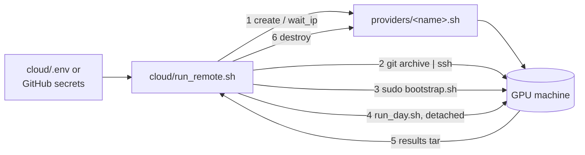

# Cloud add-on: paste credentials, get results

Everything in this folder exists so that the GPU day needs no typing on the
GPU machine. You give it an SSH-reachable Ubuntu box with NVIDIA drivers
(every GPU cloud offers one), and it installs k3s and the NVIDIA stack, runs
the whole `stage6_final/run_day.sh` unattended, copies the results back and
destroys the machine.



## No SSH box? Modal

`cloud/modal_bench.py` runs the stage 5 benchmark on Modal GPU containers
instead: one 3×A100 container per trial, three `vllm serve` processes, the
repo's router, scoring and load generator in-process, and scale-in emulated as
"remove from the ring, then SIGTERM". No Kubernetes, so it measures the effect
of the choice, not that Kubernetes honours the annotation (stages 2 and 4 do).

```bash
uv tool install modal && modal setup
modal run cloud/modal_bench.py                                       # smoke, ~10 min
modal run cloud/modal_bench.py --trials 3 --warm 120 --measure 120  # full
```

What the first runs found (devel image for `nvcc`, the `_total` metric names,
hit rates that saturate under stage 5's default traffic) is in the book,
Part VI, "Running it on Modal".

## Two ways to start it

**From a laptop**

```bash
cp cloud/.env.example cloud/.env     # fill in HF_TOKEN and the machine / provider details
cloud/run_remote.sh                  # 4-5 h; log streams to your terminal; results/remote-<time>/
```

**From GitHub Actions** (`.github/workflows/gpu-benchmark.yml`): add the
secrets below, open *Actions → GPU benchmark → Run workflow*, pick trials /
tool / N-body, and wait. Results are uploaded as a workflow artifact and
committed to a `results/run-<n>` branch.

| secret | used for |
|---|---|
| `HF_TOKEN` | Llama 3 weights (gated) |
| `GPU_SSH_PRIVATE_KEY` | logging into the machine; its public half must be on the machine or handed to the provider |
| `GPU_SSH_HOST` | provider `manual`: the machine's address |
| `GPU_PROVIDER_API_KEY` | other providers: their API key |

Variables (optional): `GPU_PROVIDER` (default `manual`), `GPU_SSH_USER`
(default `ubuntu`), `GPU_TYPE`, `GPU_REGION`.

## Providers

A provider is a 3-function shell file in `providers/`:

| function | does |
|---|---|
| `provider_create` | creates a machine with 3+ GPUs, injects your SSH public key, prints an id |
| `provider_wait_ip ID` | blocks until it has an address, prints it |
| `provider_destroy ID` | terminates it (always called on exit unless `KEEP_INSTANCE=1`) |

`manual.sh` is for a machine you already have. `template.sh` shows the shape
for a REST API; copy it to `<name>.sh`, fill in the real endpoints from the
provider's docs, and set `GPU_PROVIDER=<name>`.

**Coral Bricks.** Their site (coralbricks.ai) shows no API documentation and
describes itself as an inference provider. If your credits are for an
inference API rather than GPU virtual machines, they cannot host this
benchmark, which needs raw GPUs with Kubernetes. If they do offer VMs with
SSH, write `providers/coralbricks.sh` from their console or docs; if they
only offer a web console, create the machine there and use `GPU_PROVIDER=manual`.

## What bootstrap.sh does on the machine

1. `apt` basics; confirms `nvidia-smi` works.
2. NVIDIA container toolkit, installed **before** k3s so k3s registers the
   `nvidia` containerd runtime by itself (do not run `nvidia-ctk runtime
   configure` on k3s; it edits a config k3s does not use).
3. k3s (single node), kubeconfig world-readable.
4. `RuntimeClass nvidia` + the NVIDIA device plugin (`cloud/k8s/nvidia.yaml`);
   waits until the node advertises `nvidia.com/gpu`.
5. `pip install -r requirements.txt` (+ inference-perf if `TOOL=inference-perf`).
6. `/var/lib/hf-cache` for the model weights (downloaded once per machine).

Idempotent: rerunning skips what is already there.

## No llm-d on a fresh machine: the built-in router

llm-d is not installed by the bootstrap (its install is a project of its
own). Without a prefix-aware router every pod would cache every prefix and
the controller would have nothing to choose. So when `GATEWAY_URL` is empty,
stage 5 starts `cacheaware/router.py`: a 150-line consistent-hash router
that sends requests sharing the same system prompt to the same pod and
streams the response back. `run_day.sh` sets this up automatically. With
llm-d present, set `GATEWAY_URL` and the router is not started.

## Safety

- `cloud/.env` is git-ignored; CI reads the same values from secrets.
- The machine is destroyed on exit, including on failure, unless
  `KEEP_INSTANCE=1`. For `manual` nothing is destroyed; stop it yourself.
- The workflow has a 350-minute timeout, under GitHub's 6-hour job limit.

## Honest status

This layer could not be executed here (no GPU, no cloud account). Every
script passes `bash -n`, the manifests parse, and the device-plugin image
tag was checked. The first real run will most likely surface one or two
environment details (an apt prompt, a different driver path). Run it with
`KEEP_INSTANCE=1` the first time so you can ssh in and fix things in place.
