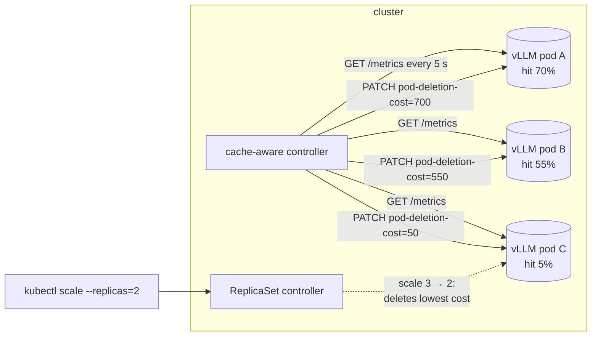
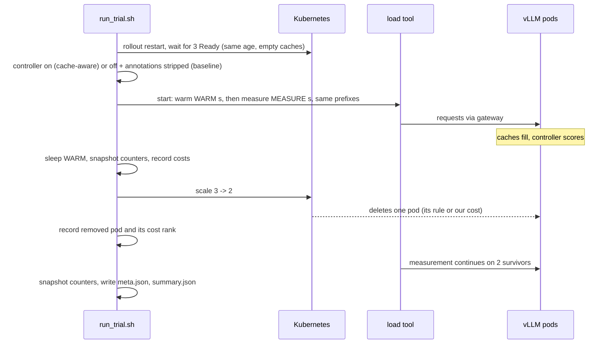
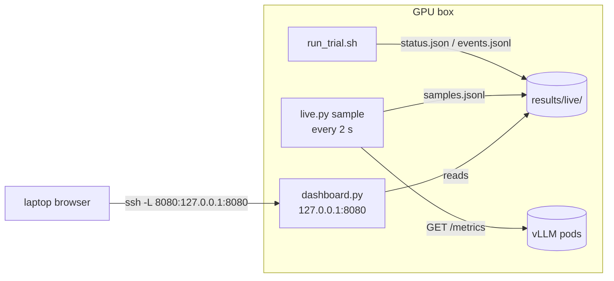

# Guide: cache-aware scale-in for vLLM on Kubernetes

1. [What this project is](#1-what-this-project-is)
2. [How to navigate the repository](#2-how-to-navigate-the-repository)
3. [The plan in one page](#3-the-plan-in-one-page)
4. [Architecture and the decisions behind it](#4-architecture-and-the-decisions-behind-it)
5. [The whole project explained for an undergrad](#5-the-whole-project-explained-for-an-undergrad)
6. [GPU-day runbook, step by step](#6-gpu-day-runbook-step-by-step)
7. [The live dashboard](#7-the-live-dashboard)
8. [Troubleshooting](#8-troubleshooting)
9. [What to send back, and how it becomes a resume bullet](#9-what-to-send-back-and-how-it-becomes-a-resume-bullet)

---

## 1. What this project is

When Kubernetes scales a vLLM Deployment from 3 replicas to 2, it has to
pick a pod to kill. Its default rule knows nothing about what is inside the
pods. Each vLLM pod holds a KV cache: the attention state of prompts it has
already processed, including shared system prompts and long chat histories.
If the pod with the most useful cache is the one that dies, the next requests
that would have hit that cache run a full prefill on another pod, and users
see a higher time to first token (TTFT).

The controller in this repository closes that gap:

1. every few seconds it reads each vLLM pod's `/metrics` page (KV-cache usage,
   prefix-cache lookups and hits);
2. it computes a cache-value score per pod;
3. it writes the score to the pod as the annotation
   `controller.kubernetes.io/pod-deletion-cost`;
4. on scale-down Kubernetes removes the pod with the lowest cost first, which
   is the coldest cache.



The repository is built as six stages so that every piece is proven before
the next one depends on it, and so that the expensive part (three A100s) is
only needed for stages 3 to 6.

---

## 2. How to navigate the repository

**Rule of thumb:** Python that is reused lives in `cacheaware/`; everything
that is specific to one stage lives in that stage's folder; everything that
runs against a cluster goes through `scripts/lib.sh`.

```
cacheaware/            the package. Read the module docstrings top to bottom:
                       vllm_metrics -> scoring -> fake_vllm -> kube -> controller
                       -> loadgen -> live -> dashboard -> report
scripts/lib.sh         every shell helper. Read this before any stage script.
scripts/scale_in_trials.sh   the scale-in experiment (used by stage 2 and 4)
stageN_*/README.md     goal, what is new, how to run, what pass looks like
stageN_*/eval.sh       the stage's evaluation; exit code 0 = pass
results/               everything produced; RESULTS.md is the final deliverable
```

Reading order for a new person: this guide section 5, then `cacheaware/scoring.py`,
then `cacheaware/controller.py`, then `scripts/scale_in_trials.sh`, then
`stage5_benchmark/run_trial.sh`. That is about 700 lines in total and covers
the whole idea.

Conventions:

- Every script starts with a comment block saying what it does and how to
  call it. `--help` works on every Python module.
- Settings are environment variables with defaults
  (`NAMESPACE=vllm SELECTOR=app=vllm DEPLOYMENT=vllm METRICS_PORT=8000`).
  Stage 5 needs `GATEWAY_URL`. If llm-d runs your vLLM pods, set the three
  first variables to llm-d's decode Deployment and its labels.
- `PASS` / `FAIL` lines are printed by evals; the exit code matches.
- Nothing deletes a pod directly. The only "destructive" action anywhere is
  `kubectl scale`, and the scripts always scale back to 3 afterwards.

---

## 3. The plan in one page

Full version with the time budget and risks: [PLAN.md](PLAN.md).

| phase | where | what you get |
|---|---|---|
| stage 1 | laptop | the scoring logic proven on fake pods, 21 unit tests |
| stage 2 | kind/k3d/k3s, no GPU | the real Kubernetes mechanism proven: scale-in removes the lowest-cost pod |
| stage 3 | 1 GPU | vLLM up, metric names known, prefix caching confirmed |
| stage 4 | 3 GPUs | **goal 1**: scale-in removes the coldest real replica, N of N trials |
| stage 5 | 3 GPUs + gateway | **goals 2-3**: TTFT and hit rate, default vs cache-aware, plus a live dashboard |
| stage 6 | 3 GPUs | controller in-cluster as an image, one-command day runner, N-body benchmarks |

---

## 4. Architecture and the decisions behind it

Each decision below says what was chosen, what the alternatives were, and
why. If you change one, the code to touch is named.

### 4.1 Which signal means "this cache is valuable"

**Decision.** Score = `0.7 × recent prefix-cache hit rate + 0.3 × KV-cache usage`,
both in 0..1. (`cacheaware/scoring.py`, `Weights`.)

**Alternatives considered.**
- *Lifetime hit rate* (hits / lookups since the pod started). Rejected: a pod
  that was hot an hour ago and idle since still looks hot. vLLM only exposes
  cumulative counters, so "recent" has to be computed by us from deltas.
- *KV usage alone.* Rejected: a full cache of prefixes nobody asks for again
  is worthless. Usage measures quantity, hit rate measures usefulness.
- *Requests in flight.* Available as a third weight (`W_INFLIGHT`, default 0).
  Graceful termination already lets in-flight requests finish, so it was left
  out of the default; it is there for people who want "busy" to count.

**How "recent" is computed.** Per pod we remember the last counter values;
each cycle we compute `Δhits / Δlookups` for the interval and smooth it with
an exponential moving average (`alpha = 0.3`, so roughly the last three to
four intervals matter). Intervals with fewer than 256 lookups teach us
nothing and are skipped. A counter going backwards means the pod restarted,
and the history starts over. (`PodHistory.update`.)

### 4.2 Score to cost

**Decision.** `cost = round(score × 1000)`, written only when it moved by at
least 25 since the last write (`MIN_DELTA`).

**Why a dead band.** Kubernetes' documentation explicitly warns against
updating `pod-deletion-cost` on every metric tick because every update is an
API-server write. With 3 pods and a 5 s interval the controller would do up
to 36 writes a minute; the dead band cuts this to a handful. The ranking
only has to be *ordered* correctly, not precise.

**Why 1000.** Readable integers. The annotation is an int32, so any scale
works; 1000 keeps "70 % hit rate" visibly as "700".

### 4.3 Why `pod-deletion-cost` and not something else

**Decision.** Use the built-in annotation and let the ReplicaSet controller
do the deletion.

**Alternatives.**
- *Delete the pod ourselves* when we see the Deployment's replica count drop.
  Rejected: racing the ReplicaSet controller; we would need to watch
  Deployments and pods, and get ordering wrong under load.
- *A custom autoscaler* (KEDA / HPA external metrics). Rejected: those decide
  *how many* replicas, not *which* ones; the "which" decision is exactly what
  `pod-deletion-cost` exists for.
- *vLLM-level sleep/wake* or llm-d's own scale-down. Interesting, but
  out of scope for a controller that should work with any Deployment.

**What Kubernetes actually does on scale-down** (the ReplicaSet controller's
`ActivePodsWithRanks` ordering; a pod that sorts first is deleted first):

1. unscheduled before scheduled
2. Pending before Unknown before Running
3. not Ready before Ready
4. **lower `pod-deletion-cost` before higher** (feature on by default since 1.22)
5. more pods on the same node before fewer ("doubled up" first)
6. ready for a shorter time before longer (log-scale buckets, ties by UID)
7. more container restarts before fewer
8. newer creation time before older

Steps 1-3 never apply to healthy replicas, so our cost is the first thing
that decides between Running, Ready pods. Pods without the annotation count
as cost 0. This is also why the baseline experiments remove the annotation
instead of just stopping the controller (section 4.8).

### 4.4 Polling instead of watching, and no Prometheus

**Decision.** A plain loop: every 5 s list pods, scrape, score, patch.

**Alternatives.** A watch on pods plus a Prometheus query for the metrics.
Rejected for this project: it adds a Prometheus server and PromQL to the
critical path for a signal that each pod already serves over HTTP. Polling
3 pods every 5 s is 36 small GETs a minute. If you had 300 pods you would
move to Prometheus; the parsing code would not change.

### 4.5 How the controller reaches `/metrics`

**Decision.** `SCRAPE_MODE=auto`: direct pod IP when running in-cluster,
API-server proxy (`/api/v1/namespaces/NS/pods/NAME:8000/proxy/metrics`)
otherwise. (`cacheaware/kube.py`.)

**Why.** From a laptop you usually cannot reach pod IPs; the proxy needs
only a kubeconfig, so stage 2 works anywhere. In-cluster, direct is one hop
fewer. All shell scripts use the proxy via `kubectl get --raw` for the same
reason.

### 4.6 Sending traffic to one specific pod

**Decision.** Warm-ups that must hit a chosen pod (stage 3, 4) go through
`kubectl port-forward pod/<name>`; the benchmark (stage 5) goes through the
gateway.

**Why.** llm-d's router is prefix-aware: it would route all requests with
the same prefix to the same pod and spoil any attempt to make pod C cold on
purpose. Port-forward bypasses the router for the experiment that needs
control; the benchmark deliberately keeps the router in the loop because
that is production.

### 4.7 Benchmark design (the part that decides whether the numbers mean anything)



Decisions inside that picture:

- **Fresh pods every trial.** `kubectl rollout restart` before each trial so
  all three pods have the same age and empty caches. Without this, the
  baseline's "newest pod first" rule (step 6/8 above) would always remove
  the pod that just came up, which is also the coldest; the baseline would
  look smart by accident. With equal ages the default pick is effectively
  arbitrary, which is the honest comparison.
- **Interleaved trials** (baseline, cache-aware, baseline, ...) so slow drift
  (thermal, other tenants) hits both modes equally.
- **Same prefixes in warm-up and measurement.** The load tool runs once per
  trial with stages; the orchestrator triggers the scale-in at the stage
  boundary. If warm-up and measurement used different prompts, no cache
  could help, and both modes would look the same.
- **Skewed prefix popularity** (Zipf, `--zipf 1.0`, 16 groups). If every
  prefix were equally popular and the router spread them evenly, every pod's
  cache would be worth the same and there would be nothing for the
  controller to choose. Real traffic is skewed; the generator reproduces that.
- **Measure in 30 s windows after the scale-in.** The penalty of killing a
  hot cache is paid by the requests that arrive right after; survivors
  re-warm within a minute or two. Reporting only a 10-minute average would
  bury the effect. The report shows the first window as the headline and
  the whole window for honesty.
- **Three numbers, from two independent sources.** Client-side TTFT from
  the load tool, server-side TTFT from vLLM's own histogram, and the
  survivors' prefix-cache hit rate from the counters (`Δhits / Δlookups`
  between the pre and post snapshots). If the client and server TTFT
  disagree wildly, something is wrong with the measurement.
- **Rank of the removed pod** recorded in every trial so the benchmark also
  re-verifies goal 1.

**What to expect.** With 3 replicas and skewed traffic, the hot pod holds
most of the valuable prefixes. Default scale-in removes it about one trial
in three; cache-aware never should. Averaged over trials, cache-aware
should show a lower first-window TTFT p90 and a higher survivor hit rate.
If a single baseline trial happens to remove the cold pod, both modes look
the same in that trial; that is why there are several and why the per-trial
table is in the report.

### 4.8 What "baseline" means

Controller **stopped and annotations removed** (`controller_off` in
`scripts/lib.sh`). Stopping alone would leave stale costs on the pods and
Kubernetes would still honour them.

### 4.9 Dashboard that cannot disturb the benchmark

**Decision.** One sampler process (`cacheaware/live.py sample`) scrapes
`/metrics` every 2 s and appends to `results/live/samples.jsonl`. The
orchestrator writes `status.json` and `events.jsonl`. The dashboard
(`cacheaware/dashboard.py`) is a read-only web server over those files,
bound to `127.0.0.1`, viewed from the laptop through `ssh -L`.

**Why this is safe for the benchmark.** The dashboard never talks to vLLM,
Kubernetes or the GPU. The sampler's load is three tiny HTTP GETs every 2 s,
the same thing a Prometheus scrape would be, and it runs in both modes, so
it cancels out. Browser refreshes hit only the dashboard process.

**Alternatives.** Prometheus + Grafana (heavier, another thing to install on
a rented box); `rsync` the `results/live` folder to the laptop and run the
dashboard there (works with the same code: `python -m cacheaware.dashboard
--results <synced dir>`; use it if you want zero extra processes on the box).

### 4.10 inference-perf and a built-in generator

**Decision.** `TOOL=inference-perf` is the primary tool, `TOOL=loadgen` the
fallback with the same orchestration and report.

**Why both.** inference-perf is the standard tool and reads well on a resume.
Its config schema has moved between releases and the template could not be
verified against the version you will install; the fallback means a schema
mismatch costs five minutes instead of the GPU day. The report module reads
either output.

### 4.11 Failure behaviour in the controller

- Scrape fails: the pod keeps its previous cost. Writing 0 on a transient
  error could get a hot pod deleted.
- Pod not Running or already terminating: skipped.
- API server unreachable: the cycle logs and retries next interval.
- Controller dies: annotations stay as they were; stale but never worse
  than no controller. Deployment uses `Recreate` so two controllers never
  patch at once.
- `--dry-run` computes and logs without writing.

### 4.12 Security

RBAC is three verbs on pods in one namespace (`get list watch patch`, plus
`pods/proxy get` for proxy mode). The image runs as a non-root user.

### 4.13 The observability stack (Prometheus, Loki, Alloy, Grafana)

**Decision.** An optional `monitoring/` add-on with plain, pinned manifests:
Prometheus (scrapes pods by the same label selector the controller uses, plus
anything annotated `prometheus.io/scrape`), Loki single-binary, Grafana
Alloy for log shipping, Grafana with both datasources and one dashboard
provisioned from files. The controller exports its decisions as metrics
(`cacheaware_pod_deletion_cost{pod}` and friends) so the costs show up in
Grafana, and `run_trial.sh` posts "scaled 3 → 2" as a Grafana annotation.

**Alternatives.**
- *kube-prometheus-stack via Helm.* The standard route in production, but it
  installs operators, CRDs and node exporters you do not need on a rented
  box, and Helm is one more tool that can be missing. Four manifests you can
  read in ten minutes are easier to trust on the day. Moving to the Helm
  chart later only means replacing `k8s/prometheus.yaml`; the dashboard and
  the controller's metrics stay.
- *Promtail / a DaemonSet with hostPath.* Promtail is end-of-life. Alloy's
  `loki.source.kubernetes` reads logs through the API server, so it needs no
  host access and runs as a single Deployment.
- *Only the file-based dashboard from stage 5.* Kept, because it works with
  zero cluster installs and shows the trial table. Grafana adds history,
  PromQL, logs next to metrics, and a demo that looks like production.

**Benchmark impact.** One GET per pod every 15 s (Prometheus) and log reads
through the API server (Alloy), identical in both modes. Nothing in the
stack touches the GPU.

**Why the controller exports metrics instead of reading annotations in
Grafana.** kube-state-metrics does not expose arbitrary annotations, and
reading them through Grafana would need another exporter. The controller
already knows the numbers; publishing them is 80 lines (`metrics_exporter.py`).

### 4.14 Running hands-free: the cloud layer and the built-in router

**Decision.** `cloud/run_remote.sh` drives any SSH-reachable GPU box: copy
the repo, `bootstrap.sh` (NVIDIA container toolkit, k3s, RuntimeClass,
device plugin), run `run_day.sh` detached, fetch results, destroy. Providers
are a three-function contract (`create`, `wait_ip`, `destroy`). A GitHub
workflow does the same from secrets.

**Why SSH + k3s rather than a managed Kubernetes.** Every GPU cloud sells
a VM with drivers; few sell managed Kubernetes with GPU nodes, and those
that do differ in every detail. One bootstrap script on Ubuntu is portable.

**Why a built-in router.** The benchmark needs pods to hold *different*
prefixes. llm-d provides prefix-aware routing but is not installed by the
bootstrap. `cacheaware/router.py` is a consistent-hash router keyed on the
first 512 characters of the prompt: same system prompt, same pod. On
scale-in only the removed pod's keys move. It is explicitly a stand-in: with
llm-d available, set `GATEWAY_URL` and it is not used.

**What is not automated.** llm-d itself, and the provider adapter for any
specific cloud (the template shows the shape). The layer has not been
executed end to end here; see cloud/README.md, "Honest status".

### 4.15 Limitations and next steps

- The cost is at most 5 s stale; a sudden traffic shift can beat it.
- `pod-deletion-cost` is best-effort by design and only orders pods of the
  same ReplicaSet; with llm-d's LeaderWorkerSet-based disaggregated serving
  the mechanism differs.
- Node spreading (ordering step 5) comes *after* cost; on a multi-node
  cluster the controller can therefore concentrate pods on a node. A
  follow-up could cap the cost difference when it would break spreading.
- Weights 0.7/0.3 are a judgment call, not fitted. A natural next experiment
  is a sweep, with the stage 5 harness unchanged.

---

## 5. The whole project explained for an undergrad

Assume you know what a web server is and have written some Python, but have
never touched Kubernetes or looked inside a language model server.

### 5.1 What a language-model server does

Serving an LLM has two phases per request:

- **prefill**: read the whole prompt and compute, for every token, the
  "keys" and "values" that attention needs. This is the expensive part and
  it grows with prompt length.
- **decode**: produce the answer one token at a time, reusing those keys and
  values.

The keys and values are stored on the GPU in the **KV cache**. The time a
user waits before the first word appears is the **time to first token
(TTFT)**, and it is dominated by prefill.

### 5.2 Prefix caching, the trick everything depends on

Most prompts start the same way: the same 1 500-token system prompt for a
customer-support bot, the same long document for many questions. vLLM keeps
the KV entries of prompts it has seen; when a new prompt starts with the
same tokens, it reuses them and only prefills the new tail. That is
**prefix caching**. The fraction of prompt tokens that were found in the
cache is the **prefix-cache hit rate**.

Worked example (numbers rounded; order of magnitude is right for Llama 3 8B
on an A100):

| prompt | tokens | prefill from scratch | with a cached 1 500-token prefix |
|---|--:|--:|--:|
| system prompt + question | 1 600 | ~160 ms | ~10 ms |

So a hot cache makes TTFT roughly ten times smaller for that family of prompts.

### 5.3 Kubernetes in four sentences

Kubernetes runs programs in **pods**. A **Deployment** says "keep N copies
(replicas) of this pod running". **Scaling in** means lowering N; Kubernetes
then kills N_old - N_new pods. A pod can carry **annotations**, small
key-value notes; one of them, `controller.kubernetes.io/pod-deletion-cost`,
is read by Kubernetes when it has to choose which pod to kill: lower cost
goes first.

### 5.4 The problem, with numbers

Three vLLM pods serve the same model behind a router. Traffic is uneven:

| pod | what its cache holds | recent hit rate |
|---|---|--:|
| A | the three most popular system prompts | 70 % |
| B | a few medium-popular ones | 55 % |
| C | mostly one-off prompts | 5 % |

Traffic drops, and the autoscaler sets replicas to 2. Kubernetes' default
tie-break between healthy pods is based on age, which has nothing to do
with the table. One time in three it kills A. Now every request that used
A's system prompts goes to B or C, which do not have them, and pays a full
prefill: TTFT jumps from ~10 ms to ~160 ms for those requests until B or C
have re-learned the prefixes.

### 5.5 The fix

A small program (the **controller**) runs in a loop:

```
every 5 seconds:
    for each vLLM pod:
        read its /metrics page                 # hits, lookups, cache usage
        recent_hit_rate = (hits now - hits 5 s ago) / (lookups now - lookups 5 s ago)
        score = 0.7 * recent_hit_rate + 0.3 * cache_usage
        write annotation pod-deletion-cost = score * 1000
```

With the table above the annotations become A=700, B=550, C=50 (if only
hit rate counted). When replicas go to 2, Kubernetes deletes C. Nobody
loses a cache worth keeping.

Why "recent" and not "since the pod started": a pod that was hot an hour
ago and idle since would still show a high lifetime rate. We want the value
of the cache *now*.

### 5.6 How we know it works: building in stages

You cannot debug three ideas at once on rented GPUs. So:

1. **Stage 1, laptop.** Write fake vLLM pods (a 150-line HTTP server that
   serves a `/metrics` page with made-up counters). Run the real controller
   against them. Check the scores. No Kubernetes, no GPU, runs in 5 s.
2. **Stage 2, any small cluster.** Put the same fake pods into Kubernetes.
   Now the controller really writes annotations and we really scale 3 → 2.
   The experiment: make pod *k* cold, scale down, check pod *k* was the one
   removed. Repeat with a different *k* each time so it cannot be luck. Then
   switch the controller off and show the default does *not* reliably pick
   the cold one.
3. **Stage 3, one GPU.** Real vLLM. Find out what its metrics are called
   this version (they renamed them twice). Send 40 prompts sharing two
   prefixes and confirm the hit rate goes up. If this fails, nothing later
   can work, and you know within 10 minutes.
4. **Stage 4, three GPUs.** Same experiment as stage 2 but the "make pod *k*
   cold" step is real traffic: 120 repeated-prefix requests to the hot pod,
   60 mixed to the warm pod, 40 unique ones to the cold pod.
5. **Stage 5.** The benchmark (next section), the live dashboard, the report.
6. **Stage 6.** Package the controller as a container so it runs inside the
   cluster like a real component, and a one-command script for the day.

### 5.7 What a fair benchmark looks like

"Fair" means the only thing that differs between the two runs is the thing
you are testing. So both modes get: the same freshly restarted pods, the same
traffic (same prefixes, same rate, same duration), the same moment of
scale-in, the same measurement window. Trials alternate between the two
modes so that if the machine slowly gets slower, both suffer equally.

Three numbers are collected per trial:

- **TTFT** as seen by the client in the first 30 s after the scale-in (the
  window where the lost cache hurts) and over the whole run;
- **prefix-cache hit rate** of the surviving pods over the measurement
  window, from vLLM's own counters;
- **which pod was removed**, and its cost rank (1 = lowest).

What a good result looks like:

```
                          default      cache-aware
TTFT p90, first 30 s      ~300 ms      ~120 ms
survivor hit rate          ~45 %        ~65 %
coldest pod removed        1/3 trials   3/3 trials
```

What a confusing result looks like, and why: if in a baseline trial
Kubernetes happened to delete the cold pod, that trial is identical to a
cache-aware trial. Over 3+ trials the averages separate; the per-trial table
in the report lets you see it.

### 5.8 Common misconceptions

- *"Pod-deletion-cost deletes the pod."* No. It only orders pods when
  something else (the Deployment's replica count) decides a pod must go.
- *"The controller needs to know which pod is 'important'."* It does not
  understand prompts. It only sees counters: lookups and hits.
- *"Why not just not scale down?"* Scaling down is the point: GPUs are
  expensive. The controller makes scaling down cheaper, it does not avoid it.
- *"The dashboard will slow the benchmark."* It reads files. The one process
  that scrapes metrics does three small requests every 2 s, in both modes.

### 5.9 Glossary

| term | meaning |
|---|---|
| KV cache | per-token attention keys and values kept on the GPU during generation |
| prefix cache | reuse of KV entries for prompts that start with the same tokens |
| hit rate | share of prompt tokens served from the prefix cache |
| TTFT | time to first token; mostly prefill time |
| replica / pod | one running copy of the vLLM server |
| scale-in | lowering the replica count |
| annotation | a key-value note attached to a Kubernetes object |
| controller | a loop that observes state and writes a desired change back |
| EWMA | exponentially weighted moving average; a cheap way to smooth a noisy number |
| llm-d | the routing layer in front of the pods (prefix-aware gateway) |

---

## 6. GPU-day runbook, step by step

All commands run on the k3s node (or anywhere `kubectl` reaches the
cluster; port-forward and the API proxy make location irrelevant).

```bash
# 0. environment
export KUBECONFIG=/etc/rancher/k3s/k3s.yaml
export HF_TOKEN=hf_...                       # only if stage 3 deploys vLLM for you
export GATEWAY_URL=http://<llm-d gateway>    # must answer $GATEWAY_URL/v1/models
# if llm-d runs the pods:
# export NAMESPACE=<ns> SELECTOR=<label=value of decode pods> DEPLOYMENT=<decode deployment>

git clone https://github.com/colmeabhi/cache-aware-scale-in && cd cache-aware-scale-in
pip install -r requirements.txt
tmux            # pane 1: runner, pane 2: dashboard, pane 3: kubectl get pods -n $NAMESPACE -w
```

```bash
# 1. go / no-go (read-only)
stage6_final/preflight.sh
```

```bash
# 2. everything, with a pause between phases
stage6_final/run_day.sh
```

Or phase by phase:

| # | command | time | pass looks like |
|---|---|---|---|
| 2m | `monitoring/setup.sh && monitoring/eval.sh` (optional) | 3 min | `monitoring stack: PASS` |
| 3a | `stage3_vllm_single/setup.sh` (skip if llm-d serves already) | 5-25 min | `1 pod(s) ready` |
| 3b | `stage3_vllm_single/discover_metrics.sh` | 1 min | a `prefix_hits` line with a real name, saved to results/ |
| 3c | `stage3_vllm_single/eval.sh` | 2 min | `PASS: prefix caching works` |
| 4a | `stage4_scale_in_real/setup.sh` | 3-5 min | `3 pod(s) ready` |
| 4b | `stage4_scale_in_real/eval.sh` | 25 min | `cache-aware coldest pod removed in 3/3`, baseline less |
| 5 | `stage5_benchmark/dashboard.sh` in pane 2, then `stage5_benchmark/eval.sh` | 50-60 min | `PASS: benchmark data is usable`, numbers printed |
| 6 | read `results/RESULTS.md`; `git add results && git commit` | 5 min | |
| 7 | `kubectl scale deploy -n $NAMESPACE $DEPLOYMENT --replicas=0`; `stage6_final/nbody_a100.sh` | 60-70 min | README results section filled; branch ready to push |

Hands-free alternative: fill `cloud/.env` and run `cloud/run_remote.sh`, or
run the *GPU benchmark* GitHub workflow; both do every row above unattended
(see [cloud/README.md](cloud/README.md)).

Optional, if you want the controller running *inside* the cluster for the
benchmark (what the resume bullet describes): before step 4,
`stage6_final/build_image.sh` and then `export CONTROLLER_MODE=cluster`.
Everything else is unchanged.

Knobs worth knowing on the day:

| variable | default | when to change |
|---|---|---|
| `TRIALS` | 3 | more trials = tighter averages; each stage 5 trial pair is ~8 min |
| `TOOL` | loadgen | `inference-perf` once its config is confirmed |
| `RATE` | 4 req/s | raise if the pods are nowhere near busy (`running` on the dashboard stays ~1) |
| `WARM` / `MEASURE` | 120 / 120 s | longer warm = hotter caches = bigger effect |
| `FRESH_PODS` | 1 | 0 skips the restarts (faster, less fair) |
| `SETTLE` | 30 s | time for the controller to re-score after a warm-up |

---

## 7. The live dashboard



- Start on the box: `stage5_benchmark/dashboard.sh` (or `make dashboard`).
- From the laptop: `ssh -L 8080:127.0.0.1:8080 user@gpu-box`, then open
  http://localhost:8080.
- What you see: current phase / mode / trial; per-pod recent hit rate, KV
  usage, cost and running requests; which pod was removed and its cost rank;
  two charts (hit rate per pod, server-side TTFT per pod, last 10 minutes);
  the table of finished trials; the event log.
- It refreshes every 2 s and has no dependencies beyond Python's standard
  library. If the page says "cannot reach /api/state", the tunnel is down.
- Zero-process alternative: `rsync -a user@gpu-box:cache-aware-scale-in/results/ ./results/`
  in a loop on the laptop and run `python -m cacheaware.dashboard --results results` locally.

**Grafana (monitoring add-on).** `monitoring/setup.sh` installs Prometheus,
Loki, Alloy and Grafana; `monitoring/open.sh` port-forwards them;
tunnel `3000` and `9090` the same way as above. The provisioned dashboard
`http://localhost:3000/d/cache-aware-scale-in` shows pod-deletion-cost,
recent hit rate, KV usage, TTFT p50/p90, running/waiting requests, and the
controller and vLLM logs, with benchmark events as red annotations. Details
and the eval in [monitoring/README.md](monitoring/README.md).

---

## 8. Troubleshooting

| symptom | likely cause | fix |
|---|---|---|
| `No prefix-cache metric found` | prefix caching off, or a fourth metric spelling | `discover_metrics.sh`; add the name to `NAME_CANDIDATES` in `vllm_metrics.py` |
| costs stay `-` in `pod_table` | controller not running or wrong `SELECTOR` | `cat results/controller.log`; `kubectl get pods -l "$SELECTOR"` |
| cache-aware trial removed a pod with rank ≠ 1 | annotation written after the scale, or k8s < 1.22, or pods not all Ready | raise `SETTLE`; `kubectl version`; `pod_table` before scaling |
| baseline removed the cold pod | expected one time in three | more trials |
| `port-forward ... did not come up` | pod not Ready, or `curl` missing | wait for Ready; `apt install curl` |
| loadgen prints `status=0` errors | gateway URL wrong or model name mismatch | `curl $GATEWAY_URL/v1/models`; pass `MODEL=` explicitly |
| inference-perf fails to parse config | schema differs from the template | compare with its examples, or `TOOL=loadgen` |
| TTFT identical in both modes | caches not warm (short `WARM`), or uniform traffic | raise `WARM`, lower `GROUPS`, check hit rates on the dashboard |
| `nbody_a100.sh`: "the GPU is busy" | vLLM still holding the GPU | `kubectl scale deploy vllm --replicas=0` |
| Prometheus `vllm` job has 0 targets | `SELECTOR` label differs from what the pods carry, or rendered before the pods existed | `kubectl get pods -l "$SELECTOR" --show-labels`; rerun `monitoring/setup.sh` |
| Loki has no streams | Alloy cannot read `pods/log` (RBAC) or Loki not ready yet | `kubectl logs -n monitoring deploy/alloy`; wait 60 s |
| Grafana dashboard empty but Prometheus has data | wrong `namespace` variable at the top of the dashboard | set it to your vLLM namespace |
| `ncu` permission error | profiling restricted to root | run as root or set `NVreg_RestrictProfilingToAdminUsers=0`; the script continues without it |

---

## 9. What to send back, and how it becomes a resume bullet

Send the "Numbers for the resume bullet" block at the end of
`results/RESULTS.md`, plus `results/ttft_after_scale_in.png` and the stage 4
summary line. Template with placeholders:

> Built a Kubernetes controller that scores each vLLM replica's KV-cache
> value from its prefix-cache metrics and sets `pod-deletion-cost` so
> scale-in removes the coldest replica; on Llama 3 8B across 3 A100
> replicas behind llm-d, cut post-scale-in TTFT p90 from **X ms to Y ms
> (−Z %)** and raised the surviving replicas' prefix-cache hit rate from
> **A % to B %** (inference-perf, N trials); verified the coldest replica
> was removed in **N/N** scale-downs.
