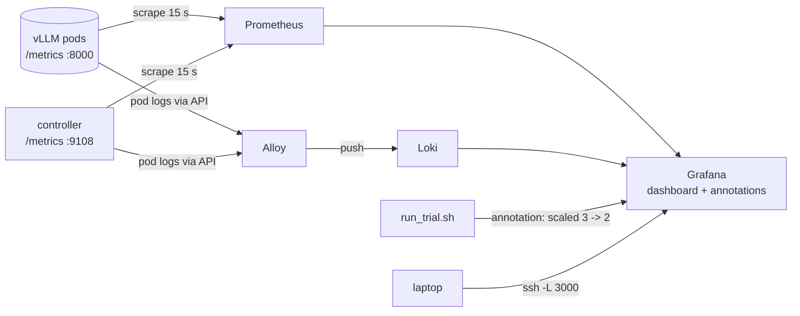

# Monitoring add-on: Prometheus, Loki, Alloy, Grafana

Usable from stage 2 onwards (the fake pods expose the same metrics as vLLM),
recommended for stage 5. Plain, pinned manifests; no Helm.



| component | image | what it does here |
|---|---|---|
| Prometheus | `prom/prometheus:v2.55.1` | scrapes every pod matching `SELECTOR` on `METRICS_PORT`, plus pods annotated `prometheus.io/scrape=true` (the controller) |
| Loki | `grafana/loki:3.3.2` | stores logs; single binary, filesystem, emptyDir |
| Alloy | `grafana/alloy:v1.5.1` | tails pod logs through the Kubernetes API and pushes them to Loki (no hostPath, no DaemonSet) |
| Grafana | `grafana/grafana:11.4.0` | provisioned datasources + the `vLLM cache-aware scale-in` dashboard |

The controller publishes its decisions as metrics when started with
`METRICS_LISTEN=0.0.0.0:9108` (`cacheaware_pod_deletion_cost{pod=...}`,
`cacheaware_recent_hit_rate`, `cacheaware_kv_usage`, `cacheaware_patches_total`,
`cacheaware_scrape_errors_total`). The in-cluster Deployment in stage 6 has
this on; `stage2_mock_cluster/run_controller.sh` turns it on with
`METRICS_LISTEN=127.0.0.1:9108` (Prometheus cannot reach a laptop process,
but `curl localhost:9108/metrics` can).

## Run

```bash
monitoring/setup.sh          # ~1-2 min; waits for all four Deployments
monitoring/open.sh           # port-forwards 3000 / 9090 / 3100 to localhost
# laptop:  ssh -L 3000:127.0.0.1:3000 -L 9090:127.0.0.1:9090 user@gpu-box
#          open http://localhost:3000/d/cache-aware-scale-in
```

Dashboard panels: replicas up, controller patches/min, scrape errors, TTFT
p90, requests in flight; pod-deletion-cost per pod; recent hit rate per pod;
KV usage per pod; TTFT p50/p90; running/waiting per pod; cache value per
pod; controller logs; vLLM logs. The `namespace` variable at the top selects
the vLLM namespace (default `vllm`). Benchmark events from `run_trial.sh`
appear as red vertical annotations (tag `bench`).

## Eval

```bash
monitoring/eval.sh
```

Checks, through the API-server service proxy (no port-forward needed):
Prometheus ready and the `vllm` job has targets up and a prefix-cache metric
is queryable; Loki ready and a log stream from the vLLM namespace exists
(proves Alloy → Loki); Grafana healthy, both datasources provisioned, the
dashboard exists. Pass looks like `monitoring stack: PASS`.

## Does it disturb the benchmark?

No, by construction: Prometheus does one small GET per pod every 15 s, Alloy
reads logs through the API server (no CPU on the pod), and both run in
every trial of both modes, so whatever tiny cost they have cancels out.
Grafana only reads Prometheus and Loki. See guide.md section 4.14.

## Changing things

- Scrape interval or extra jobs: `k8s/prometheus.yaml` (ConfigMap), then `monitoring/setup.sh` again (it restarts the pods).
- Dashboard: edit in Grafana, then **Share → Export → Save to file** over `grafana/cache-aware-scale-in.json` and rerun `setup.sh`.
- Keep data across pod restarts: replace the two `emptyDir` volumes with PersistentVolumeClaims.
- Remove everything: `monitoring/teardown.sh`.
